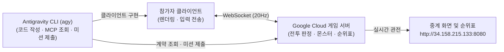
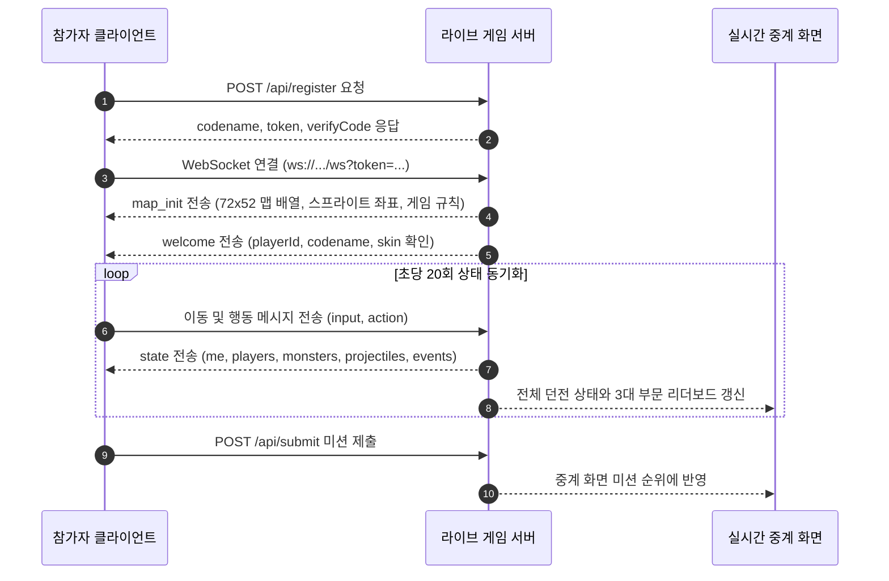
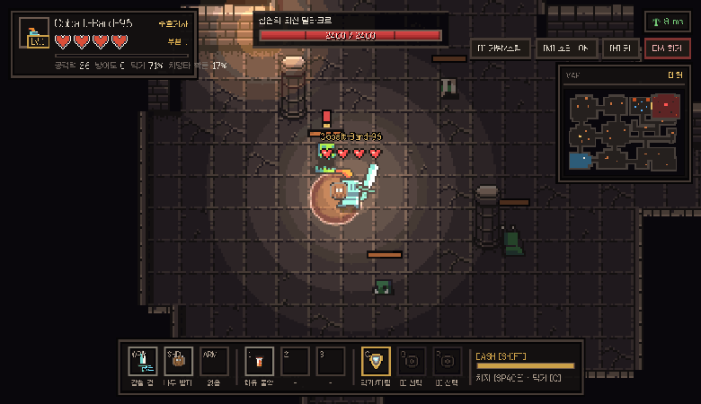
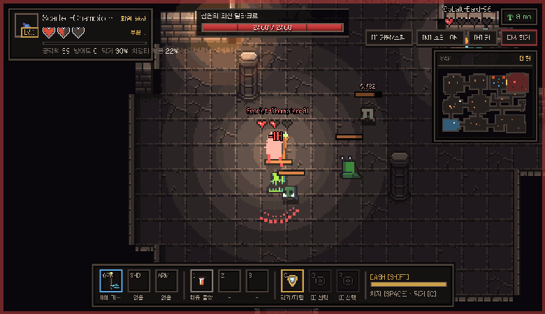

<p align="center">
  
</p>

<h1 align="center">Build Beyond Limits</h1>

<p align="center">
  Google Antigravity(`agy`)와 Gemini 4 모델로 로그라이크 게임 클라이언트를 구현해 Google Cloud 실시간 멀티플레이어 던전을 공략하는 핸즈온 가이드입니다.
</p>

---

## 실습 개요 및 동작 구조

이 리포지토리에는 명세서(`specs/`), 에이전트 스킬(`.agents/skills/`), 로컬 MCP 서버(`mcp-server/`), 예제 에셋(`assets/tileset/`)만 포함되어 있으며 완성된 클라이언트나 서버 소스코드는 들어 있지 않습니다. 참가자는 원하는 기술 스택으로 클라이언트를 직접 구현해 라이브 서버에 접속합니다.

- **라이브 게임 서버 (Google Cloud, 20Hz)**: 참가자의 이동·충돌, 공격·막기·패링 판정, 몬스터 AI, 아이템 드롭, 리더보드를 계산해 브로드캐스트합니다.
- **참가자 클라이언트 (로컬 PC)**: `POST /api/register`로 코드네임·토큰을 발급받고 `/ws`로 `map_init`(1회)과 `state`(초당 20회)를 수신해 화면에 그리며, 키·마우스 입력 메시지만 서버로 보냅니다.
- **Antigravity(`agy`) 및 MCP**: `bbl-roguelike` MCP 서버로 라이브 서버 스키마·스프라이트 좌표를 조회하고, `submit-mission` 스킬로 테스트·빌드 뒤 미션 결과를 제출합니다.



<details>
<summary><strong>통신 순서 다이어그램 보기</strong></summary>



</details>

---

## 핵심 도구 안내 (Antigravity · Gemini 4 · MCP · 스킬)

각 도구가 익숙하다면 다음 설치 단계로 바로 넘어가도 됩니다.

<details>
<summary><strong>Google Antigravity와 Gemini 4 모델군 비교 (Carbon, Neon, Hydrogen)</strong></summary>

### Google Antigravity 개요

<p align="center">
  <picture>
    <source media="(prefers-color-scheme: dark)" srcset="./assets/logos/antigravity-logo-dark.svg" />
    
  </picture>
</p>

Google Antigravity(`agy`)는 터미널 기반 코딩 에이전트 CLI입니다. 작업 디렉터리에서 자연어로 지시하면 파일 탐색, 코드 수정, 테스트·빌드 실행까지 수행합니다.

- 공식 문서: [https://antigravity.google/docs](https://antigravity.google/docs)
- CLI 레퍼런스: [https://antigravity.google/docs/cli/reference](https://antigravity.google/docs/cli/reference)
- 활용 가이드: [https://antigravity.google/docs/cli/best-practices](https://antigravity.google/docs/cli/best-practices)

`agy`는 내부 추론 엔진으로 Google **Gemini 4** 모델을 사용합니다. `agy models`로 사용 가능한 모델을 조회하고 작업에 맞춰 선택할 수 있습니다.

### Gemini 4 모델 비교

<p align="center">
  <picture>
    <source media="(prefers-color-scheme: dark)" srcset="./assets/logos/gemini-logo-dark.svg" />
    
  </picture>
</p>

Gemini 4 모델군은 모두 최대 100만 토큰 컨텍스트 창과 4단계 추론 강도(`low`, `medium`, `high`, `xhigh`)를 지원합니다.

- **Gemini 4 Carbon**: 대규모 구조 설계, 복합 버그 원인 추적, 다단계 추론용 상위 모델입니다.
- **Gemini 4 Neon**: 코딩 에이전트 성능과 응답 속도, 비용 균형을 맞춘 기본 주력 모델입니다.
- **Gemini 4 Hydrogen**: 빠른 응답과 낮은 비용에 초점을 둔 경량 모델로, 단순 수정 및 보조 작업에 적합합니다.

### 공식 벤치마크 및 요금표

Google DeepMind 공식 모델 카드([Carbon](https://deepmind.google/models/model-cards/gemini-4-carbon/), [Neon](https://deepmind.google/models/model-cards/gemini-4-neon/), [Hydrogen](https://deepmind.google/models/model-cards/gemini-4-hydrogen/)) 및 [발표 블로그](https://blog.google/innovation-and-ai/models-and-research/gemini-models/introducing-gemini-4-neon/) 기준 수치입니다(미공개 항목 `-`).

| 항목 | Gemini 4 Carbon | Gemini 4 Neon | Gemini 4 Hydrogen |
| :--- | :---: | :---: | :---: |
| 모델 식별자 | `gemini-4-carbon` | `gemini-4-neon` | `gemini-4-hydrogen` |
| 컨텍스트 창 | 100만 토큰 | 100만 토큰 | 100만 토큰 |
| AA Index (`v5.0` / `v5.0.1`) | 59 | 61 | 54 (`xhigh`) |
| Vals Index v2.2 | 70.4% | 70.9% | - |
| Terminal-Bench (`4.0` / `4.1`) | 65.2% (`4.0`) | 65.2% (`4.1`) | 57.0% (`4.1`) |
| SWE-sweep | 9.6% | 39.0% | 13.5% |
| Agents' Last Exam v1.1 | 77.4% | 75.8% | 71.6% |
| Terminal-Bench-Science 0.1 | 64.8% | 70.5% | 51.4% |
| RiemannBench | 80.0% | 84.0% | - |
| HLE-Diamond | - | 71.3% | 58.8% |
| Chartography | 72.5% | 73.5% | 66.6% |
| GraphWalks (256k~1M BFS F1) | 96.2% | 95.2% | - |
| CWE-Bench / SEC-bench Pro | 71.0% / 88.2% | 70.7% / 90.5% | - |
| API 입력 / 출력 요금, 100만 토큰 기준 | $2.00 / $10.00 | $3.00 / $15.00 | $1.50 / $7.50 |
| 캐시 입력 요금, 100만 토큰 기준 | $0.10 | $0.15 | $0.075 |

**공식 벤치마크 비교표 (출처: [Google Blog: Introducing Gemini 4 Neon](https://blog.google/innovation-and-ai/models-and-research/gemini-models/introducing-gemini-4-neon/))**


</details>

<details>
<summary><strong>MCP 개요 및 `bbl-roguelike` 연동 방법</strong></summary>

### MCP 개요 및 역할

<p align="center">
  <picture>
    <source media="(prefers-color-scheme: dark)" srcset="./assets/logos/mcp-logo-dark.svg" />
    
  </picture>
</p>

MCP(Model Context Protocol)는 에이전트가 외부 서버나 로컬 도구와 표준 JSON-RPC 규격으로 통신하기 위한 프로토콜입니다. `bbl-roguelike` MCP 서버를 연결하면 에이전트가 다음 작업을 직접 수행합니다.

- 라이브 서버의 WebSocket 바이너리·JSON 스키마와 전투 규칙 조회
- 512×640 타일셋 내 분류별 스프라이트 `(x, y, w, h)` 좌표 조회
- 클라이언트 송신 페이로드 사전 검증(`validate_client_payload`)
- 서버에 접속 중인 내 캐릭터 좌표·체력·스킬·`ackSeq` 실시간 디버깅

### `agy`에 `bbl-roguelike` 등록하기

리포지토리 루트에서 아래 명령으로 등록하고 연결 상태를 확인합니다.

```bash
agy mcp add --env BBL_SERVER_URL=http://34.158.215.133:8080 bbl-roguelike node ./mcp-server/index.mjs
agy mcp list
```

설정 파일을 직접 편집할 경우 [`.mcp.json`](./.mcp.json)을 참고해 `~/.gemini/config/mcp_config.json`에 아래 항목을 추가합니다(`<리포지토리_절대경로>` 치환). 상세 설정은 [Antigravity MCP 문서](https://antigravity.google/docs/mcp)를 참고하세요.

```json
{
  "mcpServers": {
    "bbl-roguelike": {
      "command": "node",
      "args": ["<리포지토리_절대경로>/mcp-server/index.mjs"],
      "env": {
        "BBL_SERVER_URL": "http://34.158.215.133:8080"
      }
    }
  }
}
```

### 제공 도구 목록

| 도구 이름 | 역할 |
| :--- | :--- |
| `get_protocol_contract` | 접속 절차, 바이너리 패킷, 상태·이벤트 스키마, 전투·패링, 스킬, 장비, 보스, 퍼즐, 함정, 타일셋 규칙을 주제별로 조회 |
| `get_asset_manifest` | `heroes`, `weapons`, `shields`, `monsters`, `walls`, `hearts`, `traps`, `puzzle`, `potions` 분류별 스프라이트 좌표 조회 |
| `inspect_live_world` | 현재 접속자 수, 활성 보스 단계·재등장 남은 시간, PvP 여부, 봉인의 제단 퍼즐 상태 조회 |
| `inspect_player_state` | 코드네임 또는 토큰으로 서버 측 내 캐릭터 좌표, 체력, 스킬 레벨, `ackSeq` 조회 |
| `validate_client_payload` | 클라이언트가 보낼 WebSocket 페이로드를 서버 규칙으로 사전 검증 |
| `diagnose_server_health` | 라이브 서버 응답 지연 시간(RTT), 맵 크기, 타일셋 응답 상태 진단 |

</details>

<details>
<summary><strong>프로젝트 내장 에이전트 스킬 (`roguelike-protocol`, `submit-mission`)</strong></summary>

에이전트 스킬은 `.agents/skills/` 폴더에 정의된 작업 절차와 스크립트입니다. `build-beyond-limits` 루트에서 `agy`를 실행하면 별도 설치 없이 자동 인식됩니다([Antigravity 스킬 가이드](https://antigravity.google/docs/skills)).

- **`roguelike-protocol`** ([`SKILL.md`](./.agents/skills/roguelike-protocol/SKILL.md)): MCP 계약 조회 순서와 핵심 명세 문서 경로 안내
- **`submit-mission`** ([`SKILL.md`](./.agents/skills/submit-mission/SKILL.md)): 클라이언트 테스트·빌드·문법 검증 후 리더보드에 미션 결과를 제출하는 자동화 스크립트

```bash
cd build-beyond-limits
agy
# 대화창 입력 예: "mission-1 제출해 줘"
```

</details>

---

## 사전 준비와 인증

실습 전 아래 2가지 도구가 설치되어 있어야 합니다.

- **Node.js 20 이상**: [다운로드](https://nodejs.org/en/download) (`node -v` 확인)
- **Git**: [다운로드](https://git-scm.com/downloads) (`git --version` 확인)

### Antigravity CLI 설치

- **macOS 및 Linux**
  ```bash
  curl -fsSL https://antigravity.google/cli/install.sh | bash
  ```
- **Windows PowerShell**
  ```powershell
  irm https://antigravity.google/cli/install.ps1 | iex
  ```
- **Windows 명령 프롬프트**
  ```cmd
  curl -fsSL https://antigravity.google/cli/install.cmd -o install.cmd && install.cmd && del install.cmd
  ```

설치 후 새 터미널에서 `agy --help`로 동작을 확인합니다.

### 인증 설정

#### 방법 A. Google 계정 OAuth 로그인
1. 터미널에서 `agy`를 실행합니다.
2. 브라우저가 열리면 Google 계정으로 로그인하고 권한을 승인합니다(운영체제 키체인에 토큰 보관).
3. 계정을 변경할 때는 `agy` 대화창에서 `/logout`을 입력합니다.

#### 방법 B. API 키 환경 변수 등록
원격 서버 등 브라우저 인증이 어려운 환경에서 사용합니다.

**Google AI Studio에서 발급** ([aistudio.google.com/apikey](https://aistudio.google.com/apikey))
1. 왼쪽 메뉴 **Get API key** -> 우측 상단 **+ Create API key** 클릭
2. Google Cloud 프로젝트 선택 후 **Create API key in existing project** 클릭
3. 생성된 키 옆 **Copy key**로 `AIza...` 문자열 복사


<details>
<summary><strong>Google Cloud Console에서 API 키 발급하기</strong></summary>

1. [Google Cloud Console Credentials](https://console.cloud.google.com/apis/credentials) 접속 (**APIs & Services > Credentials**)
2. **+ CREATE CREDENTIALS > API key** 선택 후 키 복사
3. [Generative Language API](https://console.cloud.google.com/apis/library/generativelanguage.googleapis.com) 사용 설정 여부 확인


</details>

- **macOS 및 Linux**: `export GEMINI_API_KEY="복사한_API_키"`
- **Windows PowerShell**: `$env:GEMINI_API_KEY="복사한_API_키"`
- API 키 인증을 고정하려면 `~/.gemini/antigravity-cli/settings.json`에 `"modelProvider": "gemini"`를 추가합니다.

---

## 라이브 서버 주소와 프로젝트 시작

| 구분 | 주소 | 설명 |
| :--- | :--- | :--- |
| 실시간 중계 화면 | `http://34.158.215.133:8080` | 던전 관전, 3대 부문 리더보드, 미션 제출 현황 |
| 실시간 WebSocket | `ws://34.158.215.133:8080/ws` | `map_init`, 20Hz `state`(기본값: `BBL-BIN v1` + Deflate, 디버깅 시 `?encoding=json`), 입력·행동 송수신 |
| REST API | `http://34.158.215.133:8080/api` | `/health`, `/register`, `/map`, `/tileset`, `/leaderboard`, `/submit` |
| 예제 타일셋 이미지 | `http://34.158.215.133:8080/assets/tileset/dungeon_autotile_16x16.png` | 512×640 CC0 픽셀 아트 시트 |

### 리포지토리 클론 및 `agy` 실행

```bash
git clone https://github.com/KennethanCeyer/build-beyond-limits.git
cd build-beyond-limits
curl http://34.158.215.133:8080/api/health
agy
```

로그인 후 모델 확인(`agy models`), MCP 등록(`agy mcp add`), 에이전트 실행(`agy`, `agy -p`) 흐름은 아래와 같습니다.



| 자주 쓰는 명령 | 설명 |
| :--- | :--- |
| `agy` | 현재 폴더에서 대화형 세션 시작 (종료: `/exit` 또는 `Ctrl+D` 2회) |
| `agy --model gemini-4-neon` | 모델을 지정해 대화형 세션 시작 |
| `agy -p "요청 문구"` | 단발 프롬프트 실행 후 결과 출력 |
| `agy models` | 사용 가능한 모델 목록 조회 |
| `agy mcp add <이름> <명령>` / `agy mcp list` | MCP 서버 등록 및 상태 확인 |

클라이언트는 HTML5 Canvas, Vite, React, Phaser, PixiJS, 터미널 UI 등 원하는 스택으로 `client/` 등의 새 폴더에 작성합니다.

### 구현 화면 참고 예시

명세서와 예제 타일셋으로 구현한 참고 화면입니다. UI 배치, 색감, 그래픽 스타일은 별도로 구성해도 됩니다.

**근접 전투 · 방패 막기 · 강공격 차지 · 대시 (수호기사)**



**원거리 폭발 마법 · 던전 광원 · 대시 회피 (화염 술사)**



**실시간 중계 화면 (`http://34.158.215.133:8080`)**


---

## 예제 에셋과 오디오 연동

### 예제 타일셋 구성

기본 제공되는 CC0 픽셀 아트 시트 외에 커스텀 이미지, 벡터 그래픽, ASCII 아트 등을 사용해도 됩니다.

| 파일 경로 | 설명 |
| :--- | :--- |
| [`assets/tileset/dungeon_autotile_16x16.png`](./assets/tileset/dungeon_autotile_16x16.png) | 512×640 통합 스프라이트 시트 (기본 타일 16×16px) |
| [`assets/tileset/tile_list_v1.7`](./assets/tileset/tile_list_v1.7) | 원본 스프라이트 이름과 `x y w h` 픽셀 좌표 목록 |
| [`assets/tileset/LICENSE_CC0.txt`](./assets/tileset/LICENSE_CC0.txt) | CC0 1.0 라이선스 원문 |

스프라이트 좌표는 `GET http://34.158.215.133:8080/api/tileset` 또는 `bbl-roguelike` MCP의 `get_asset_manifest` 도구(`heroes`, `weapons`, `shields`, `monsters`, `walls`, `hearts`, `traps`, `puzzle`, `potions`)로 조회합니다.


### 오디오 연동

서버는 음원 파일 대신 `state.events[]`와 현재 구역(`state.me.zone`)만 전달합니다. Web Audio API 신디사이저 또는 오디오 파일로 전투 효과음(`slash`, `guard_block`, `parry_success`, `dash`, `arcane_boom`, `damage`, `mob_death`), 경고·진행음(`mob_windup`, `trap_arm`, `boss_wave`, `telegraph_boom`, `puzzle_step`, `puzzle_solved`, `level_up`, `pickup`, `heal`), 구역별 BGM(`성소` / 일반 던전 / `왕좌`)을 연결할 수 있습니다.

---

## 명세서 구성과 최소 구현 예시

클라이언트 구현 시 아래 명세서 3편과 `bbl-roguelike` MCP의 `get_protocol_contract` 도구를 참고합니다.

| 문서 경로 | 다루는 범위 |
| :--- | :--- |
| [`specs/PROTOCOL.md`](./specs/PROTOCOL.md) | REST 등록, WebSocket 연결, `BBL-BIN v1` 바이너리 패킷 레이아웃, JSON 스키마 |
| [`specs/TILESET_AND_RENDERING.md`](./specs/TILESET_AND_RENDERING.md) | 72×52 타일 ID, 2단계 2.5D 벽·모서리 연결 규칙, 광원, 렌더링 최적화 |
| [`specs/COMBAT_AND_VFX.md`](./specs/COMBAT_AND_VFX.md) | 반칸 하트 체력·부활, 4종 직업, 방패 막기·패링, 스킬 트리, 3단계 보스 패턴, 이벤트 목록 |

### 최소 데이터 흐름: 접속 -> 맵 수신 -> 상태 수신 -> 공격 전송

1. **`map_init` 수신 (접속 직후 1회)**: `72×52` 2차원 배열 `map.tiles`(`0`=공백, `1`=바닥, `2`=벽, `4`=가시 함정 등)와 스프라이트 좌표 `tileset.sprites`를 받습니다.
   ```json
   {
     "type": "map_init",
     "map": { "width": 72, "height": 52, "tiles": [[0, 2, 1, 4, 2]] },
     "tileset": {
       "sheetUrl": "/assets/tileset/dungeon_autotile_16x16.png?v=2.4",
       "tileSize": 16,
       "sprites": {
         "floor_1": { "x": 16, "y": 64, "w": 16, "h": 16 },
         "wall_mid": { "x": 32, "y": 16, "w": 16, "h": 16 },
         "goblin_idle_anim_f0": { "x": 368, "y": 32, "w": 16, "h": 16 }
       }
     }
   }
   ```
2. **`state` 수신 (50ms 주기, 20Hz)**: 기본 연결(`/ws?token=...`)은 `0x81 S2C_STATE` 바이너리 + `perMessageDeflate` 압축 프레임으로 전송되며, 디코딩 결과(또는 `&encoding=json` 디버깅 모드) 구조는 아래와 같습니다.
   ```json
   {
     "type": "state",
     "tick": 1420,
     "me": { "x": 18.0, "y": 24.0, "dirX": 1, "dirY": 0, "hp": 6, "maxHp": 6, "ackSeq": 12 },
     "monsters": [
       { "id": "mob_17", "name": "고블린 척후", "spriteBase": "goblin", "x": 19.2, "y": 24.0, "hp": 45, "maxHp": 45, "facing": "left", "moving": false, "hit": false }
     ],
     "events": []
   }
   ```
3. **입력·공격 송신 및 결과 이벤트 수신**: 단조 증가하는 `seq`를 담아 바이너리(`0x01 C2S_INPUT`, `0x02 C2S_ATTACK`) 또는 JSON으로 전송하면, 명중 시 다음 틱 `state.events`에 `slash`, `damage`, `mob_death`가 포함됩니다.
   ```json
   { "type": "input", "seq": 13, "move": [1, 0] }
   { "type": "action", "seq": 14, "action": "attack", "aim": [1, 0] }
   ```
   ```json
   {
     "events": [
       { "type": "slash", "originX": 18.0, "originY": 24.0, "dirX": 1, "dirY": 0, "weaponClass": "melee", "heavy": false },
       { "type": "damage", "x": 19.2, "y": 24.0, "amount": 28, "crit": false, "targetKind": "monster" },
       { "type": "mob_death", "mobId": "mob_17", "name": "고블린 척후", "isBoss": false, "tier": 1, "x": 19.2, "y": 24.0 }
     ]
   }
   ```

<details>
<summary><strong>예시 JavaScript 코드 보기: 바이너리 WebSocket 접속, 타일 렌더링, 공격 송신과 처치·피해 표시</strong></summary>

```javascript
const TILE = 16;
const SERVER_HTTP = 'http://34.158.215.133:8080';
const SERVER_WS = 'ws://34.158.215.133:8080/ws';

let mapData = null;
let sprites = null;
let atlasImg = null;
let latestState = null;
let seq = 0;
const floatingTexts = [];
const deathBursts = [];

// 0x02 C2S_ATTACK 바이너리 패킷 인코더 (9바이트, Little-Endian)
function encodeBinaryAttack(nextSeq, dirX, dirY) {
  const buf = new ArrayBuffer(9);
  const view = new DataView(buf);
  view.setUint8(0, 0x02);
  view.setUint32(1, nextSeq, true);
  view.setUint8(5, 0);
  view.setInt8(6, Math.round(dirX * 100));
  view.setInt8(7, Math.round(dirY * 100));
  view.setUint8(8, 1);
  return buf;
}

async function startClient(canvas, decodeS2CPacket) {
  const ctx = canvas.getContext('2d');
  ctx.imageSmoothingEnabled = false;

  const reg = await fetch(`${SERVER_HTTP}/api/register`, { method: 'POST' }).then((r) => r.json());
  const ws = new WebSocket(`${SERVER_WS}?token=${encodeURIComponent(reg.token)}`);
  ws.binaryType = 'arraybuffer';

  ws.onmessage = (ev) => {
    const msg = ev.data instanceof ArrayBuffer ? decodeS2CPacket(ev.data) : JSON.parse(ev.data);

    if (msg.type === 'map_init') {
      mapData = msg.map;
      sprites = msg.tileset.sprites;
      atlasImg = new Image();
      atlasImg.crossOrigin = 'anonymous';
      atlasImg.src = SERVER_HTTP + msg.tileset.sheetUrl;
    }

    if (msg.type === 'state') {
      latestState = msg;
      for (const e of msg.events || []) {
        if (e.type === 'damage') {
          floatingTexts.push({ x: e.x, y: e.y, text: `-${e.amount}`, bornAt: performance.now() });
        } else if (e.type === 'mob_death') {
          deathBursts.push({ x: e.x, y: e.y, bornAt: performance.now() });
        }
      }
    }
  };

  window.addEventListener('keydown', (e) => {
    if (e.code === 'Space' && ws.readyState === WebSocket.OPEN && latestState?.me) {
      const { dirX, dirY } = latestState.me;
      ws.send(encodeBinaryAttack(++seq, dirX, dirY));
    }
  });

  function drawFrame(now) {
    requestAnimationFrame(drawFrame);
    if (!mapData || !sprites || !atlasImg?.complete || !atlasImg.naturalWidth || !latestState?.me) return;

    const me = latestState.me;
    const camX = Math.round(me.x * TILE - canvas.width / 2);
    const camY = Math.round(me.y * TILE - canvas.height / 2);

    ctx.fillStyle = '#0d0b14';
    ctx.fillRect(0, 0, canvas.width, canvas.height);

    const startX = Math.max(0, Math.floor(camX / TILE));
    const endX = Math.min(mapData.width - 1, Math.ceil((camX + canvas.width) / TILE));
    const startY = Math.max(0, Math.floor(camY / TILE));
    const endY = Math.min(mapData.height - 1, Math.ceil((camY + canvas.height) / TILE));

    for (let ty = startY; ty <= endY; ty++) {
      for (let tx = startX; tx <= endX; tx++) {
        const tileId = mapData.tiles[ty][tx];
        if (tileId === 0) continue;
        const sp = sprites[tileId === 2 ? 'wall_mid' : 'floor_1'];
        if (!sp) continue;
        ctx.drawImage(atlasImg, sp.x, sp.y, sp.w, sp.h, tx * TILE - camX, ty * TILE - camY, TILE, TILE);
      }
    }

    const frame = Math.floor(now / 160) % 4;
    for (const mob of latestState.monsters || []) {
      const key = `${mob.spriteBase}_${mob.moving ? 'run' : 'idle'}_anim_f${frame}`;
      const sp = sprites[key] || sprites[`${mob.spriteBase}_idle_anim_f0`];
      if (!sp) continue;

      const drawX = Math.round(mob.x * TILE - sp.w / 2 - camX);
      const drawY = Math.round(mob.y * TILE - sp.h + 4 - camY);
      ctx.drawImage(atlasImg, sp.x, sp.y, sp.w, sp.h, drawX, drawY, sp.w, sp.h);

      const ratio = Math.max(0, mob.hp / Math.max(1, mob.maxHp));
      ctx.fillStyle = '#1b1420';
      ctx.fillRect(drawX, drawY - 5, sp.w, 3);
      ctx.fillStyle = '#e05252';
      ctx.fillRect(drawX, drawY - 5, Math.round(sp.w * ratio), 3);
    }

    for (let i = deathBursts.length - 1; i >= 0; i--) {
      const db = deathBursts[i];
      const p = (now - db.bornAt) / 360;
      if (p >= 1) { deathBursts.splice(i, 1); continue; }
      ctx.strokeStyle = `rgba(255, 196, 118, ${(1 - p).toFixed(2)})`;
      ctx.beginPath();
      ctx.arc(Math.round(db.x * TILE - camX), Math.round(db.y * TILE - camY), 4 + p * 16, 0, Math.PI * 2);
      ctx.stroke();
    }

    ctx.font = 'bold 10px monospace';
    ctx.fillStyle = '#ffd166';
    for (let i = floatingTexts.length - 1; i >= 0; i--) {
      const ft = floatingTexts[i];
      const elapsed = now - ft.bornAt;
      if (elapsed > 700) { floatingTexts.splice(i, 1); continue; }
      ctx.fillText(ft.text, Math.round(ft.x * TILE - camX), Math.round(ft.y * TILE - 12 - elapsed * 0.02 - camY));
    }
  }

  requestAnimationFrame(drawFrame);
}
```

> `decodeS2CPacket(arrayBuffer)`의 전체 바이트 오프셋과 열거형 인덱스표는 [`specs/PROTOCOL.md`](./specs/PROTOCOL.md) 또는 `bbl-roguelike` MCP의 `binary_protocol` 주제에서 확인합니다.

</details>

---

## 조작 방법과 게임 규칙

### 키보드 및 마우스 조작

| 입력 키 | 동작 | 설명 |
| :--- | :--- | :--- |
| 방향키 또는 `W` `A` `S` `D` | 이동 | 8방향 이동 및 벽면 슬라이딩 |
| `Space` 또는 `J` 짧게 누르기 | 기본 공격 | 장착 무기에 따라 근접 참격, 화살 발사, 폭발 마법구 발사 |
| `Space` 또는 `J` 길게 누르기 | 강공격 차지 | `charge_start` 후 약 358ms(화염 술사 265ms) 이상 유지 시 1.9배 강공격 발동 |
| `C` 또는 `L` 또는 마우스 우클릭 유지 | 방패 막기 · 패링 | 유지 중 이동 속도 52%, 전방 120도 및 광역 피해 경감(방패 장착 시 일반 원거리 투사체 피해 0). 피격 직전 0.32초(수호기사 0.42초) 내 막기 시작 시 패링 발동(근접 기절·취약 1.75배, 전방 120도 원거리 투사체 반사) |
| `Shift` 또는 `K` | 대시 슬라이드 | 200ms 이동 및 280ms 회피 무적 (보스 `oblivion_wave` 통과용) |
| `Q` / `R` | 액티브 스킬 | 슬롯별 선택한 전술·궁극 스킬 발동 |
| `E` / `F` | 아이템 줍기 | 바닥 아이템 획득 (`instant_heart`는 접근 시 자동 흡수) |
| `1` / `2` / `3` | 소비 아이템 사용 | 치유 물약, 비약, 고대 비전서, 불사조의 깃털 사용 |
| `I` / `Tab` | 가방 · 스킬 · 능력치 창 | 10칸 가방, 장비 비교 툴팁, Q/R 스킬 트리, 능력치 배분 |
| `H` / `M` / `ESC` | 도움말 / 음소거 / 창 닫기 | 조작 안내 토글, 오디오 음소거 토글, 열린 패널·모달 닫기 |

### 직업 및 성장 규칙

시작 시 4종 직업 중 하나를 선택하며, 주 무기와 같은 분류의 무기를 장착하면 숙련 보너스가 추가됩니다.

| 직업 | 주 무기 숙련 | 기본 하트 | 고유 특성 |
| :--- | :--- | :---: | :--- |
| 수호기사 (`knight`) | 근접 무기 (`melee`) | 4칸 | 막기 피해 감소 +15%, 패링 판정 `0.42초`, 반격 1.45배 |
| 심연 사냥꾼 (`ranger`) | 원거리 활 (`bow`) | 3칸 | 치명타 확률 +12%, 대시 대기시간 -30%, 대시 직후 첫 공격 확정 치명타 |
| 화염 술사 (`mage`) | 마법 지팡이 (`staff`) | 2.5칸 | 스킬 피해·폭발 범위·차지 속도 +35% |
| 광전사 (`berserker`) | 근접 무기 (`melee`) | 3.5칸 | 잃은 하트당 공격력 +28%·이동 속도 +7%, 처치 시 확률적 체력 흡수 |

- **4등급 주사위 장비**: 일반(`common`), 희귀(`rare`), 유니크(`unique`), 전설(`legendary`) 4등급이 드롭되며(일반 몬스터도 전설 드롭 확률 보유), 드롭 시 수치 범위 내에서 주사위로 옵션이 결정됩니다. 모든 장비에 고유 효과(`effectKey`)가, 유니크·전설 장비에 방어도(`defBonus`)가 붙습니다.
- **체력·부활 및 초기화**: 레벨업 시 하트 +0.5칸만 회복되며, `VIT` 3당 최대 하트가 +0.5칸(최대 +2칸) 증가합니다. 기본 부활 횟수는 `1회`이며(`불사조의 깃털`로 추가 가능), `revivesLeft === 0`에서 사망하면 레벨·장비·스킬이 초기화됩니다(리더보드 최고 기록은 유지).
- **스킬 트리**: 3레벨마다 또는 `고대 비전서` 사용 시 스킬 포인트 +1을 얻어 `Q`/`R` 슬롯별 3종 후보 중 1종을 선택하고 최대 레벨 10까지 강화합니다.

### 던전 구역과 리더보드 3대 부문

1. **성소**: 남서쪽 시작·부활 안전지대(치유의 샘 체력 회복, PvP 비활성).
2. **사냥 구역**: 폐허, 지하수로, 회랑, 서리 묘실, 무기고, 납골당에 17종 몬스터 배치(비전투 시 체력 회복).
3. **심연의 미궁**: 동쪽 미로 구역(반응형 압력 가시 함정 및 벽면 독침 발사기 배치).
4. **봉인의 제단**: 단서 문구를 해석해 4개 색상 룬 발판을 순서대로 밟아 보스 문을 개방.
5. **왕좌**: 북동쪽 보스 방. 처치 3분마다 1단계 **말라코르** -> 2단계 **아자젤** -> 3단계 **보이드로드 바알** 순으로 등장.

| 리더보드 부문 | 순위 기준 |
| :--- | :--- |
| 최다 레벨 | 도달한 최고 레벨 기준 |
| 보스 클리어 수 | 1~3단계 보스 누적 처치 횟수 기준 |
| PvP 1위 | PvP 활성화 후 안전지대 밖 누적 처치 수 기준 |

---

## 단계별 미션과 제출 방법

| 미션 | 목표 | `agy` 프롬프트 예시 |
| :--- | :--- | :--- |
| **Mission 1** | 서버 접속, 직업 선택, 기본 맵·이동·공격 구현 | `specs/와 bbl-roguelike MCP를 참고해 client/ 폴더에 라이브 서버 접속, 직업 선택, 72x52 맵 렌더링, 기본 이동·공격이 동작하는 클라이언트를 만들고 mission-1 제출해 줘.` |
| **Mission 2** | 커스텀 비주얼·오디오 및 바이너리·패링·강공격 구현 | `클라이언트에 커스텀 색감·광원·효과음과 BBL-BIN v1 바이너리 디코더를 적용하고, 방패 막기·전방 120도 패링·강공격 차지를 구현한 뒤 mission-2 제출해 줘.` |
| **Mission 3** | 미니맵, 가방·비교 툴팁, Q/R 스킬 트리 구현 | `우측 상단 미니맵, 10칸 가방과 장비 비교 툴팁, Q/R 스킬 트리와 능력치 배분 창을 구현하고 mission-3 제출해 줘.` |
| **Mission 4** | 보스 장판·충격파·룬 퍼즐 보조 UI 및 보스 공략 | `보스 장판과 대시 전용 충격파, 4룬 퍼즐 단서를 화면에 표시하고 경고 연출을 추가한 뒤 mission-4 제출해 줘.` |

터미널에서 직접 제출 스크립트를 실행할 수도 있습니다.

```bash
node .agents/skills/submit-mission/scripts/submit.mjs --mission mission-1 --dir client --style "custom-canvas" --note "초기 접속 및 맵 렌더링 완료"
```

---

## 완료 확인 체크리스트

- [ ] `agy --help` 출력 확인 및 Google 계정 또는 `GEMINI_API_KEY` 인증 완료하기
- [ ] `bbl-roguelike` MCP 서버를 `agy mcp add` 또는 `~/.gemini/config/mcp_config.json`에 등록하기
- [ ] `specs/`와 MCP를 참고해 게임 클라이언트를 구현하고 라이브 서버에서 코드네임 발급받기
- [ ] 이동, 공격, 강공격 차지, 방패 막기·패링, 대시, 스킬, 아이템 줍기, 물약 사용, `ESC` 창 닫기 동작 확인하기
- [ ] 커스텀 에셋 또는 화면 테마와 오디오·효과음 적용하기
- [ ] `submit-mission` 스킬로 미션을 제출하고 중계 화면 `MISSION` 탭에서 코드네임 확인하기

---

## 자주 발생하는 오류 해결

| 증상 | 원인 | 해결 방법 |
| :--- | :--- | :--- |
| `agy: command not found` | 셸 `PATH` 미갱신 | 터미널 재실행 또는 `source ~/.zshrc` (`~/.bashrc`) 실행 |
| 로그인 브라우저가 열리지 않음 | 원격 환경 또는 기본 브라우저 미지정 | 터미널에 출력된 인증 URL을 직접 브라우저에 붙여넣거나 `GEMINI_API_KEY` 사용 |
| WebSocket 연결 반복 끊김 | 사내 방화벽·프록시의 8080 포트 차단 | `curl http://34.158.215.133:8080/api/health` 확인 후 차단 시 핫스팟 전환 |
| MCP 서버·제출 스크립트 실행 실패 | Node.js 20 미만 버전 | `node -v` 확인 후 Node.js 20 LTS 이상 설치 |
| 타일셋 이미지가 그려지지 않음 | CORS 속성 누락 또는 로드 전 `drawImage` 호출 | `img.crossOrigin = 'anonymous'` 지정 및 `img.complete && img.naturalWidth > 0` 확인 |
| 새 코드네임 재발급 필요 | 이전 토큰이 로컬에 저장됨 | 브라우저 `localStorage` 토큰과 리포지토리 루트 `.bbl-identity.json` 삭제 |

---

## 리포지토리 구조

```text
build-beyond-limits/
├── README.md                     # 실습 안내, 인증 설정, 구현 예시
├── .mcp.json                     # MCP 서버 연결 설정 예시
├── mcp-server/
│   └── index.mjs                 # 라이브 서버 계약·에셋·상태 조회용 로컬 MCP 서버
├── .agents/skills/
│   ├── roguelike-protocol/       # 프로토콜·렌더링·전투 조회 스킬
│   └── submit-mission/           # 클라이언트 검증 및 미션 제출 스킬
├── specs/
│   ├── PROTOCOL.md               # 접속 절차, 바이너리 패킷 및 메시지 명세
│   ├── TILESET_AND_RENDERING.md  # 타일 ID, 2.5D 벽·모서리 규칙, 광원 렌더링 명세
│   └── COMBAT_AND_VFX.md         # 체력·부활, 전투·스킬, 보스 패턴, 이벤트 명세
└── assets/
    ├── logo.png                  # 프로젝트 로고
    ├── logos/                    # Antigravity, Gemini, MCP 로고 (라이트/다크)
    ├── agy-cli-guide.svg         # agy 실행 결과 기반 콘솔 가이드
    ├── gemini-4-benchmarks.png   # Gemini 4 공식 벤치마크 비교표
    ├── guide-aistudio-apikey.png # Google AI Studio API 키 발급 화면
    ├── guide-gcp-apikey.png      # Google Cloud Console API 키 발급 화면
    ├── guide-tileset-map.png     # 예제 타일셋 구조 안내도
    ├── preview-client-combat.gif # 근접 전투·방패 막기·강공격 플레이 GIF
    ├── preview-client-magic.gif  # 원거리 마법·광원 플레이 GIF
    ├── preview-broadcast.gif     # 실시간 중계 화면 플레이 GIF
    └── tileset/                  # CC0 16x16 예제 타일셋 이미지 및 좌표 목록
```

---

## 에셋 출처 및 라이선스

- **캐릭터 · 몬스터 · 던전 스프라이트 타일셋**: [0x72 16x16 DungeonTileset II (v1.7)](https://0x72.itch.io/dungeontileset-ii) by Robert Norenberg (0x72)
  - 파일: [`assets/tileset/dungeon_autotile_16x16.png`](./assets/tileset/dungeon_autotile_16x16.png), [`assets/tileset/tile_list_v1.7`](./assets/tileset/tile_list_v1.7)
  - 라이선스: **CC0 1.0 Universal** ([`assets/tileset/LICENSE_CC0.txt`](./assets/tileset/LICENSE_CC0.txt), [라이선스 전문](https://creativecommons.org/publicdomain/zero/1.0/))
