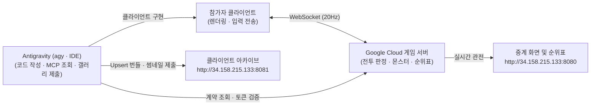
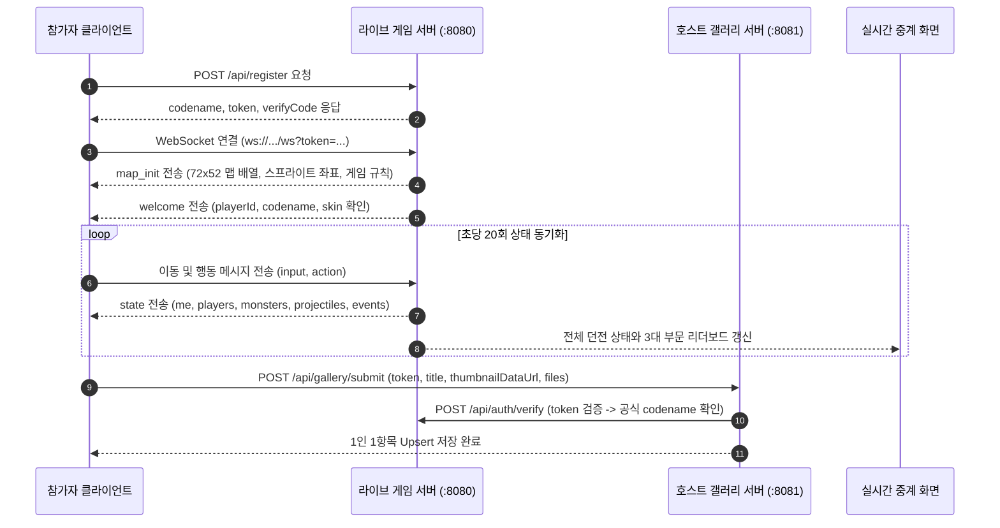
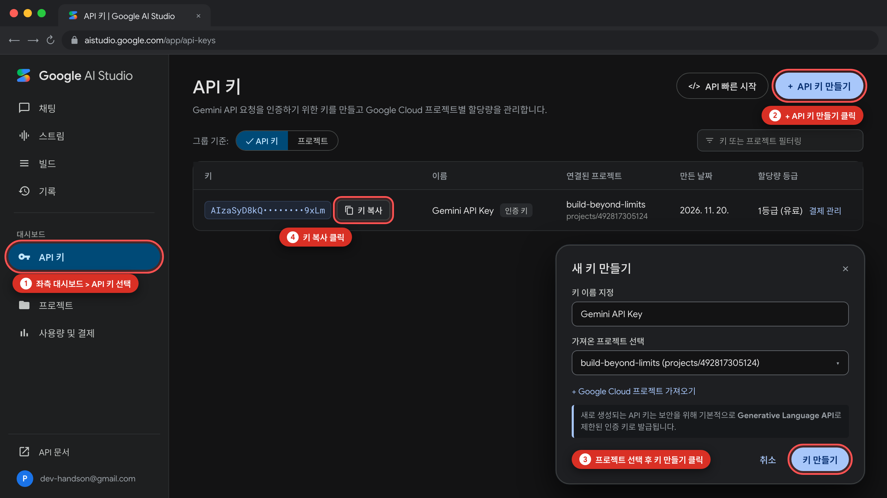
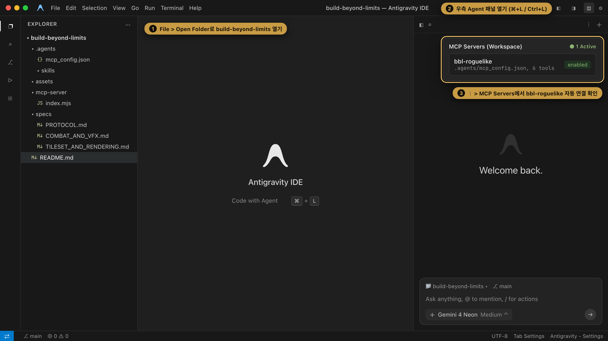
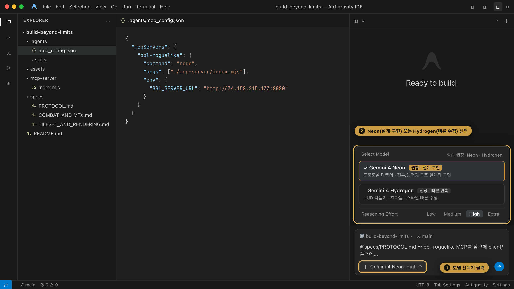
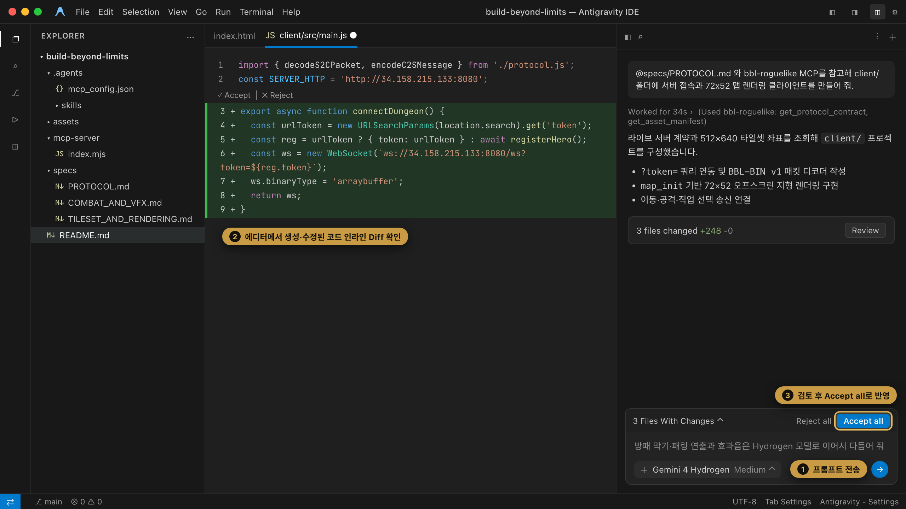
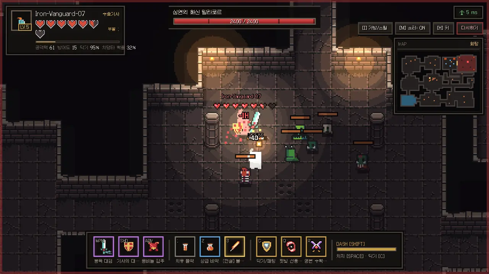
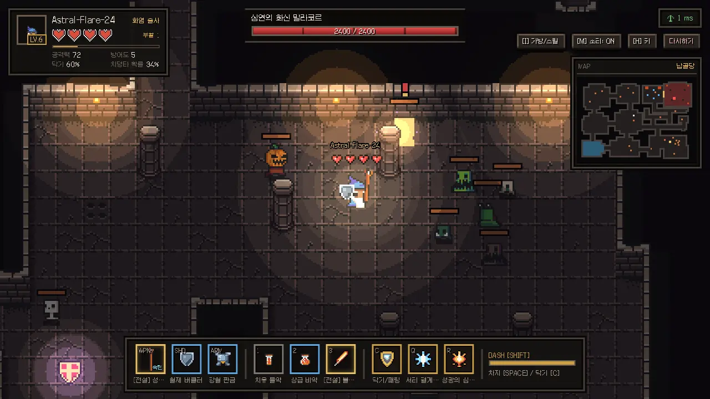
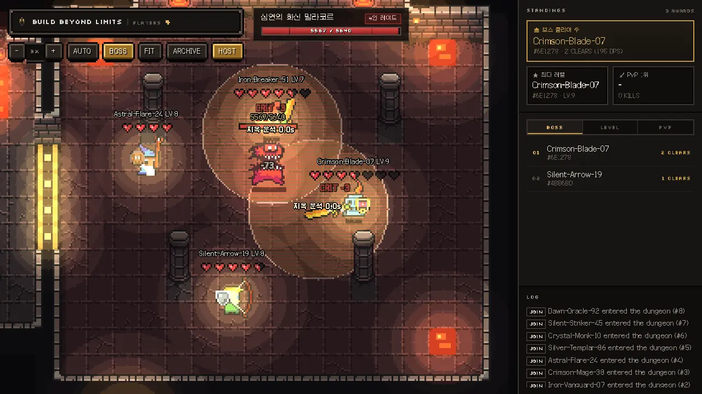
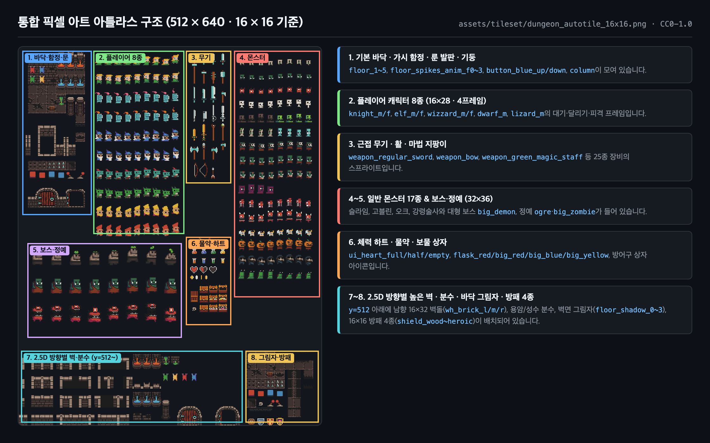

<p align="center">
  
</p>

<h1 align="center">Build Beyond Limits</h1>

<p align="center">
  Google Antigravity(`agy`)와 Gemini 4 모델로 로그라이크 게임 클라이언트를 구현해 Google Cloud 실시간 멀티플레이어 던전을 공략하는 핸즈온 가이드입니다.
</p>

---

## 실습 개요 및 동작 구조

이 리포지토리에는 명세서(`specs/`), 에이전트 스킬(`.agents/skills/`), 로컬 MCP 서버(`mcp-server/`), 예제 에셋(`assets/tileset/`)만 들어 있으며 클라이언트나 서버 소스코드는 포함되어 있지 않습니다. 참가자는 원하는 기술 스택으로 클라이언트를 구현해 라이브 서버에 접속합니다.

- 게임 서버: 참가자의 이동·충돌, 공격·막기·패링 판정, 몬스터 AI, 아이템 드롭, 리더보드를 계산해 초당 20회 브로드캐스트합니다.
- 참가자 클라이언트: `POST /api/register`로 코드네임·토큰을 발급받고 `/ws`로 `map_init`과 `state`를 받아 화면에 그리며, 키·마우스 입력 메시지만 서버로 보냅니다.
- Antigravity(`agy`) 및 MCP: `bbl-roguelike` MCP 서버로 서버 스키마와 스프라이트 좌표를 조회하고, `submit-client` 스킬로 클라이언트 번들과 썸네일을 호스트 갤러리에 제출합니다.



<details>
<summary>통신 순서 다이어그램 보기</summary>



</details>

---

## 도구 안내

이미 익숙한 도구는 건너뛰고 다음 설치 단계로 넘어가도 됩니다.

<details>
<summary>Google Antigravity와 Gemini 4 모델 비교</summary>

### Google Antigravity 개요

<p align="center">
  <picture>
    <source media="(prefers-color-scheme: dark)" srcset="./assets/logos/antigravity-logo-dark.svg" />
    
  </picture>
</p>

Google Antigravity는 데스크톱 IDE, 에디터 확장, 터미널 클라이언트인 Antigravity CLI(`agy`), Python SDK를 제공하는 개발 플랫폼입니다. 이 실습에서는 터미널 클라이언트인 `agy` 또는 Antigravity IDE를 사용하며, 모델은 `Gemini 4 Neon`이나 `Gemini 4 Hydrogen` 사용을 권장합니다.

- 공식 문서: [https://antigravity.google/docs](https://antigravity.google/docs)
- IDE 다운로드: [https://antigravity.google/download](https://antigravity.google/download)
- 지원 모델 및 요금제: [https://antigravity.google/docs/models](https://antigravity.google/docs/models)
- CLI 레퍼런스: [https://antigravity.google/docs/cli/reference](https://antigravity.google/docs/cli/reference)
- CLI 활용 가이드: [https://antigravity.google/docs/cli/best-practices](https://antigravity.google/docs/cli/best-practices)

`agy`에서는 Gemini 4 모델군(`Neon`, `Carbon`, `Argon`, `Hydrogen`), 협업 모드인 `Orchestrator`, 그리고 `Gemini 3.8 Flash`, `Claude Opus/Sonnet 5.5`, `GPT-OSS 120B` 등을 선택할 수 있습니다. 현재 계정에서 쓸 수 있는 목록은 `agy models`로 확인합니다.

### Gemini 4 모델 구성

<p align="center">
  <picture>
    <source media="(prefers-color-scheme: dark)" srcset="./assets/logos/gemini-logo-dark.svg" />
    
  </picture>
</p>

- `Gemini 4 Carbon`: 복잡한 아키텍처 설계나 원인 분석에 쓰는 상위 추론 모델입니다. Google AI Ultra·Enterprise 요금제 또는 유료 Gemini API 키에서 사용할 수 있습니다.
- `Gemini 4 Argon`: 소프트웨어 개발과 문서 분석 전반에 쓰는 범용 추론 모델입니다. 유료 Pro·Ultra·Enterprise 요금제에서 지원합니다.
- `Gemini 4 Neon`: 추론 성능과 응답 속도의 균형을 맞춘 유료 요금제 기본 모델입니다. 실습에서 프로토콜 디코더·전투·렌더링 구조를 구현할 때 권장합니다.
- `Gemini 4 Hydrogen`: 코드 편집이나 반복 실행처럼 빠른 응답이 필요한 작업에 쓰는 경량 모델입니다. 실습에서 UI 배치나 효과음, 스타일을 빠르게 다듬을 때 권장합니다(무료·Plus 요금제에서는 `Gemini 3.8 Flash` 제공).
- `Orchestrator`: 상위 모델(`Neon`, `Carbon`, `Argon`)이 설계·검토를 맡고 `Hydrogen`이 코드 수정과 빌드·테스트 실행을 나눠 맡는 모드입니다.

핸즈온에서는 응답 속도와 사용량 한도를 고려해 `Gemini 4 Neon` 또는 `Gemini 4 Hydrogen`으로 진행하는 것을 권장합니다.

### 주요 사양 · 벤치마크 · API 요금

| 항목 | Gemini 4 Carbon | Gemini 4 Argon | Gemini 4 Neon | Gemini 4 Hydrogen |
| :--- | :---: | :---: | :---: | :---: |
| API 모델 ID | `gemini-4-carbon` | `gemini-4-argon` | `gemini-4-neon` | `gemini-4-hydrogen` |
| 추론 강도 (`--effort`) | `low` ~ `high` (3단계) | `low` ~ `high` (3단계) | `low` ~ `xhigh` (4단계) | `low` ~ `xhigh` (4단계) |
| 컨텍스트 창 | 1M (`agy` 동일) | 1M (`agy` 동일) | 1M (`agy` 내 512K) | 1M (`agy` 동일) |
| AA Index | 59 | 50 | 61 (`xhigh`) | 51 (`high`) / 54 (`xhigh`) |
| SWE-sweep (`mini-swe-agent`) | 9.6% | 4.3% | 12.8% | - |
| SWE-sweep (`Antigravity-CLI`) | - | - | 39.0% | 13.5% |
| Terminal-Bench | 65.2% (`v4.0`) | 57.1% (`v4.0`) | 65.2% (`v4.1`, `xhigh`) | 57.0% (`v4.1`, `high`) |
| Agents' Last Exam v1.1 | 77.4% | 69.0% | 75.8% | 71.6% |
| 입력 / 출력 요금 (1M 토큰) | $4.00 / $20.00 | $4.00 / $20.00 | $3.00 / $15.00 | $1.50 / $7.50 |
| 캐시 읽기 / 쓰기 (1M 토큰) | $0.20 / - | $0.20 / - | $0.15 / $3.75 | $0.075 / $1.875 |

- 요금은 Global 리전 정가 기준이며 출력 요금에 추론 토큰이 포함됩니다. `Carbon`과 `Argon`은 2026년 11월 30일까지 정가의 50%($2.00 / $10.00, 캐시 읽기 $0.10) 프로모션 단가가 적용됩니다.
- 세부 평가 조건과 전체 지표는 공식 모델 카드([Carbon](https://deepmind.google/models/model-cards/gemini-4-carbon/) · [Argon](https://deepmind.google/models/model-cards/gemini-4-argon/) · [Neon](https://deepmind.google/models/model-cards/gemini-4-neon/) · [Hydrogen](https://deepmind.google/models/model-cards/gemini-4-hydrogen/)) 및 요금 문서([Vertex AI](https://cloud.google.com/model-garden/pricing) · [Gemini API](https://ai.google.dev/gemini-api/docs/pricing))에서 확인할 수 있습니다.

출처: [Google Blog · Introducing Gemini 4 Neon](https://blog.google/innovation-and-ai/models-and-research/gemini-models/introducing-gemini-4-neon/)


</details>

<details>
<summary>MCP 개요 및 `bbl-roguelike` 연동 방법</summary>

### MCP 개요 및 역할

<p align="center">
  <picture>
    <source media="(prefers-color-scheme: dark)" srcset="./assets/logos/mcp-logo-dark.svg" />
    
  </picture>
</p>

MCP(Model Context Protocol)는 에이전트가 외부 서버나 로컬 도구와 표준 JSON-RPC 규격으로 통신하기 위한 프로토콜입니다. `bbl-roguelike` MCP 서버를 연결하면 에이전트가 다음 작업을 직접 수행합니다.

- 라이브 서버의 WebSocket 바이너리·JSON 스키마와 전투 규칙 조회
- 512×640 타일셋 내 분류별 스프라이트 `(x, y, w, h)` 좌표 조회
- 클라이언트 송신 페이로드 사전 검증(`validate_client_payload`)
- 서버에 접속 중인 내 캐릭터 좌표·체력·스킬·`ackSeq` 실시간 디버깅

### `agy`에 `bbl-roguelike` 등록하기

이 리포지토리에는 Antigravity 공식 워크스페이스 MCP 설정 파일인 [`.agents/mcp_config.json`](./.agents/mcp_config.json)이 포함되어 있어 `build-beyond-limits` 루트에서 `agy`를 실행하면 워크스페이스 범위로 자동 인식됩니다.

전역 설정(`~/.gemini/config/mcp_config.json`)에 등록해 `agy mcp list`로 상태를 확인하려면 리포지토리 루트에서 아래 명령을 실행합니다.

```bash
agy mcp add --env BBL_SERVER_URL=http://34.158.215.133:8080 bbl-roguelike node ./mcp-server/index.mjs
agy mcp list
```

설정 파일을 직접 편집할 경우 워크스페이스 전용 경로(`.agents/mcp_config.json`) 또는 전역 경로(`~/.gemini/config/mcp_config.json`, `<리포지토리_절대경로>` 치환)에 아래 항목을 추가합니다. 상세 규격은 [Antigravity MCP 문서](https://antigravity.google/docs/mcp)를 참고하세요.

```json
{
  "mcpServers": {
    "bbl-roguelike": {
      "command": "node",
      "args": ["<리포지토리_절대경로>/mcp-server/index.mjs"],
      "env": {
        "BBL_SERVER_URL": "http://34.158.215.133:8080"
      }
    }
  }
}
```

### 제공 도구 목록

| 도구 이름 | 역할 |
| :--- | :--- |
| `get_protocol_contract` | 접속 절차, 바이너리 패킷, 상태·이벤트 스키마, 전투·패링, 스킬, 장비, 보스, 퍼즐, 함정, 타일셋 규칙을 주제별로 조회 |
| `get_asset_manifest` | `heroes`, `weapons`, `armors`, `shields`, `monsters`, `walls`, `hearts`, `traps`, `puzzle`, `potions` 분류별 스프라이트 좌표 조회 |
| `inspect_live_world` | 현재 접속자 수, 활성 보스 단계·재등장 남은 시간, PvP 여부, 봉인의 제단 퍼즐 상태 조회 |
| `inspect_player_state` | 코드네임 또는 토큰으로 서버 측 내 캐릭터 좌표, 체력, 스킬 레벨, `ackSeq` 조회 |
| `validate_client_payload` | 클라이언트가 보낼 WebSocket 페이로드를 서버 규칙으로 사전 검증 |
| `diagnose_server_health` | 라이브 서버 응답 지연 시간(RTT), 맵 크기, 타일셋 응답 상태 진단 |

</details>

<details>
<summary>프로젝트 내장 에이전트 스킬 (`roguelike-protocol`, `submit-client`)</summary>

에이전트 스킬은 `.agents/skills/` 폴더에 정의된 작업 절차와 스크립트입니다. `build-beyond-limits` 루트에서 `agy`를 실행하면 별도 설치 없이 인식됩니다([스킬 문서](https://antigravity.google/docs/skills)).

- `roguelike-protocol` ([`SKILL.md`](./.agents/skills/roguelike-protocol/SKILL.md)): MCP 계약 조회 순서와 명세 문서 경로 안내
- `submit-client` ([`SKILL.md`](./.agents/skills/submit-client/SKILL.md)): 게임 인증 `token`으로 플레이어 이름(`codename`)을 확인한 뒤 클라이언트 번들과 썸네일을 호스트 갤러리(`http://34.158.215.133:8081/`)에 업로드하는 스크립트

```bash
cd build-beyond-limits
agy --model gemini-4-neon-high
# 대화창 입력 예: "제목 '심연의 픽셀 로그라이크'로 내 클라이언트를 갤러리에 제출해 줘"
```

</details>

---

## 사전 준비와 인증

> 단계별 화면 안내와 사전 점검 체크리스트만 따로 보려면 **[`docs/SETUP_GUIDE.md`](./docs/SETUP_GUIDE.md)** 문서를 참고하세요.

실습 전 아래 두 가지 도구를 설치합니다.

- Node.js 20 이상: [다운로드](https://nodejs.org/en/download) (`node -v` 확인)
- Git: [다운로드](https://git-scm.com/downloads) (`git --version` 확인)

### Antigravity CLI 설치

- macOS 및 Linux
  ```bash
  curl -fsSL https://antigravity.google/cli/install.sh | bash
  ```
- Windows PowerShell
  ```powershell
  irm https://antigravity.google/cli/install.ps1 | iex
  ```
- Windows 명령 프롬프트
  ```cmd
  curl -fsSL https://antigravity.google/cli/install.cmd -o install.cmd && install.cmd && del install.cmd
  ```

설치 후 새 터미널에서 `agy --help`로 실행 여부를 확인합니다. 터미널 대신 IDE 화면에서 진행하려면 아래 프로젝트 시작 섹션의 Antigravity IDE 설치 및 실행 안내를 참고하세요.

### 인증 설정

#### 방법 A. Google 계정 OAuth 로그인
1. 터미널에서 `agy`를 실행합니다.
2. 브라우저가 열리면 Google 계정으로 로그인하고 권한을 승인합니다.
3. 계정을 바꿀 때는 `agy` 대화창에서 `/logout`을 입력합니다.

#### 방법 B. Gemini API 키 인증
원격 서버나 CI처럼 브라우저 로그인이 어려운 환경에서 사용합니다([API 키 인증 문서](https://antigravity.google/docs/install/#using-a-gemini-api-key)). `GEMINI_API_KEY` 환경 변수만 설정하면 동작하지 않으므로 `~/.gemini/antigravity-cli/settings.json`의 `"modelProvider": "gemini"` 설정을 함께 넣어야 합니다.

1단계. API 키 발급 ([Google AI Studio](https://aistudio.google.com/apikey) · [API 키 안내](https://ai.google.dev/gemini-api/docs/api-key))
1. 좌측 `대시보드 > API 키` 메뉴에서 우측 상단 `+ API 키 만들기` 클릭
2. `새 키 만들기` 창에서 키 이름과 연결할 Google Cloud 프로젝트를 고른 뒤 `키 만들기` 클릭
3. 목록에서 `키 복사`를 눌러 `AIza...` 문자열 복사



<details>
<summary>Google Cloud 콘솔에서 API 키 발급하기</summary>

1. [Google Cloud 콘솔 사용자 인증 정보](https://console.cloud.google.com/apis/credentials) 접속 (`API 및 서비스 > 사용자 인증 정보`)
2. 상단 `+ 사용자 인증 정보 만들기 > API 키` 선택 후 생성된 키 복사
3. [Generative Language API](https://console.cloud.google.com/apis/library/generativelanguage.googleapis.com) 사용 설정을 켜고, `키 수정 > API 제한사항`에서 `Generative Language API`로 제한 설정 (제한이 없는 표준 키는 Gemini API 호출이 거부됨)


</details>

2단계. `settings.json` 및 환경 변수 설정
- `~/.gemini/antigravity-cli/settings.json`에 `"modelProvider": "gemini"`를 추가합니다.
  ```json
  {
    "modelProvider": "gemini"
  }
  ```
- 터미널에 API 키를 등록하고 `agy`를 실행합니다.
  - macOS 및 Linux: `export GEMINI_API_KEY="복사한_API_키"`
  - Windows PowerShell: `$env:GEMINI_API_KEY="복사한_API_키"`
- 다시 OAuth 로그인으로 전환할 때는 `settings.json`에서 `"modelProvider"` 항목을 지운 뒤 재실행합니다.

---

## 라이브 서버 주소와 프로젝트 시작

| 구분 | 주소 | 설명 |
| :--- | :--- | :--- |
| 실시간 중계 화면 | `http://34.158.215.133:8080` | 발표자 전용 던전 관전 및 3개 부문 순위표 |
| 실시간 WebSocket | `ws://34.158.215.133:8080/ws` | `map_init`, 20Hz `state`, 입력·행동 송수신 (`?encoding=json` 디버깅 지원) |
| REST API | `http://34.158.215.133:8080/api/*` | [`/api/health`](http://34.158.215.133:8080/api/health), `/api/register`, `/api/auth/verify`, `/api/map`, `/api/tileset`, `/api/leaderboard` (`/api` 단독 호출은 404) |
| 클라이언트 아카이브 | `http://34.158.215.133:8081` | 발표자 전용 시연 아카이브 (참가자는 `POST /api/gallery/submit`으로만 제출) |
| 예제 타일셋 이미지 | `http://34.158.215.133:8080/assets/tileset/dungeon_autotile_16x16.png` | 512×640 CC0 픽셀 아트 시트 |

### 리포지토리 클론 및 실행

핸즈온에서는 설계·기능 구현에 `Gemini 4 Neon`, UI·효과음 등 반복 수정에 `Gemini 4 Hydrogen`을 사용하는 것을 권장합니다.

```bash
git clone https://github.com/KennethanCeyer/build-beyond-limits.git
cd build-beyond-limits
curl http://34.158.215.133:8080/api/health
agy --model gemini-4-neon-high
```

버전 확인(`agy --version`), `Neon`·`Hydrogen` 모델 조회(`agy models`), MCP 연결 확인(`agy mcp list`), 단발 프롬프트 실행(`agy -p`) 흐름은 아래와 같습니다.


| 자주 쓰는 명령 | 설명 |
| :--- | :--- |
| `agy --model gemini-4-neon-high` | 권장 모델(`Neon`)로 대화형 세션 시작 (종료: `/exit`, 빈 입력창에서 `Ctrl+D`, 대기 중 `Ctrl+C` 2회) |
| `agy --model gemini-4-hydrogen-medium` | 빠른 반복 수정용 권장 모델(`Hydrogen`)로 대화형 세션 시작 (실행 중 변경은 대화창에서 `/model` 입력) |
| `agy --model gemini-4-hydrogen-medium -p "요청 문구"` | 모델을 지정해 단발 프롬프트 실행 후 결과 출력 |
| `agy models` | 현재 계정에서 사용 가능한 모델 목록 조회 |
| `agy mcp list` / `agy mcp add <이름> <명령>` | 연결된 MCP 서버 확인 및 전역 등록 |

<details>
<summary>Antigravity IDE에서 설치 및 실행하기 (단계별 화면 안내)</summary>

터미널 CLI 대신 그래픽 에디터 환경에서 진행할 때는 Antigravity IDE를 설치해 동일한 워크스페이스 설정과 권장 모델(`Gemini 4 Neon`, `Gemini 4 Hydrogen`)을 그대로 사용할 수 있습니다.

1단계. 설치 및 로그인
1. [Antigravity 다운로드 페이지](https://antigravity.google/download)에서 운영체제별 설치 파일(macOS 12 이상, Windows 10 64비트 이상, Linux)을 받아 실행합니다. 기존 VS Code 환경에서는 [Google Antigravity 확장](https://marketplace.visualstudio.com/items?itemName=Google.google-antigravity)을 설치해도 됩니다.
2. 첫 실행 화면에서 Google 계정으로 로그인합니다.

2단계. 폴더 열기, Agent 패널 실행 및 MCP 확인
1. 상단 메뉴 `File > Open Folder`로 클론한 `build-beyond-limits` 폴더를 엽니다.
2. 우측 상단 패널 아이콘을 누르거나 단축키(`macOS: Cmd + L`, `Windows/Linux: Ctrl + L`)를 눌러 우측 Agent 패널을 엽니다.
3. Agent 패널 우측 상단 `⋮ > MCP Servers`를 열어 워크스페이스 설정([`.agents/mcp_config.json`](./.agents/mcp_config.json))에 정의된 `bbl-roguelike` 서버가 활성화되어 있는지 확인합니다.



3단계. 권장 모델(`Neon` · `Hydrogen`) 선택
1. Agent 입력창 좌측 하단의 모델 선택기를 클릭합니다.
2. 프로토콜 디코더와 전투·렌더링 구현 단계에서는 `Gemini 4 Neon`(`Medium` 또는 `High`), UI·효과음·스타일 다듬기 단계에서는 `Gemini 4 Hydrogen`(`Medium`)을 선택합니다.



4단계. 프롬프트 전송 및 변경 코드 반영
1. 입력창에서 `@specs/PROTOCOL.md`처럼 명세 파일을 언급해 구현 요청을 전송합니다.
2. 에이전트가 작성한 코드는 중앙 에디터의 인라인 Diff(`Accept` / `Reject`)로 비교해 보고, 입력창 상단 `Accept all`을 눌러 파일에 반영합니다.



</details>

클라이언트는 HTML5 Canvas, Vite, React, Phaser, PixiJS, 터미널 UI 등 원하는 스택으로 `client/` 등의 새 폴더에 작성합니다.

### 구현 화면 참고 예시

명세서와 예제 타일셋으로 구현한 참고 화면입니다. UI 배치, 색감, 그래픽 스타일은 별도로 구성해도 됩니다.

근접 전투 · 방패 막기 · 강공격 차지 · 대시 (수호기사)



원거리 폭발 마법 · 던전 광원 · 대시 회피 (화염 술사)



실시간 중계 화면 (`http://34.158.215.133:8080`)



---

## 예제 에셋과 오디오 연동

### 예제 타일셋 구성

기본 제공되는 CC0 픽셀 아트 시트 외에 커스텀 이미지, 벡터 그래픽, ASCII 아트 등을 사용해도 됩니다.

| 파일 경로 | 설명 |
| :--- | :--- |
| [`assets/tileset/dungeon_autotile_16x16.png`](./assets/tileset/dungeon_autotile_16x16.png) | 512×640 통합 스프라이트 시트 (기본 타일 16×16px) |
| [`assets/tileset/tile_list_v1.7`](./assets/tileset/tile_list_v1.7) | 원본 스프라이트 이름과 `x y w h` 픽셀 좌표 목록 |
| [`assets/tileset/LICENSE_CC0.txt`](./assets/tileset/LICENSE_CC0.txt) | CC0 1.0 라이선스 원문 |

스프라이트 좌표는 `GET http://34.158.215.133:8080/api/tileset` 또는 `bbl-roguelike` MCP의 `get_asset_manifest` 도구(`heroes`, `weapons`, `armors`, `shields`, `monsters`, `walls`, `hearts`, `traps`, `puzzle`, `potions`)로 조회합니다.



### 오디오 연동

서버는 음원 파일 대신 `state.events[]`와 현재 구역(`state.me.zone`)만 전달합니다. Web Audio API 신디사이저 또는 오디오 파일로 전투 효과음(`slash`, `guard_block`, `parry_success`, `dash`, `arcane_boom`, `damage`, `mob_death`), 경고·진행음(`mob_windup`, `trap_arm`, `boss_wave`, `telegraph_boom`, `puzzle_step`, `puzzle_solved`, `level_up`, `pickup`, `heal`), 구역별 BGM(`성소` / 일반 던전 / `왕좌`)을 연결할 수 있습니다.

---

## 명세서 구성과 최소 구현 예시

클라이언트 구현 시 아래 명세서 3편과 `bbl-roguelike` MCP의 `get_protocol_contract` 도구를 참고합니다.

| 문서 경로 | 다루는 범위 |
| :--- | :--- |
| [`specs/PROTOCOL.md`](./specs/PROTOCOL.md) | REST 등록, WebSocket 연결, `BBL-BIN v1` 바이너리 패킷 레이아웃, JSON 스키마 |
| [`specs/TILESET_AND_RENDERING.md`](./specs/TILESET_AND_RENDERING.md) | 72×52 타일 ID, 2단계 2.5D 벽·모서리 연결 규칙, 광원, 렌더링 최적화 |
| [`specs/COMBAT_AND_VFX.md`](./specs/COMBAT_AND_VFX.md) | 반칸 하트 체력·부활, 4종 직업, 방패 막기·패링, 스킬 트리, 3단계 보스 패턴, 이벤트 목록 |

### 최소 데이터 흐름: 접속 -> 맵 수신 -> 상태 수신 -> 공격 전송

1. `map_init` 수신 (접속 직후 1회): `72×52` 2차원 배열 `map.tiles`와 스프라이트 좌표 `tileset.sprites`를 받습니다.
   ```json
   {
     "type": "map_init",
     "map": { "width": 72, "height": 52, "tiles": [[0, 2, 1, 4, 2]] },
     "tileset": {
       "sheetUrl": "/assets/tileset/dungeon_autotile_16x16.png?v=2.5",
       "tileSize": 16,
       "sprites": {
         "floor_1": { "x": 16, "y": 64, "w": 16, "h": 16 },
         "wall_mid": { "x": 32, "y": 16, "w": 16, "h": 16 },
         "goblin_idle_anim_f0": { "x": 368, "y": 40, "w": 16, "h": 16 }
       }
     }
   }
   ```
2. `state` 수신 (50ms 주기, 20Hz): 기본 연결은 `0x81 S2C_STATE` 바이너리 압축 프레임으로 오며, 디코딩한 객체 구조는 아래와 같습니다.
   ```json
   {
     "type": "state",
     "tick": 1420,
     "me": { "x": 18.0, "y": 24.0, "dirX": 1, "dirY": 0, "hp": 6, "maxHp": 6, "ackSeq": 12 },
     "monsters": [
       { "id": "mob_3", "name": "고블린 척후", "spriteBase": "goblin", "x": 19.2, "y": 24.0, "hp": 90, "maxHp": 90, "facing": "left", "moving": false, "hit": false }
     ],
     "events": []
   }
   ```
3. 입력·공격 송신 및 이벤트 수신: 1씩 증가하는 `seq`를 담아 전송하면, 명중 시 다음 틱 `state.events`에 `slash`, `damage`, `mob_death`가 포함됩니다.
   ```json
   { "type": "input", "seq": 13, "move": [1, 0] }
   { "type": "action", "seq": 14, "action": "attack", "aim": [1, 0] }
   ```
   ```json
   {
     "events": [
       { "type": "slash", "originX": 18.0, "originY": 24.0, "dirX": 1, "dirY": 0, "weaponClass": "melee", "heavy": false },
       { "type": "damage", "x": 19.2, "y": 24.0, "amount": 28, "crit": false, "targetKind": "monster" },
       { "type": "mob_death", "mobId": "mob_3", "name": "고블린 척후", "isBoss": false, "tier": 1, "x": 19.2, "y": 24.0 }
     ]
   }
   ```

<details>
<summary>예시 JavaScript 코드 보기: WebSocket 접속, 타일 렌더링, 공격 송신</summary>

```javascript
const TILE = 16;
const SERVER_HTTP = 'http://34.158.215.133:8080';
const SERVER_WS = 'ws://34.158.215.133:8080/ws';

let mapData = null;
let sprites = null;
let atlasImg = null;
let latestState = null;
let seq = 0;
const floatingTexts = [];
const deathBursts = [];

// 0x02 C2S_ATTACK 바이너리 패킷 인코더 (9바이트, Little-Endian)
function encodeBinaryAttack(nextSeq, dirX, dirY) {
  const buf = new ArrayBuffer(9);
  const view = new DataView(buf);
  view.setUint8(0, 0x02);
  view.setUint32(1, nextSeq, true);
  view.setUint8(5, 0);
  view.setInt8(6, Math.round(dirX * 100));
  view.setInt8(7, Math.round(dirY * 100));
  view.setUint8(8, 1);
  return buf;
}

async function startClient(canvas, decodeS2CPacket) {
  const ctx = canvas.getContext('2d');
  ctx.imageSmoothingEnabled = false;

  const reg = await fetch(`${SERVER_HTTP}/api/register`, { method: 'POST' }).then((r) => r.json());
  const ws = new WebSocket(`${SERVER_WS}?token=${encodeURIComponent(reg.token)}`);
  ws.binaryType = 'arraybuffer';

  ws.onmessage = (ev) => {
    const msg = ev.data instanceof ArrayBuffer ? decodeS2CPacket(ev.data) : JSON.parse(ev.data);

    if (msg.type === 'map_init') {
      mapData = msg.map;
      sprites = msg.tileset.sprites;
      atlasImg = new Image();
      atlasImg.crossOrigin = 'anonymous';
      atlasImg.src = SERVER_HTTP + msg.tileset.sheetUrl;
    }

    if (msg.type === 'state') {
      latestState = msg;
      for (const e of msg.events || []) {
        if (e.type === 'damage') {
          floatingTexts.push({ x: e.x, y: e.y, text: `-${e.amount}`, bornAt: performance.now() });
        } else if (e.type === 'mob_death') {
          deathBursts.push({ x: e.x, y: e.y, bornAt: performance.now() });
        }
      }
    }
  };

  window.addEventListener('keydown', (e) => {
    if (e.code === 'Space' && ws.readyState === WebSocket.OPEN && latestState?.me) {
      const { dirX, dirY } = latestState.me;
      ws.send(encodeBinaryAttack(++seq, dirX, dirY));
    }
  });

  function drawFrame(now) {
    requestAnimationFrame(drawFrame);
    if (!mapData || !sprites || !atlasImg?.complete || !atlasImg.naturalWidth || !latestState?.me) return;

    const me = latestState.me;
    const camX = Math.round(me.x * TILE - canvas.width / 2);
    const camY = Math.round(me.y * TILE - canvas.height / 2);

    ctx.fillStyle = '#0d0b14';
    ctx.fillRect(0, 0, canvas.width, canvas.height);

    const startX = Math.max(0, Math.floor(camX / TILE));
    const endX = Math.min(mapData.width - 1, Math.ceil((camX + canvas.width) / TILE));
    const startY = Math.max(0, Math.floor(camY / TILE));
    const endY = Math.min(mapData.height - 1, Math.ceil((camY + canvas.height) / TILE));

    for (let ty = startY; ty <= endY; ty++) {
      for (let tx = startX; tx <= endX; tx++) {
        const tileId = mapData.tiles[ty][tx];
        if (tileId === 0) continue;
        const sp = sprites[tileId === 2 ? 'wall_mid' : 'floor_1'];
        if (!sp) continue;
        ctx.drawImage(atlasImg, sp.x, sp.y, sp.w, sp.h, tx * TILE - camX, ty * TILE - camY, TILE, TILE);
      }
    }

    const frame = Math.floor(now / 160) % 4;
    for (const mob of latestState.monsters || []) {
      const key = `${mob.spriteBase}_${mob.moving ? 'run' : 'idle'}_anim_f${frame}`;
      const sp = sprites[key] || sprites[`${mob.spriteBase}_idle_anim_f0`];
      if (!sp) continue;

      const drawX = Math.round(mob.x * TILE - sp.w / 2 - camX);
      const drawY = Math.round(mob.y * TILE - sp.h + 5 - camY);
      ctx.drawImage(atlasImg, sp.x, sp.y, sp.w, sp.h, drawX, drawY, sp.w, sp.h);

      const ratio = Math.max(0, mob.hp / Math.max(1, mob.maxHp));
      ctx.fillStyle = '#1b1420';
      ctx.fillRect(drawX, drawY - 5, sp.w, 3);
      ctx.fillStyle = '#e05252';
      ctx.fillRect(drawX, drawY - 5, Math.round(sp.w * ratio), 3);
    }

    for (let i = deathBursts.length - 1; i >= 0; i--) {
      const db = deathBursts[i];
      const p = (now - db.bornAt) / 360;
      if (p >= 1) { deathBursts.splice(i, 1); continue; }
      ctx.strokeStyle = `rgba(255, 196, 118, ${(1 - p).toFixed(2)})`;
      ctx.beginPath();
      ctx.arc(Math.round(db.x * TILE - camX), Math.round(db.y * TILE - camY), 4 + p * 16, 0, Math.PI * 2);
      ctx.stroke();
    }

    ctx.font = 'bold 10px monospace';
    ctx.fillStyle = '#ffd166';
    for (let i = floatingTexts.length - 1; i >= 0; i--) {
      const ft = floatingTexts[i];
      const elapsed = now - ft.bornAt;
      if (elapsed > 700) { floatingTexts.splice(i, 1); continue; }
      ctx.fillText(ft.text, Math.round(ft.x * TILE - camX), Math.round(ft.y * TILE - 12 - elapsed * 0.02 - camY));
    }
  }

  requestAnimationFrame(drawFrame);
}
```

> `decodeS2CPacket(arrayBuffer)`의 전체 바이트 오프셋과 열거형 인덱스표는 [`specs/PROTOCOL.md`](./specs/PROTOCOL.md) 또는 `bbl-roguelike` MCP의 `binary_protocol` 주제에서 확인합니다.

</details>

---

## 조작 방법과 게임 규칙

세부 수치와 판정 공식은 [`specs/COMBAT_AND_VFX.md`](./specs/COMBAT_AND_VFX.md)를 참고하세요.

### 키보드 및 마우스 조작

| 입력 키 | 동작 | 설명 |
| :--- | :--- | :--- |
| 방향키 또는 `W` `A` `S` `D` | 이동 | 8방향 이동 |
| `Space` 또는 `J` 짧게 누르기 | 기본 공격 | 장착 무기에 따라 근접 참격, 화살, 폭발 마법구 발사 |
| `Space` 또는 `J` 길게 누르기 | 강공격 차지 | 일정 시간 모았다가 떼면 강화된 공격 발동 |
| `C` 또는 `L` 또는 마우스 우클릭 | 방패 막기 · 패링 | 유지 중 전방·광역 피해 경감, 피격 직전에 올리면 패링 및 투사체 반사 |
| `Shift` 또는 `K` | 대시 | 짧은 무적 회피 이동 (보스 충격파 통과용) |
| `Q` / `R` | 액티브 스킬 | 슬롯별 선택한 스킬 발동 |
| `E` / `F` | 아이템 줍기 | 바닥 아이템 획득 (생명의 하트는 접근 시 자동 회복) |
| `1` / `2` / `3` | 소비 아이템 사용 | 물약, 비약, 고대 비전서, 불사조의 깃털 사용 |
| `I` / `Tab` | 가방 · 스킬 · 능력치 창 | 10칸 가방, 장비 비교, 스킬 트리, 능력치 배분 |
| `H` / `M` / `ESC` | 도움말 / 음소거 / 닫기 | 조작 안내 토글, 음소거 토글, 열린 창 닫기 |

### 직업 및 성장 규칙

시작할 때 4종 직업 중 하나를 고르며, 주 무기와 같은 종류를 장착하면 숙련 보너스가 붙습니다.

| 직업 | 주 무기 | 기본 하트 | 주요 특징 |
| :--- | :--- | :---: | :--- |
| 수호기사 (`knight`) | 근접 무기 | 4칸 | 막기 피해 감소 증가, 넉넉한 패링 시간, 반격 피해 강화 |
| 심연 사냥꾼 (`ranger`) | 원거리 활 | 3칸 | 높은 치명타 확률, 짧은 대시 대기시간, 대시 직후 첫 공격 확정 치명타 |
| 화염 술사 (`mage`) | 마법 지팡이 | 2.5칸 | 스킬 피해·폭발 범위·차지 속도 증가 |
| 광전사 (`berserker`) | 근접 무기 | 3.5칸 | 체력이 낮을수록 공격력·이동 속도 증가, 적 처치 시 확률 회복 |

- 장비 등급: 일반, 희귀, 유니크, 전설 4등급이 드롭되며 주사위 범위 안에서 옵션이 정해집니다. 모든 장비에 고유 효과가 붙고 유니크 이상 장비에는 방어도가 추가됩니다.
- 체력과 부활: 레벨업 시 하트 0.5칸이 회복되며 `VIT` 3당 최대 하트가 0.5칸 늘어납니다. 기본 부활 기회는 1회이며, 부활 기회가 없을 때 사망하면 레벨·장비·스킬이 초기화됩니다(리더보드 최고 기록은 유지).
- 스킬 트리: 3레벨마다 또는 `고대 비전서` 사용 시 스킬 포인트 1점을 얻어 `Q`/`R` 슬롯 스킬을 배우고 최대 10레벨까지 올립니다.

### 던전 구역과 리더보드 부문

1. 성소: 남서쪽 시작·부활 안전지대. 치유의 샘에서 체력을 회복하며 PvP가 비활성화됩니다.
2. 사냥 구역: 폐허, 지하수로, 회랑, 서리 묘실, 무기고, 납골당으로 이어지는 일반·정예 몬스터 구역입니다.
3. 심연의 미궁: 압력 가시 함정과 벽면 독침 발사기가 배치된 동쪽 미로입니다.
4. 봉인의 제단: 단서 문구에 맞춰 4개 색상 룬 발판을 순서대로 밟아 보스 문을 여는 구역입니다.
5. 왕좌: 북동쪽 보스 방입니다. 처치 3분마다 말라코르(1단계) -> 아자젤(2단계) -> 보이드로드 바알(3단계) 순으로 등장하며 주변 레이드 인원수에 따라 체력과 공격력이 조정됩니다.

| 리더보드 부문 | 순위 기준 |
| :--- | :--- |
| 최다 레벨 | 도달한 최고 레벨 |
| 보스 클리어 수 | 1~3단계 보스 누적 처치 횟수 |
| PvP 1위 | PvP 활성화 후 안전지대 밖 누적 처치 수 |

---

## 단계별 구현 가이드와 갤러리 제출

부문별 순위는 중계 화면 리더보드에서 실시간으로 집계되며, 완성한 클라이언트는 `submit-client` 스킬로 호스트 갤러리(`http://34.158.215.133:8081/`)에 올려 시연할 수 있습니다.

| 단계 | 구현 목표 | `agy` 프롬프트 예시 |
| :--- | :--- | :--- |
| Step 1 | 서버 접속, `?token=` 연동, 직업 선택, 맵·이동·공격 | `specs/와 bbl-roguelike MCP를 참고해 client/ 폴더에 라이브 서버 접속(?token= 쿼리 연동 포함), 직업 선택, map_init 기반 72x52 맵 렌더링, 기본 이동·공격이 동작하는 클라이언트를 만들어 줘.` |
| Step 2 | 비주얼·오디오 및 바이너리·패링·강공격 구현 | `클라이언트에 색감·광원·효과음과 BBL-BIN v1 바이너리 디코더를 적용하고, 방패 막기·패링·강공격 차지를 구현해 줘.` |
| Step 3 | 미니맵, 가방·비교 툴팁, Q/R 스킬 트리 구현 | `우측 상단 미니맵, 10칸 가방과 장비 비교 툴팁, Q/R 스킬 트리와 능력치 배분 창을 구현해 줘.` |
| Step 4 | 보스 패턴·룬 퍼즐 UI 및 갤러리 제출 | `보스 장판과 충격파, 4룬 퍼즐 단서를 화면에 표시하고, submit-client 스킬로 제목을 붙여 호스트 갤러리에 제출해 줘.` |

### 호스트 갤러리 제출 안내

- 1인 1항목 갱신: 같은 플레이어가 다시 제출하면 새 카드가 생기는 대신 기존 번들·제목·썸네일이 갱신되고 `REV` 번호만 올라갑니다.
- 플레이어 이름 연동: 제출 스크립트는 게임 서버 `/api/auth/verify`로 `token`을 확인해 `codename`을 가져옵니다. 브라우저 `localStorage`(`bbl_player_identity_v1`)의 `token`을 `--token`으로 넘기거나, 스크립트가 만든 `.bbl-identity.json`의 토큰을 `?token=<TOKEN>`으로 브라우저에 전달하면 같은 이름으로 표시됩니다.

```bash
node .agents/skills/submit-client/scripts/submit-client.mjs \
  --title "심연의 픽셀 로그라이크" \
  --dir ./client \
  --desc "방향성 투사체 패링과 4룬 퍼즐 미니맵 구현"
```

---

## 완료 확인 체크리스트

- [ ] Antigravity(`agy` 또는 IDE) 인증 완료 및 권장 모델(`Gemini 4 Neon` · `Gemini 4 Hydrogen`) 선택 확인하기
- [ ] 워크스페이스 `.agents/mcp_config.json` 인식 확인 또는 `agy mcp add`로 `bbl-roguelike` 전역 등록하기
- [ ] 맵 지형이나 몬스터 동작을 하드코딩하지 않고 `map_init`과 `20Hz state`만으로 동작하는 클라이언트 구현하기
- [ ] 이동, 공격, 강공격 차지, 방패 막기·패링, 대시, 스킬, 아이템 줍기, 물약 사용, `ESC` 창 닫기 동작 확인하기
- [ ] 커스텀 화면 테마와 오디오·효과음 적용하기
- [ ] 브라우저 플레이어 `token`과 연동해 `submit-client` 스킬로 호스트 갤러리에 클라이언트 제출하기

---

## 자주 발생하는 오류 해결

| 증상 | 원인 | 해결 방법 |
| :--- | :--- | :--- |
| `agy: command not found` | 셸 `PATH` 미갱신 | 터미널 재실행 또는 `source ~/.zshrc` (`~/.bashrc`) 실행 |
| 로그인 브라우저가 열리지 않음 | 원격 환경 또는 기본 브라우저 미지정 | 터미널에 출력된 인증 URL을 직접 브라우저에 붙여넣거나 `settings.json`(`"modelProvider": "gemini"`) + `GEMINI_API_KEY` 사용 |
| `GEMINI_API_KEY`를 설정했는데 로그인 화면이 뜸 | `settings.json`에 `modelProvider` 누락 | `~/.gemini/antigravity-cli/settings.json`에 `"modelProvider": "gemini"` 추가 후 재실행 |
| WebSocket 연결 반복 끊김 | 사내 방화벽·프록시의 8080 포트 차단 | `curl http://34.158.215.133:8080/api/health` 확인 후 차단 시 핫스팟 전환 |
| MCP 서버·제출 스크립트 실행 실패 | Node.js 20 미만 버전 | `node -v` 확인 후 Node.js 20 LTS 이상 설치 |
| 타일셋 이미지가 그려지지 않음 | CORS 속성 누락 또는 로드 전 `drawImage` 호출 | `img.crossOrigin = 'anonymous'` 지정 및 `img.complete && img.naturalWidth > 0` 확인 |
| 새 코드네임 재발급 필요 | 이전 토큰이 로컬에 저장됨 | 브라우저 `localStorage` 토큰과 리포지토리 루트 `.bbl-identity.json` 삭제 |

---

## 리포지토리 구조

```text
build-beyond-limits/
├── README.md                     # 실습 안내, 모델·요금 비교, 인증 설정, 구현 예시
├── docs/
│   └── SETUP_GUIDE.md            # Antigravity 설치 및 Gemini API 키 발급 선행 가이드
├── .mcp.json                     # 외부 호환용 MCP 서버 설정 예시
├── mcp-server/
│   └── index.mjs                 # 라이브 서버 계약·에셋·상태 조회용 로컬 MCP 서버
├── .agents/
│   ├── mcp_config.json           # Antigravity 워크스페이스 MCP 서버 설정
│   └── skills/
│       ├── roguelike-protocol/   # 프로토콜·렌더링·전투 조회 스킬
│       └── submit-client/        # 클라이언트 아카이브 Upsert 제출 스킬
├── specs/
│   ├── PROTOCOL.md               # 접속 절차, 바이너리 패킷 및 메시지 명세
│   ├── TILESET_AND_RENDERING.md  # 타일 ID, 2.5D 벽·모서리 규칙, 광원 렌더링 명세
│   └── COMBAT_AND_VFX.md         # 체력·부활, 전투·스킬, 보스 패턴, 이벤트 명세
└── assets/
    └── tileset/                  # CC0 16x16 게임 타일셋 이미지 및 좌표 목록
        ├── dungeon_autotile_16x16.png
        └── tile_list_v1.7
```

---

## 에셋 출처 및 라이선스

- 캐릭터 · 몬스터 · 던전 스프라이트 타일셋: [0x72 16x16 DungeonTileset II (v1.7)](https://0x72.itch.io/dungeontileset-ii) by Robert Norenberg (0x72)
  - 파일: [`assets/tileset/dungeon_autotile_16x16.png`](./assets/tileset/dungeon_autotile_16x16.png), [`assets/tileset/tile_list_v1.7`](./assets/tileset/tile_list_v1.7)
  - 라이선스: CC0 1.0 Universal ([`assets/tileset/LICENSE_CC0.txt`](./assets/tileset/LICENSE_CC0.txt), [라이선스 원문](https://creativecommons.org/publicdomain/zero/1.0/))
