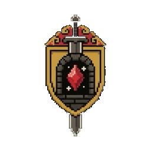
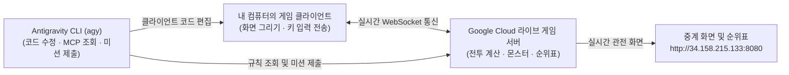
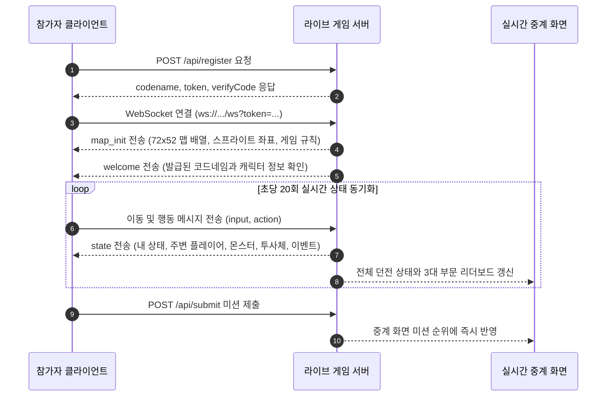
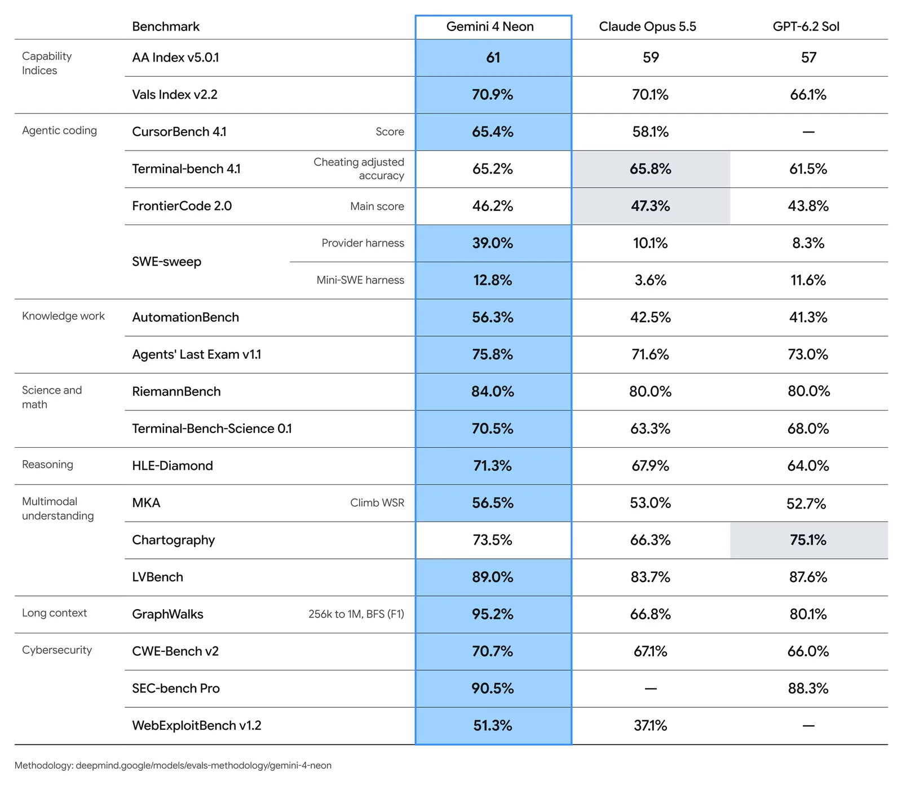
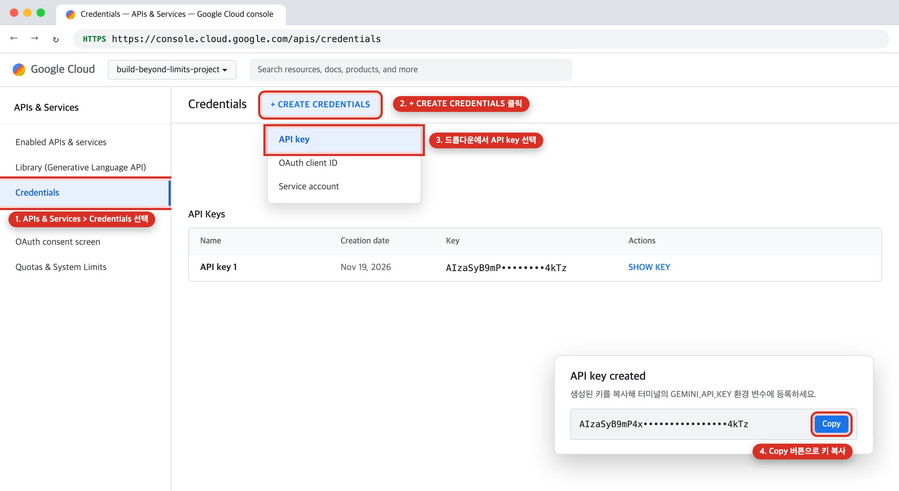
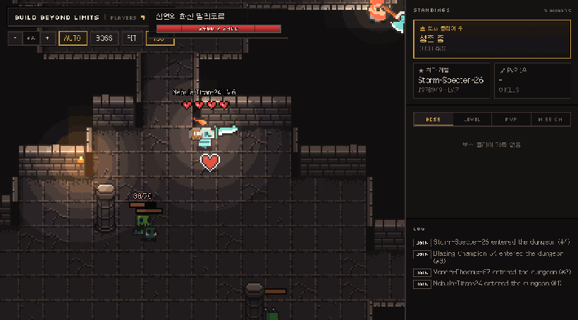

<p align="center">
  
</p>

<h1 align="center">Build Beyond Limits</h1>

<p align="center">
  Google Antigravity와 Gemini 4 모델을 활용해 나만의 로그라이크 게임 클라이언트를 만들고, Google Cloud 실시간 멀티플레이어 던전에서 보스를 공략하는 핸즈온 가이드입니다.
</p>

---

## 핸즈온 안내

이 리포지토리는 Google Cloud에서 실시간으로 운영 중인 멀티플레이어 로그라이크 던전에 접속할 게임 클라이언트를 직접 만들어 보기 위한 명세서와 MCP 도구 모음입니다. 미리 완성된 클라이언트나 서버 소스코드는 들어 있지 않으며, `README.md`, `specs/` 명세서, `.agents/skills/`, `bbl-roguelike` MCP 서버만 보고 `agy`와 함께 원하는 기술 스택으로 나만의 클라이언트를 구현합니다.

실습은 아래 순서로 진행합니다.

- Antigravity CLI(`agy`)를 설치하고 Google 계정 또는 API 키로 인증합니다.
- 리포지토리를 내려받고 `bbl-roguelike` MCP 서버를 `agy`에 연결합니다.
- `specs/` 명세서와 MCP 도구를 바탕으로 `agy`와 함께 클라이언트를 구현해 라이브 서버에 접속합니다.
- 나만의 에셋, 화면 스타일, 효과음과 배경음악, 전투 UI, 보스 패턴 경고 표시를 자유롭게 추가합니다.
- 내장된 제출 스킬로 미션을 제출하고, 던전 미로와 룬 퍼즐을 통과해 3단계로 강해지는 보스에 도전합니다.

---

## 전체 동작 구조

이 게임은 **실시간 게임 서버**와 **내 컴퓨터의 클라이언트**가 역할을 나누어 동작합니다.

- **라이브 게임 서버**: Google Cloud 위에서 초당 20회 주기로 게임 세계를 계산합니다. 모든 참가자의 이동 충돌, 몬스터와 보스의 공격 판정, 아이템 드롭, 순위표 집계를 서버가 맡아서 처리합니다.
- **내 컴퓨터의 클라이언트**: 서버가 보내 주는 맵과 캐릭터 좌표를 받아 화면에 그립니다. 사용자가 누른 키보드·마우스 입력만 서버로 전달하면 되므로, 화면 색감이나 인터페이스, 시각 효과는 참가자가 자유롭게 바꿀 수 있습니다.
- **Antigravity(`agy`)와 MCP**: 코드를 수정할 때 `agy`가 로컬 MCP 서버를 통해 라이브 게임 서버의 통신 규격과 스프라이트 좌표를 직접 확인하고, 테스트·빌드 뒤 미션 제출까지 돕습니다.



### 접속부터 플레이까지 한눈에 보기

1. **처음 접속할 때**: 클라이언트가 서버에 등록 요청을 보내 고유 코드네임과 접속 토큰을 받습니다. 이어서 WebSocket 연결이 열리면 서버가 `72×52` 던전 지도와 스프라이트 좌표표를 한 번 내려 줍니다.
2. **게임을 플레이하는 동안**: 서버가 초당 20회씩 내 캐릭터, 주변 플레이어, 몬스터, 투사체, 보스 공격 예고 정보를 보내 주고, 클라이언트는 이 데이터를 받아 캔버스에 그립니다. 키를 누르면 클라이언트가 입력 메시지만 서버로 보냅니다.
3. **기능을 구현하고 확장할 때**: `agy`에게 원하는 화면 구성과 기능을 말하면 프로젝트 명세서와 MCP 도구를 참고해 나만의 클라이언트 코드를 작성하고 검증합니다.
4. **미션을 마쳤을 때**: 제출 명령을 실행하면 서버가 결과를 기록하고 실시간 중계 화면의 미션 순위에 내 코드네임이 올라갑니다.

<details>
<summary><strong>상세 통신 순서 다이어그램 보기</strong></summary>



</details>

---

## 주요 기술 개념 자세히 보기

핸즈온에서 사용하는 Antigravity, Gemini 4 모델, MCP, 에이전트 스킬이 처음이라면 아래 항목을 펼쳐서 읽어 보세요. 이미 익숙하다면 바로 다음 설치 단계로 넘어가도 됩니다.

<details>
<summary><strong>Google Antigravity와 Gemini 4 모델군 비교: Carbon, Neon, Hydrogen</strong></summary>

### Google Antigravity란 무엇인가요?

<p align="center">
  <picture>
    <source media="(prefers-color-scheme: dark)" srcset="./assets/logos/antigravity-logo-dark.svg" />
    
  </picture>
</p>

Google Antigravity는 터미널에서 실행하는 에이전트 기반 개발 도구입니다. 명령어는 `agy`를 사용합니다. 프로젝트 폴더에서 `agy`를 열고 자연어로 작업을 요청하면, 에이전트가 프로젝트 파일을 직접 읽고 코드를 수정하며 테스트와 빌드 명령까지 실행해 결과를 확인합니다.

- 공식 문서 홈: [https://antigravity.google/docs](https://antigravity.google/docs)
- CLI 레퍼런스: [https://antigravity.google/docs/cli/reference](https://antigravity.google/docs/cli/reference)
- 활용 가이드: [https://antigravity.google/docs/cli/best-practices](https://antigravity.google/docs/cli/best-practices)

`agy`는 이러한 코드 분석, 설계, 편집, 디버깅 작업을 수행할 때 내부 추론 엔진으로 Google의 **Gemini 4** 모델을 사용합니다. `agy models`로 사용 가능한 모델을 확인하고 작업 성격에 맞춰 원하는 모델을 선택할 수 있습니다.

### Gemini 4 모델 선택 가이드

<p align="center">
  <picture>
    <source media="(prefers-color-scheme: dark)" srcset="./assets/logos/gemini-logo-dark.svg" />
    
  </picture>
</p>

Gemini 4 모델군은 모두 최대 100만 토큰의 컨텍스트 창을 지원하며, 문제 난이도에 따라 추론 강도를 `low`, `medium`, `high`, `xhigh` 4단계로 조절할 수 있습니다. `agy`에서 작업 성격에 따라 아래 3가지 모델 중 하나를 골라 쓰면 됩니다.

- **Gemini 4 Carbon**: 대규모 코드베이스 구조 설계, 복잡한 버그 원인 추적, 긴 다단계 추론 작업에 맞춰진 최상위 추론 모델입니다.
- **Gemini 4 Neon**: 코딩 에이전트 작업 성능과 응답 속도, 비용의 균형을 맞춘 주력 모델입니다. 실제 파일 편집과 도구 호출이 이어지는 핸즈온 개발 작업에 가장 잘 어울립니다.
- **Gemini 4 Hydrogen**: 빠른 응답 속도와 낮은 비용이 장점인 경량 모델입니다. 간단한 스타일 수정, 빠른 문법 점검, 병렬 보조 작업에 적합합니다.

### Gemini 4 모델별 공식 벤치마크 및 요금 비교

아래 표의 모든 벤치마크 수치는 Google DeepMind 공식 모델 카드([Gemini 4 Carbon](https://deepmind.google/models/model-cards/gemini-4-carbon/), [Gemini 4 Neon](https://deepmind.google/models/model-cards/gemini-4-neon/), [Gemini 4 Hydrogen](https://deepmind.google/models/model-cards/gemini-4-hydrogen/))와 [Google 공식 발표 블로그](https://blog.google/innovation-and-ai/models-and-research/gemini-models/introducing-gemini-4-neon/)에 공개된 평가 결과를 기준으로 정리했습니다. 모델 카드에 미공개된 항목은 `-`로 표기했습니다.

| 항목 | Gemini 4 Carbon | Gemini 4 Neon | Gemini 4 Hydrogen |
| :--- | :---: | :---: | :---: |
| 모델 식별자 | `gemini-4-carbon` | `gemini-4-neon` | `gemini-4-hydrogen` |
| 컨텍스트 창 | 100만 토큰 | 100만 토큰 | 100만 토큰 |
| AA Index (`v5.0` / `v5.0.1`) | 59 | 61 | 54 (`xhigh`) |
| Vals Index v2.2 | 70.4% | 70.9% | - |
| Terminal-Bench (`4.0` / `4.1`) | 65.2% (`4.0`) | 65.2% (`4.1`) | 57.0% (`4.1`) |
| SWE-sweep | 9.6% | 39.0% | 13.5% |
| Agents' Last Exam v1.1 | 77.4% | 75.8% | 71.6% |
| Terminal-Bench-Science 0.1 | 64.8% | 70.5% | 51.4% |
| RiemannBench | 80.0% | 84.0% | - |
| HLE-Diamond | - | 71.3% | 58.8% |
| Chartography | 72.5% | 73.5% | 66.6% |
| GraphWalks (256k~1M BFS F1) | 96.2% | 95.2% | - |
| CWE-Bench / SEC-bench Pro | 71.0% / 88.2% | 70.7% / 90.5% | - |
| API 입력 / 출력 요금, 100만 토큰 기준 | $2.00 / $10.00 | $3.00 / $15.00 | $1.50 / $7.50 |
| 캐시 입력 요금, 100만 토큰 기준 | $0.10 | $0.15 | $0.075 |

**Google 공식 게시 벤치마크 지표 (출처: [Google Blog: Introducing Gemini 4 Neon](https://blog.google/innovation-and-ai/models-and-research/gemini-models/introducing-gemini-4-neon/))**



</details>

<details>
<summary><strong>MCP란 무엇이며 왜 쓰는지, agy에 연동하는 방법</strong></summary>

### MCP란 무엇인가요?

<p align="center">
  <picture>
    <source media="(prefers-color-scheme: dark)" srcset="./assets/logos/mcp-logo-dark.svg" />
    
  </picture>
</p>

MCP는 Model Context Protocol의 줄임말로, AI 에이전트가 외부 데이터나 실행 중인 서버와 표준 방식으로 통신할 수 있게 해 주는 규격입니다. 흔히 컴퓨터의 USB 포트에 비유합니다. MCP 도구를 연결하면 에이전트가 라이브 서버의 규칙과 상태를 바로 조회할 수 있습니다.

### 이번 핸즈온에서 MCP를 쓰면 어떤 점이 좋나요?
실시간 멀티플레이어 게임은 프로토콜 필드 이름이나 스프라이트 좌표가 1글자만 틀려도 화면이 깨지거나 서버가 입력을 무시합니다. 이 리포지토리에 포함된 `bbl-roguelike` MCP 서버를 연결하면 에이전트가 아래 작업을 직접 수행합니다.

- 라이브 서버가 실제로 요구하는 WebSocket 바이너리 패킷 형식과 게임 규칙을 실시간으로 조회합니다.
- 300개가 넘는 픽셀 아트 스프라이트의 정확한 `(x, y, w, h)` 좌표를 실수 없이 가져옵니다.
- 내가 작성한 WebSocket 송신 메시지가 서버 규칙에 맞는지 실행 전에 미리 검사합니다.
- 내 캐릭터가 현재 서버에서 어느 좌표에 서 있고 어떤 상태인지 바로 조회해 오류 원인을 찾습니다.

### agy에 `bbl-roguelike` MCP 서버 연동하기
리포지토리 루트에서 아래 `agy mcp add` 명령 1줄로 바로 등록하고 `agy mcp list`로 연결 상태를 확인할 수 있습니다.

```bash
agy mcp add --env BBL_SERVER_URL=http://34.158.215.133:8080 bbl-roguelike node ./mcp-server/index.mjs
agy mcp list
```

직접 설정 파일을 편집하려면 리포지토리 루트의 [`.mcp.json`](./.mcp.json)을 참고해 `~/.gemini/config/mcp_config.json`에 아래 내용을 추가합니다. `<리포지토리_절대경로>` 부분은 실제로 `build-beyond-limits` 폴더를 내려받은 경로로 바꿔 주세요.

```json
{
  "mcpServers": {
    "bbl-roguelike": {
      "command": "node",
      "args": ["<리포지토리_절대경로>/mcp-server/index.mjs"],
      "env": {
        "BBL_SERVER_URL": "http://34.158.215.133:8080"
      }
    }
  }
}
```

설정을 저장한 뒤 `agy`를 다시 실행하면 `bbl-roguelike` 서버가 자동으로 연결됩니다. 설정 파일의 자세한 옵션은 [Antigravity MCP 연동 문서](https://antigravity.google/docs/mcp)에서도 확인할 수 있습니다.

### 제공되는 MCP 도구 목록

| 도구 이름 | 역할 |
| :--- | :--- |
| `get_protocol_contract` | 접속 절차, 바이너리 패킷 구조, 전체 상태·이벤트 스키마, 전투·막기·패링, 스킬 트리, 무기·장비, 보스 패턴, 미로 퍼즐, 체력·함정, 타일셋 규칙을 주제별로 조회합니다. |
| `get_asset_manifest` | 영웅, 무기, 방패, 몬스터, 벽, 하트, 함정, 퍼즐 등 분류별 스프라이트 좌표를 조회합니다. |
| `inspect_live_world` | 라이브 서버의 현재 접속자 수, 활성 보스 단계와 재등장 남은 시간, PvP 활성화 여부, 봉인의 제단 퍼즐 상태를 확인합니다. |
| `inspect_player_state` | 내 코드네임이나 토큰으로 서버에 기록된 내 캐릭터 위치, 체력, 스킬 레벨, 최신 처리 시퀀스를 조회합니다. |
| `validate_client_payload` | 클라이언트가 보낼 WebSocket 페이로드를 서버 검사 규칙으로 사전 검증합니다. |
| `diagnose_server_health` | 라이브 게임 서버의 응답 지연 시간과 맵, 아틀라스 응답 상태를 진단합니다. |

> `agy` 요청 예시: `"bbl-roguelike MCP 도구로 binary_protocol과 combat_guard_parry 규칙을 확인한 뒤, 막기 입력 메시지를 validate_client_payload로 검사하고 클라이언트 코드에 반영해 줘."`

</details>

<details>
<summary><strong>에이전트 스킬이란 무엇이며 왜 쓰는지, agy 연동 방식</strong></summary>

### 에이전트 스킬이란 무엇인가요?
에이전트 스킬은 특정 작업을 잘 수행하기 위해 미리 정리해 둔 작업 매뉴얼과 보조 스크립트 묶음입니다. 리포지토리 안의 `.agents/skills/` 폴더에 작업 규칙과 스크립트를 넣어 두면, 에이전트가 상황에 맞는 스킬을 스스로 찾아 읽고 실행합니다.

### 이 리포지토리에 들어 있는 스킬과 이점
`build-beyond-limits` 폴더 안에는 2가지 프로젝트 스킬이 미리 들어 있습니다.

- **`roguelike-protocol`** ([`.agents/skills/roguelike-protocol/SKILL.md`](./.agents/skills/roguelike-protocol/SKILL.md)): 프로토콜 버전, 타일 번호, 2.5D 벽 렌더링 순서, 전투 시각 효과 규칙을 에이전트가 빠르게 파악할 수 있도록 요약해 둔 스킬입니다.
- **`submit-mission`** ([`.agents/skills/submit-mission/SKILL.md`](./.agents/skills/submit-mission/SKILL.md)): 클라이언트 단위 테스트와 빌드를 자동으로 돌리고, 서버 연결 상태를 확인한 뒤 리더보드에 미션 결과를 제출해 주는 자동화 스킬입니다.

### agy에서 스킬을 사용하는 방법
별도의 설치나 설정 파일 편집이 필요 없습니다. 터미널에서 `build-beyond-limits` 리포지토리 최상위 폴더로 이동한 다음 `agy`를 실행하면 `.agents/skills/` 아래의 스킬이 자동으로 인식됩니다.

```bash
cd build-beyond-limits
agy
```

대화창에서 `"mission-1 제출해 줘"` 또는 `"roguelike-protocol 스킬을 참고해서 보스 공격 경고 테두리를 강조해 줘"`처럼 자연어로 말하면 에이전트가 해당 스킬을 바로 불러와 실행합니다. 스킬 작성 방법은 [Antigravity 스킬 가이드](https://antigravity.google/docs/skills)에서 확인할 수 있습니다.

</details>

---

## 사전 준비와 인증

실습을 시작하기 전에 아래 2가지 도구가 설치되어 있는지 확인합니다.

- **Node.js 20 이상**: [Node.js 공식 다운로드](https://nodejs.org/en/download)에서 설치한 뒤 터미널에서 `node -v`로 버전을 확인합니다.
- **Git**: [Git 공식 다운로드](https://git-scm.com/downloads)에서 설치한 뒤 `git --version`으로 확인합니다.

### Antigravity CLI 설치

사용 중인 운영체제에 맞는 명령을 터미널에 입력합니다.

- **macOS 및 Linux**
  ```bash
  curl -fsSL https://antigravity.google/cli/install.sh | bash
  ```
- **Windows PowerShell**
  ```powershell
  irm https://antigravity.google/cli/install.ps1 | iex
  ```
- **Windows 명령 프롬프트**
  ```cmd
  curl -fsSL https://antigravity.google/cli/install.cmd -o install.cmd && install.cmd && del install.cmd
  ```

설치가 끝나면 터미널을 새로 열고 아래 명령으로 정상 설치를 확인합니다.

```bash
agy --help
```

### 인증 토큰 발급과 등록

`agy`는 Google 계정으로 바로 로그인하거나, API 키를 발급받아 환경 변수로 등록해 사용할 수 있습니다.

#### 방법 A. Google 계정 OAuth 로그인

개인 노트북에서 브라우저를 열 수 있다면 가장 간편한 방법입니다.

1. 터미널에서 `agy`를 입력해 실행합니다.
2. 기본 웹 브라우저가 자동으로 열리면 Google 계정으로 로그인하고 권한을 승인합니다.
3. 인증 토큰은 운영체제의 보안 키체인에 자동으로 보관됩니다.
4. 나중에 다른 계정으로 바꾸고 싶다면 `agy` 대화창에서 `/logout`을 입력하면 됩니다.

#### 방법 B. API 키 발급 및 환경 변수 등록

원격 서버에 접속해 브라우저를 열기 어렵거나, 프로젝트별 API 키로 직접 인증해야 할 때 사용합니다.

**Google AI Studio에서 발급받기** ([바로가기: aistudio.google.com/apikey](https://aistudio.google.com/apikey))

1. 브라우저에서 [Google AI Studio API 키 페이지](https://aistudio.google.com/apikey)를 열고 왼쪽 메뉴의 **Get API key**를 클릭합니다.
2. 오른쪽 위의 **+ Create API key** 버튼을 누릅니다.
3. 연결할 Google Cloud 프로젝트를 고른 뒤 **Create API key in existing project** 버튼을 누릅니다.
4. 목록에 생성된 키 옆의 **Copy key** 버튼을 눌러 `AIza...` 문자열을 복사합니다.


<details>
<summary><strong>Google Cloud Console에서 API 키를 발급받는 방법 보기</strong></summary>

1. 브라우저에서 [Google Cloud Console 사용자 인증 정보 페이지](https://console.cloud.google.com/apis/credentials)에 접속하고 왼쪽 메뉴에서 **APIs & Services > Credentials**를 선택합니다.
2. 상단 메뉴의 **+ CREATE CREDENTIALS**를 누른 뒤 드롭다운에서 **API key**를 선택합니다.
3. 생성 창이 열리면 **Copy** 버튼을 눌러 키를 복사합니다.
4. 필요하면 [Generative Language API 페이지](https://console.cloud.google.com/apis/library/generativelanguage.googleapis.com)에서 해당 API가 사용 설정되어 있는지 확인합니다.



</details>

복사한 키는 아래 명령으로 터미널 환경 변수에 등록합니다.

- **macOS 및 Linux**
  ```bash
  export GEMINI_API_KEY="복사한_API_키를_여기에_입력"
  ```
- **Windows PowerShell**
  ```powershell
  $env:GEMINI_API_KEY="복사한_API_키를_여기에_입력"
  ```

API 키 방식으로 강제 지정해야 하는 환경이라면 `~/.gemini/antigravity-cli/settings.json` 파일에 `"modelProvider": "gemini"` 항목을 추가해 주세요.

---

## 라이브 서버 주소와 프로젝트 시작

핸즈온용 라이브 게임 서버와 실시간 중계 화면은 아래 주소에서 상시 실행되고 있습니다.

| 구분 | 주소 | 설명 |
| :--- | :--- | :--- |
| 실시간 중계 화면 | `http://34.158.215.133:8080` | 전체 던전 실시간 관전, 3대 우승 부문 순위표, 미션 제출 현황 |
| 실시간 WebSocket | `ws://34.158.215.133:8080/ws` | 맵 초기화, 20Hz 실시간 상태 수신(기본값: 바이너리 `BBL-BIN v1` + Deflate 압축, 디버깅 시 `?encoding=json`), 이동과 전투 행동 전송 |
| REST API | `http://34.158.215.133:8080/api` | 서버 상태 확인(`/health`), 코드네임 등록(`/register`), 맵 조회(`/map`), 타일셋 조회(`/tileset`), 미션 제출(`/submit`) |
| 예제 타일셋 이미지 | `http://34.158.215.133:8080/assets/tileset/dungeon_autotile_16x16.png` | 바로 활용해 볼 수 있는 CC0 픽셀 아트 예제 시트 |

### 리포지토리 내려받기 및 `agy` 기초 사용법

```bash
git clone https://github.com/KennethanCeyer/build-beyond-limits.git
cd build-beyond-limits
curl http://34.158.215.133:8080/api/health
agy
```

`agy` 최초 실행 시 브라우저에서 Google 계정으로 로그인하면 인증이 완료됩니다. 이어서 모델 목록 조회(`agy models`), 프로젝트 MCP 서버 등록(`agy mcp add`), 에이전트 실행(`agy` 또는 `agy -p`)까지의 실제 터미널 실행 흐름은 아래와 같습니다.


| 자주 쓰는 `agy` 명령 | 설명 |
| :--- | :--- |
| `agy` | 현재 폴더에서 대화형 에이전트 세션 시작 (종료: `/exit` 또는 `Ctrl+D` 2회) |
| `agy --model gemini-4-carbon-medium` | 원하는 Gemini 4 모델을 지정해 대화형 세션 시작 |
| `agy -p "요청 문구"` | 한 번만 질문하고 결과만 바로 출력 (비대화형 실행) |
| `agy models` | 현재 계정에서 사용 가능한 모델 목록 조회 |
| `agy mcp add <이름> <명령>` / `agy mcp list` | MCP 서버 등록 및 연결 상태 확인 |

클라이언트는 HTML5 Canvas, Vite, React, Phaser, PixiJS, 터미널 UI 등 편한 언어와 프레임워크를 자유롭게 골라 `client/` 같은 새 폴더에 만들면 됩니다.

### 구현 화면 참고 예시

아래 플레이 영상은 명세서와 예제 에셋으로 구현한 참고 예시입니다. 참가자 클라이언트의 화면 배치, 색감, 아트 스타일은 전혀 다르게 만들어도 됩니다.

**근접 전투 · 방패 막기 · 강공격 차지 · 대시 플레이 (수호기사)**


**원거리 폭발 마법 · 던전 광원 · 대시 회피 플레이 (화염 술사)**


**실시간 중계 화면 (`http://34.158.215.133:8080`)**

전체 던전 지도 위에서 모든 참가자의 이동과 보스전을 관전하고, 최다 레벨, 보스 클리어 수, PvP 1위 순위표와 미션 제출 기록을 실시간으로 확인할 수 있습니다.



---

## 예제 에셋과 오디오 안내

### 예제 타일셋 에셋

바로 화면을 그려 볼 수 있도록 1장짜리 CC0 픽셀 아트 타일셋을 **예제 에셋**으로 함께 제공합니다.

> **다른 에셋 사용 안내**: 이 예제 에셋을 반드시 사용할 필요는 없습니다. 직접 준비한 다른 타일셋이나 스프라이트, 기하학적 벡터 도형, 네온 와이어프레임, ASCII 아트, AI로 생성한 이미지 등 원하는 에셋을 자유롭게 사용해 나만의 분위기로 구현해 보세요.

| 파일 경로 | 용도 |
| :--- | :--- |
| [`assets/tileset/dungeon_autotile_16x16.png`](./assets/tileset/dungeon_autotile_16x16.png) | 가로 512픽셀, 세로 640픽셀 크기의 통합 스프라이트 시트 이미지입니다. 기본 타일 단위는 16×16픽셀입니다. |
| [`assets/tileset/tile_list_v1.7`](./assets/tileset/tile_list_v1.7) | 원본 스프라이트 이름과 이미지 안의 `x y w h` 픽셀 좌표가 줄 단위로 정리된 텍스트 파일입니다. |
| [`assets/tileset/LICENSE_CC0.txt`](./assets/tileset/LICENSE_CC0.txt) | 에셋 출처와 CC0 라이선스 원문입니다. |

이미지를 직접 열어 보거나, 아래 2가지 방법으로 각 스프라이트의 정확한 좌표를 조회할 수 있습니다.

- **웹 브라우저 또는 curl로 조회**: `http://34.158.215.133:8080/api/tileset`에 접속하면 모든 스프라이트의 이름과 `{ x, y, w, h }` 좌표를 JSON으로 내려받습니다.
- **MCP 도구로 조회**: `agy`에서 `get_asset_manifest` 도구를 호출하면 `heroes`, `weapons`, `shields`, `monsters`, `walls`, `hearts`, `traps`, `puzzle`, `potions`처럼 원하는 분류의 좌표만 추려서 받을 수 있습니다.


#### 원본 출처와 라이선스

- **원본 에셋**: Robert Norenberg가 제작한 [0x72 16x16 DungeonTileset II (v1.7)](https://0x72.itch.io/dungeontileset-ii)
- **확장 구성**: 원본 시트에 2.5D 방향별 높은 벽, 용암·성수 분수, 벽면 그림자 타일을 세로 좌표 `y=512` 아래에 합치고, 4종의 방패 아이콘과 불사조의 깃털, 고대 비전서 아이콘을 오른쪽 하단에 추가했습니다.
- **라이선스**: **CC0 1.0 Universal** ([라이선스 전문 보기](https://creativecommons.org/publicdomain/zero/1.0/)). 퍼블릭 도메인으로 기증된 에셋이므로 상업적 이용, 수정, 재배포가 모두 자유롭습니다.

### 오디오와 효과음 안내

게임 서버는 음원 파일을 보내지 않고 전투와 상태 이벤트(`state.events[]`) 및 현재 구역(`state.me.zone`) 정보만 전송합니다. 클라이언트에서 아래 이벤트에 맞춰 효과음과 배경음악을 추가하면 타격감과 공격 예고 파악이 훨씬 수월해집니다.

- **전투 효과음 예시**: 공격 휘두르기(`slash`), 강공격 타격(`slash.heavy`), 방패 올리기와 막기(`guard_raise`, `guard_block`), 패링 반격(`parry_success`), 대시(`dash`), 마법 폭발(`arcane_boom`), 피격과 치명타(`damage`), 몬스터 처치(`mob_death`).
- **경고와 진행 효과음 예시**: 원거리 시전 충전(`mob_windup`), 가시 함정 예고(`trap_arm`), 보스 충격파 경보와 장판 폭발(`boss_wave`, `telegraph_boom`), 룬 퍼즐 진행·해제(`puzzle_step`, `puzzle_reset`, `puzzle_solved`), 레벨업과 아이템 획득(`level_up`, `pickup`, `heal`).
- **구역별 배경음악 예시**: `성소`, 일반 던전, 보스전 `왕좌`에 따라 분위기나 리듬이 바뀌도록 구성할 수 있습니다.

> **자유로운 오디오 창작 권장**: 위 효과음 목록은 출발점으로 참고만 하세요. Web Audio API 신디사이저(칩튠, FM 신스, 로파이, 앰비언트)로 직접 소리를 합성하거나, 외부 무료 효과음·음원 파일, 음성 안내, 리듬감 있는 커스텀 사운드를 조합하는 등 여러분만의 방식으로 자유롭게 창작해 보시길 추천합니다.

---

## 명세서 참고 방법과 실전 구현 예시

클라이언트를 처음부터 설계할 때는 `specs/` 폴더의 문서 3편과 `bbl-roguelike` MCP 도구를 함께 보면 됩니다.

| 문서 경로 | 언제 읽어 보면 좋은가요? |
| :--- | :--- |
| [`specs/PROTOCOL.md`](./specs/PROTOCOL.md) | REST API 등록 절차, WebSocket 바이너리 패킷 구조와 바이트 다이어그램, 메시지 순서를 확인할 때 봅니다. |
| [`specs/TILESET_AND_RENDERING.md`](./specs/TILESET_AND_RENDERING.md) | 72×52 맵의 타일 번호, 2.5D 벽 연결 규칙, 던전 광원, 화면 출력 방법을 볼 때 참고합니다. |
| [`specs/COMBAT_AND_VFX.md`](./specs/COMBAT_AND_VFX.md) | 체력과 부활 규칙, 방패 막기와 패링, 강공격 차지, 스킬, 보스 공격 예고 장판과 타격 연출 규칙을 확인할 때 봅니다. |

세부 JSON 필드나 최신 밸런스 수치가 궁금할 때는 `agy`에서 `bbl-roguelike` MCP의 `get_protocol_contract` 도구를 호출해 라이브 서버 기준 계약을 확인하면 문서를 일일이 뒤지지 않아도 됩니다.

### 예시 시나리오: 접속해 맵을 그린 뒤 앞의 몬스터를 처치하기

실제로 서버에 접속해서 바닥과 벽 타일을 캔버스에 그리고, 바로 앞에 서 있는 몬스터를 공격해 쓰러뜨리기까지 어떤 데이터가 오가고 코드를 어떻게 작성하면 되는지 순서대로 살펴봅니다.

#### 접속 직후 서버에서 받는 `map_init` 데이터

WebSocket 연결이 열리면 서버가 가장 먼저 `map_init` 메시지를 한 번 보내 줍니다. 이 안에 `72×52` 크기의 2차원 숫자 배열 `map.tiles`와, 각 스프라이트의 픽셀 좌표가 담긴 `tileset.sprites`가 들어 있습니다.

```json
{
  "type": "map_init",
  "map": {
    "width": 72,
    "height": 52,
    "tiles": [
      [0, 0, 2, 2, 2, 0],
      [0, 2, 1, 1, 1, 2],
      [0, 2, 1, 1, 4, 2]
    ]
  },
  "tileset": {
    "sheetUrl": "/assets/tileset/dungeon_autotile_16x16.png?v=2.4",
    "tileSize": 16,
    "sprites": {
      "floor_1": { "x": 16, "y": 64, "w": 16, "h": 16 },
      "wall_mid": { "x": 32, "y": 16, "w": 16, "h": 16 },
      "goblin_idle_anim_f0": { "x": 368, "y": 32, "w": 16, "h": 16 }
    }
  }
}
```

`map.tiles[y][x]`의 숫자 `0`은 빈 공간, `1`은 걸을 수 있는 던전 바닥, `2`는 막혀 있는 벽, `4`는 가시 함정을 뜻합니다. 이 숫자를 보고 `tileset.sprites`에서 알맞은 좌표를 꺼내 캔버스에 잘라 그리면 됩니다.

#### 초당 20회 주기로 서버에서 받는 `state` 데이터

잠시 뒤부터 서버가 50밀리초마다 `state` 메시지를 보냅니다. 기본 연결(`/ws?token=...`)은 대역폭 절감을 위해 리틀 엔디안 바이너리(`BBL-BIN v1`)와 RFC 7692 `perMessageDeflate` 압축으로 전송되며(평문 JSON 대비 약 88% 축소), 디버깅이나 빠른 프로토타이핑 단계에서 평문 JSON으로 확인하고 싶다면 `&encoding=json`을 붙여 연결할 수 있습니다. 바이너리 프레임을 디코딩했을 때의 주요 상태 객체 구조는 JSON 모드와 호환됩니다(대역폭 절감을 위한 일부 타임스탬프·메타 생략 항목은 [`specs/PROTOCOL.md`](./specs/PROTOCOL.md) 참고). 내 캐릭터가 `(18.0, 24.0)` 위치에서 오른쪽을 바라보고 있고, 바로 앞 `(19.2, 24.0)` 위치에 고블린이 서 있을 때의 구조는 다음과 같습니다.

```json
{
  "type": "state",
  "tick": 1420,
  "me": {
    "x": 18.0,
    "y": 24.0,
    "dirX": 1,
    "dirY": 0,
    "hp": 6,
    "maxHp": 6,
    "ackSeq": 12
  },
  "monsters": [
    {
      "id": "mob_17",
      "name": "고블린 척후",
      "spriteBase": "goblin",
      "x": 19.2,
      "y": 24.0,
      "hp": 45,
      "maxHp": 45,
      "facing": "left",
      "moving": false,
      "hit": false
    }
  ],
  "events": []
}
```

#### 공격 메시지 전송과 타격 결과 수신

앞에 있는 고블린 쪽으로 방향을 맞춘 뒤 공격하려면, 1씩 증가하는 `seq` 번호를 담아 2개 메시지를 보냅니다. 기본 바이너리 모드에서는 `0x01 C2S_INPUT`(7바이트)과 `0x02 C2S_ATTACK`(9바이트)으로 전송하며, 디버깅할 때는 아래처럼 JSON으로 보내도 서버가 똑같이 처리합니다.

```json
{ "type": "input", "seq": 13, "move": [1, 0] }
{ "type": "action", "seq": 14, "action": "attack", "aim": [1, 0] }
```

서버가 사거리와 방향을 판정해 명중하면 바로 다음 틱의 `state.events` 배열에 검기 궤적, 피해량, 처치 이벤트가 실려 옵니다.

```json
{
  "events": [
    { "type": "slash", "originX": 18.0, "originY": 24.0, "dirX": 1, "dirY": 0, "weaponClass": "melee", "heavy": false },
    { "type": "damage", "x": 19.2, "y": 24.0, "amount": 28, "crit": false, "targetKind": "monster" },
    { "type": "mob_death", "mobId": "mob_17", "name": "고블린 척후", "isBoss": false, "tier": 1, "x": 19.2, "y": 24.0 }
  ]
}
```

<details>
<summary><strong>예시 JavaScript 코드 보기: 바이너리 WebSocket 접속, 타일 렌더링, 공격 송신과 처치·피해 연출</strong></summary>

```javascript
const TILE = 16;
const SERVER_HTTP = 'http://34.158.215.133:8080';
const SERVER_WS = 'ws://34.158.215.133:8080/ws';

let mapData = null;
let sprites = null;
let atlasImg = null;
let latestState = null;
let seq = 0;
const floatingTexts = [];
const deathBursts = [];

// 0x02 C2S_ATTACK 바이너리 패킷 인코더 (9바이트, Little-Endian)
function encodeBinaryAttack(nextSeq, dirX, dirY) {
  const buf = new ArrayBuffer(9);
  const view = new DataView(buf);
  view.setUint8(0, 0x02);
  view.setUint32(1, nextSeq, true);
  view.setUint8(5, 0);
  view.setInt8(6, Math.round(dirX * 100));
  view.setInt8(7, Math.round(dirY * 100));
  view.setUint8(8, 1);
  return buf;
}

// 1. 코드네임 발급 후 기본 바이너리(+perMessageDeflate) WebSocket 연결
async function startClient(canvas, decodeS2CPacket) {
  const ctx = canvas.getContext('2d');
  ctx.imageSmoothingEnabled = false;

  const reg = await fetch(`${SERVER_HTTP}/api/register`, { method: 'POST' }).then((r) => r.json());
  // 기본 연결은 BBL-BIN v1 바이너리 + perMessageDeflate 압축 (디버깅 시에만 &encoding=json 추가)
  const ws = new WebSocket(`${SERVER_WS}?token=${encodeURIComponent(reg.token)}`);
  ws.binaryType = 'arraybuffer';

  ws.onmessage = (ev) => {
    // 20Hz state(0x81)와 pong(0x8F)은 ArrayBuffer, 초기 map_init/welcome/leaderboard는 텍스트 JSON
    const msg = ev.data instanceof ArrayBuffer ? decodeS2CPacket(ev.data) : JSON.parse(ev.data);

    if (msg.type === 'map_init') {
      mapData = msg.map;
      sprites = msg.tileset.sprites;
      atlasImg = new Image();
      atlasImg.crossOrigin = 'anonymous';
      atlasImg.src = SERVER_HTTP + msg.tileset.sheetUrl;
    }

    if (msg.type === 'state') {
      latestState = msg;
      for (const e of msg.events || []) {
        if (e.type === 'damage') {
          floatingTexts.push({ x: e.x, y: e.y, text: `-${e.amount}`, bornAt: performance.now() });
        } else if (e.type === 'mob_death') {
          deathBursts.push({ x: e.x, y: e.y, bornAt: performance.now() });
        }
      }
    }
  };

  // 스페이스바를 누르면 현재 바라보는 방향으로 9바이트 바이너리 공격 패킷 전송
  window.addEventListener('keydown', (e) => {
    if (e.code === 'Space' && ws.readyState === WebSocket.OPEN && latestState?.me) {
      const { dirX, dirY } = latestState.me;
      ws.send(encodeBinaryAttack(++seq, dirX, dirY));
    }
  });

  // 2. 매 프레임 캔버스 렌더링
  function drawFrame(now) {
    requestAnimationFrame(drawFrame);
    if (!mapData || !sprites || !atlasImg?.complete || !latestState?.me) return;

    const me = latestState.me;
    const camX = Math.round(me.x * TILE - canvas.width / 2);
    const camY = Math.round(me.y * TILE - canvas.height / 2);

    ctx.fillStyle = '#0d0b14';
    ctx.fillRect(0, 0, canvas.width, canvas.height);

    // 2-1. 화면에 보이는 범위의 맵 타일 그리기
    const startX = Math.max(0, Math.floor(camX / TILE));
    const endX = Math.min(mapData.width - 1, Math.ceil((camX + canvas.width) / TILE));
    const startY = Math.max(0, Math.floor(camY / TILE));
    const endY = Math.min(mapData.height - 1, Math.ceil((camY + canvas.height) / TILE));

    for (let ty = startY; ty <= endY; ty++) {
      for (let tx = startX; tx <= endX; tx++) {
        const tileId = mapData.tiles[ty][tx];
        if (tileId === 0) continue;
        const spriteKey = tileId === 2 ? 'wall_mid' : 'floor_1';
        const sp = sprites[spriteKey];
        if (!sp) continue;
        ctx.drawImage(atlasImg, sp.x, sp.y, sp.w, sp.h, tx * TILE - camX, ty * TILE - camY, TILE, TILE);
      }
    }

    // 2-2. 몬스터 스프라이트와 머리 위 체력 바 그리기
    const frame = Math.floor(now / 160) % 4;
    for (const mob of latestState.monsters || []) {
      const key = `${mob.spriteBase}_${mob.moving ? 'run' : 'idle'}_anim_f${frame}`;
      const sp = sprites[key] || sprites[`${mob.spriteBase}_idle_anim_f0`];
      if (!sp) continue;

      const drawX = Math.round(mob.x * TILE - sp.w / 2 - camX);
      const drawY = Math.round(mob.y * TILE - sp.h + 4 - camY);
      ctx.drawImage(atlasImg, sp.x, sp.y, sp.w, sp.h, drawX, drawY, sp.w, sp.h);

      const ratio = Math.max(0, mob.hp / Math.max(1, mob.maxHp));
      ctx.fillStyle = '#1b1420';
      ctx.fillRect(drawX, drawY - 5, sp.w, 3);
      ctx.fillStyle = '#e05252';
      ctx.fillRect(drawX, drawY - 5, Math.round(sp.w * ratio), 3);
    }

    // 2-3. 몬스터 처치 폭발 링 그리기
    for (let i = deathBursts.length - 1; i >= 0; i--) {
      const db = deathBursts[i];
      const p = (now - db.bornAt) / 360;
      if (p >= 1) {
        deathBursts.splice(i, 1);
        continue;
      }
      ctx.strokeStyle = `rgba(255, 196, 118, ${(1 - p).toFixed(2)})`;
      ctx.beginPath();
      ctx.arc(Math.round(db.x * TILE - camX), Math.round(db.y * TILE - camY), 4 + p * 16, 0, Math.PI * 2);
      ctx.stroke();
    }

    // 2-4. 위로 떠오르는 피해 숫자 그리기
    ctx.font = 'bold 10px monospace';
    ctx.fillStyle = '#ffd166';
    for (let i = floatingTexts.length - 1; i >= 0; i--) {
      const ft = floatingTexts[i];
      const elapsed = now - ft.bornAt;
      if (elapsed > 700) {
        floatingTexts.splice(i, 1);
        continue;
      }
      ctx.fillText(ft.text, Math.round(ft.x * TILE - camX), Math.round(ft.y * TILE - 12 - elapsed * 0.02 - camY));
    }
  }

  requestAnimationFrame(drawFrame);
}
```

> `decodeS2CPacket(arrayBuffer)`의 전체 바이트 오프셋과 열거형 인덱스표는 [`specs/PROTOCOL.md`](./specs/PROTOCOL.md) 또는 `bbl-roguelike` MCP의 `binary_protocol` 주제에서 확인할 수 있습니다.

</details>

---

## 조작 방법과 게임 규칙

### 키보드와 마우스 조작

| 입력 키 | 동작 | 설명 |
| :--- | :--- | :--- |
| 방향키 또는 `W` `A` `S` `D` | 이동 | 8방향 이동 및 벽면 슬라이딩 |
| `Space` 또는 `J` 짧게 누르기 | 기본 공격 | 장착한 무기에 따라 근접 참격, 화살 발사, 폭발 마법구 발사 |
| `Space` 또는 `J` 길게 누르기 | 강공격 차지 | 기력을 모아 1.9배 위력의 강공격 발동 |
| `C` 또는 `L` 또는 마우스 우클릭 유지 | 방패 막기와 패링 | 누르고 있는 동안 이동 속도가 줄어들며 전방 120도와 광역 공격 피해를 줄입니다(방패 장착 시 일반 원거리 투사체는 피해 0으로 완전히 막아냄). 공격이 닿기 직전 0.32초(수호기사 0.42초) 안에 막기를 올리면 패링이 발동해 피해를 무효화하고, 근접 적은 기절·취약(받는 피해 1.75배), 전방 120도 원거리 투사체는 날아온 방향으로 그대로 튕겨내 반격합니다. |
| `Shift` 또는 `K` | 대시 슬라이드 | 빠르게 미끄러지며 잠시 무적 상태가 됩니다. 보스의 심연의 충격파를 통과할 때 사용합니다. |
| `Q` / `R` | 액티브 스킬 | 가방 창에서 선택한 전술 스킬과 궁극 스킬을 발동합니다. |
| `E` / `F` | 아이템 줍기 | 바닥에 떨어진 장비나 소비 아이템을 줍습니다. 생명의 하트는 밟으면 즉시 체력을 회복합니다. |
| `1` / `2` / `3` | 소비 아이템 사용 | 치유 물약, 비약, 고대 비전서, 불사조의 깃털을 사용합니다. |
| `I` / `Tab` | 가방 · 스킬 · 능력치 창 | 10칸 가방, 무기·방어구 비교 툴팁, 3택 1 스킬 트리, 능력치 배분 창을 엽니다. |
| `H` / `M` | 도움말 / 소리 음소거 | 조작 안내 창 열기, 배경 음악 및 효과음 켜고 끄기 |
| `ESC` | 열린 창 닫기 | 열려 있는 가방, 도움말, 툴팁, 다시하기 확인 창을 닫습니다. |

### 직업과 장비 성장 규칙

게임을 시작할 때 아래 4가지 직업 중 하나를 선택합니다. 자기 직업의 주 무기를 장착하면 추가 숙련 보너스가 활성화됩니다.

| 직업 | 주 무기 숙련 | 기본 하트 | 고유 특성 |
| :--- | :--- | :--- | :--- |
| 수호기사 | 근접 무기 | 4칸 | 방패 막기 피해 감소, 패링 판정 시간 `0.42초` 및 반격 강화 |
| 심연 사냥꾼 | 원거리 활 | 3칸 | 치명타 확률 +12%, 대시 대기시간 -30%, 대시 직후 첫 공격 확정 치명타(1.5배) |
| 화염 술사 | 마법 지팡이 | 2.5칸 | 광역 마법 폭발 피해와 시전·차지 속도 특화 |
| 광전사 | 근접 무기 | 3.5칸 | 잃은 체력에 비례한 공격력·이동 속도 상승 및 처치 시 체력 흡수 |

- **4등급 주사위 장비, 방어도 및 고유 효과**: 일반, 희귀, 유니크, 전설 4등급의 무기와 방어구, 방패가 드롭됩니다(일반 몬스터에게도 낮은 확률로 전설 드롭 기회 존재). 같은 이름의 장비라도 드롭 시점에 주사위를 굴려 하급부터 최상급까지 서로 다른 수치로 생성되며, 일반 이상 모든 장비에는 흡혈·연쇄 피해·처형·관통 화살·반격 파동·가시 반사 같은 **고유 효과**가, 유니크·전설 장비에는 **방어도**가 추가로 붙습니다.
- **체력과 제한된 회복**: 레벨이 오를 때 체력이 가득 차지 않고 하트 반 칸만 회복됩니다. 최대 체력 역시 체력 능력치 3당 반 칸씩 최대 2칸까지만 늘어나며, 바닥에 떨어진 아이템은 일정 시간이 지나면 서서히 사라집니다.
- **1회 부활과 로그라이크 초기화**: 탐험을 시작할 때 부활 기회는 1회만 주어집니다. 부활 기회가 없는 상태에서 쓰러지면 장비, 레벨, 스킬이 모두 초기화되고 직업을 다시 골라 새로 시작합니다. 정예 몬스터나 보스에게서 드물게 나오는 **불사조의 깃털**을 얻으면 부활 횟수를 늘릴 수 있습니다. 초기화되더라도 리더보드 1위 기록은 유지됩니다.
- **스킬 트리와 능력치**: 레벨이 3 오를 때마다 또는 몬스터가 떨어뜨리는 **고대 비전서**를 사용해 스킬 포인트를 얻습니다. `Q`와 `R` 슬롯마다 3가지 후보 중 원하는 스킬을 골라 최대 레벨 10까지 강화할 수 있습니다.

### 던전 구역과 3단계 보스전

1. **성소**: 남서쪽 안전지대입니다. 탐험 시작 지점이자 부활 지점이며, 치유의 샘 위에서 체력을 회복할 수 있습니다.
2. **일반 사냥 구역**: 폐허, 지하수로, 회랑, 서리 묘실, 무기고, 납골당에 17종(총 24개체)의 몬스터가 배치되어 있습니다. 비전투 상태의 몬스터는 서서히 체력을 회복합니다.
3. **심연의 미궁**: 동쪽에 위치한 미로 구역입니다. 밟으면 짧은 예고 뒤 튀어나오는 압력 가시 함정과 벽면 독침 발사기를 피해 통과해야 합니다.
4. **봉인의 제단**: 보스 왕좌로 들어가는 문이 봉인되어 있습니다. 제단에 표시되는 추리 단서를 읽고 4개 색깔의 룬 발판을 순서대로 밟아 문을 엽니다.
5. **왕좌**: 북동쪽 보스 방입니다. 1단계 보스 **심연의 화신 말라코르**를 처치하면 3분 뒤 2단계 보스 **흑요석의 심판관 아자젤**이, 다시 3분 뒤 3단계 보스 **종말의 군주 보이드로드 바알**이 차례로 등장합니다.

### 실시간 리더보드 3대 부문

PvP는 기본적으로 꺼져 있으며, 진행자가 원하는 시점에 활성화할 수 있습니다.

| 부문 | 순위 기준 |
| :--- | :--- |
| 최다 레벨 | 던전 사냥과 보스전으로 가장 높은 레벨에 도달한 참가자 |
| 보스 클리어 수 | 보스(1~3단계)를 가장 많이 처치한 참가자 |
| PvP 1위 | PvP 활성화 이후 안전지대 밖에서 가장 많은 상대를 쓰러뜨린 참가자 |

---

## 단계별 미션과 자동 제출

프로젝트 루트에서 `agy`를 실행한 뒤 아래 미션을 순서대로 진행해 보세요.

| 미션 | 목표 | `agy` 프롬프트 예시 |
| :--- | :--- | :--- |
| **Mission 1** | 라이브 서버 접속, 직업 선택, 기본 맵·이동 구현 | `specs/와 bbl-roguelike MCP를 참고해 client/ 폴더에 라이브 서버 접속, 직업 선택, 72x52 맵 렌더링, 기본 이동·공격이 동작하는 클라이언트를 만들고 mission-1 제출해 줘.` |
| **Mission 2** | 나만의 비주얼 스타일과 전투 효과·오디오 구현 | `내 클라이언트에 나만의 색감·광원·효과음과 바이너리 프로토콜(BBL-BIN v1) 디코더를 적용하고, 방패 막기·전방 120도 패링·강공격 차지를 구현해 줘. 끝나면 mission-2 제출해 줘.` |
| **Mission 3** | 가방·장비 비교 툴팁·분기형 스킬 트리·미니맵 구현 | `우측 상단 미니맵, 10칸 가방과 장비 비교 툴팁, Q/R 분기형 스킬 트리와 능력치 배분 창을 구현해 줘. 끝나면 mission-3 제출해 줘.` |
| **Mission 4** | 보스 패턴·충격파 회피 보조와 실전 보스 공략 | `보스 장판과 대시 전용 충격파, 4룬 퍼즐 단서를 화면에 알기 쉽게 표시하고 위험 경고 표시를 추가해 줘. 검증 후 mission-4 제출해 줘.` |

### 터미널에서 직접 미션 제출하기

터미널에서 아래 명령으로 제출 스크립트를 직접 실행할 수도 있습니다. `--dir` 옵션으로 자신이 만든 클라이언트 폴더를 지정할 수 있습니다.

```bash
node .agents/skills/submit-mission/scripts/submit.mjs --mission mission-1 --dir client --style "custom-canvas" --note "초기 접속 및 맵 렌더링 완료"
```

정상적으로 제출되면 순위와 검증 코드가 출력되고, 중계 화면의 `MISSION` 탭에 바로 올라갑니다.

```text
[OK]  클라이언트 문법/빌드 검증
[OK]  Server healthy (online players: 12)

----------------------------------------
MISSION  : MISSION-1
RANK     : #1
CODENAME : Crimson-Blade-42
VERIFY   : #8A4F1C
BOARD    : http://34.158.215.133:8080
----------------------------------------
```

---

## 완료 확인 체크리스트

- [ ] `agy --help` 정상 출력 확인 및 Google 계정 또는 `GEMINI_API_KEY` 인증 완료하기
- [ ] `bbl-roguelike` MCP 서버를 `agy mcp add` 또는 `~/.gemini/config/mcp_config.json`에 연동하기
- [ ] `specs/`와 MCP를 참고해 나만의 게임 클라이언트를 구현하고 라이브 서버에서 고유 코드네임 발급받기
- [ ] 이동, 공격, 강공격 차지, 방패 막기·패링, 대시, 스킬, 아이템 줍기, 물약 사용, `ESC` 창 닫기 동작 확인하기
- [ ] 나만의 에셋 또는 비주얼 테마와 오디오·효과음 적용하기
- [ ] `submit-mission` 스킬로 미션을 제출하고 중계 화면 `MISSION` 탭에서 내 코드네임 확인하기

---

## 자주 발생하는 오류 해결

| 증상 | 원인 | 해결 방법 |
| :--- | :--- | :--- |
| `agy: command not found` | 설치 직후 셸의 `PATH` 환경 변수가 갱신되지 않음 | 터미널을 닫고 새로 열거나 `source ~/.zshrc` 또는 `source ~/.bashrc`를 실행합니다. |
| `agy` 로그인 브라우저가 열리지 않음 | 원격 접속 환경이거나 기본 브라우저가 지정되지 않음 | 터미널에 출력된 로그인 주소를 복사해 직접 브라우저에서 열거나 `GEMINI_API_KEY` 환경 변수를 사용합니다. |
| WebSocket 연결이 반복해서 끊김 | 사내 방화벽이나 프록시가 8080 포트 또는 WebSocket을 차단함 | `curl http://34.158.215.133:8080/api/health`로 접속을 확인합니다. 차단된 Wi-Fi라면 모바일 핫스팟으로 전환해 보세요. |
| MCP 서버나 제출 스크립트 실행 실패 | Node.js 버전이 20 미만임 | `node -v`로 버전을 확인한 뒤 Node.js 20 LTS 이상으로 업데이트합니다. |
| 타일셋 이미지가 캔버스에 그려지지 않음 | `crossOrigin = 'anonymous'` 누락 또는 이미지 로드 완료 전 `drawImage` 호출 | `img.crossOrigin = 'anonymous'`를 지정하고 `img.complete && img.naturalWidth > 0`을 확인한 뒤 그립니다. |
| 새로운 코드네임을 다시 발급받고 싶음 | 이전 토큰이 브라우저 `localStorage`와 로컬 파일에 남아 있음 | 브라우저 개발자 도구 Local Storage의 저장 토큰과 리포지토리 루트의 `.bbl-identity.json` 파일을 삭제합니다. |

---

## 리포지토리 구조

이 리포지토리에는 명세서, MCP 서버, 에이전트 스킬, 예제 에셋만 포함되어 있습니다. 참가자는 `client/` 등 원하는 폴더를 새로 만들어 자신만의 클라이언트를 구현합니다.

```text
build-beyond-limits/
├── README.md                     # 핸즈온 안내, 인증 가이드, 구현 예시
├── .mcp.json                     # MCP 서버 기본 연결 설정 예시
├── mcp-server/
│   └── index.mjs                 # 라이브 서버 계약·에셋·상태 조회용 로컬 MCP 서버
├── .agents/skills/
│   ├── roguelike-protocol/       # agy가 참고하는 프로토콜·렌더링·전투 요약 스킬
│   └── submit-mission/           # 클라이언트 검증 및 미션 자동 제출 스킬
├── specs/
│   ├── PROTOCOL.md               # 네트워크 접속, 바이너리 패킷 다이어그램 및 메시지 명세서
│   ├── TILESET_AND_RENDERING.md  # 예제 에셋, 2.5D 벽 연결 규칙, 광원 렌더링 명세서
│   └── COMBAT_AND_VFX.md         # 체력·부활, 전투·스킬, 보스 패턴, 연출·오디오 명세서
└── assets/
    ├── logo.png                  # 프로젝트 로고
    ├── logos/                    # Antigravity, Gemini, MCP 공식 로고 (라이트/다크)
    ├── agy-cli-guide.svg         # 실제 agy 실행 결과 기반 애니메이션 콘솔 가이드
    ├── gemini-4-benchmarks.png   # Google 공식 Gemini 4 벤치마크 비교표
    ├── guide-aistudio-apikey.png # Google AI Studio API 키 발급 화면 안내
    ├── guide-gcp-apikey.png      # Google Cloud Console API 키 발급 화면 안내
    ├── guide-tileset-map.png     # 예제 타일셋 구조 안내 이미지
    ├── preview-client-combat.gif # 클라이언트 근접 전투·방패 막기·강공격 플레이 GIF
    ├── preview-client-magic.gif  # 클라이언트 원거리 마법·광원 플레이 GIF
    ├── preview-broadcast.gif     # 실시간 중계 화면 플레이 GIF
    └── tileset/                  # CC0 16x16 예제 픽셀 아트 아틀라스와 좌표 목록
```

---

## 오픈소스 및 에셋 라이선스 출처

이 리포지토리에서 사용하거나 인용한 모든 외부 에셋, 브랜드 로고, 오픈소스 도구와 규격의 출처 및 라이선스는 아래와 같습니다.

### 에셋 및 시각 자료 출처

| 리소스 | 파일 경로 | 원저작자 / 출처 | 라이선스 및 고지 |
| :--- | :--- | :--- | :--- |
| **0x72 16x16 DungeonTileset II (v1.7)** | [`assets/tileset/dungeon_autotile_16x16.png`](./assets/tileset/dungeon_autotile_16x16.png), [`assets/tileset/tile_list_v1.7`](./assets/tileset/tile_list_v1.7) | Robert Norenberg ([0x72.itch.io/dungeontileset-ii](https://0x72.itch.io/dungeontileset-ii)) | **CC0 1.0 Universal** (퍼블릭 도메인, 전문: [`LICENSE_CC0.txt`](./assets/tileset/LICENSE_CC0.txt)). 원본 시트에 2.5D 고벽·그림자·방패 4종·불사조의 깃털·고대 비전서 픽셀 스프라이트를 합쳐 구성했습니다. |
| **Model Context Protocol (MCP) 로고** | [`assets/logos/mcp-logo.svg`](./assets/logos/mcp-logo.svg), [`assets/logos/mcp-logo-dark.svg`](./assets/logos/mcp-logo-dark.svg) | Model Context Protocol ([modelcontextprotocol.io](https://modelcontextprotocol.io)) | **MIT License** |
| **Google Antigravity · Gemini 로고** | [`assets/logos/antigravity-logo.svg`](./assets/logos/antigravity-logo.svg), [`assets/logos/gemini-logo.svg`](./assets/logos/gemini-logo.svg) (다크 변형 포함) | Google LLC ([antigravity.google](https://antigravity.google), [deepmind.google](https://deepmind.google)) | 공식 브랜드 상표 및 로고입니다. 상표권과 저작권은 Google LLC에 귀속되며 문서 안내 목적으로만 포함했습니다. |
| **Gemini 4 공식 벤치마크 차트 및 수치** | [`assets/gemini-4-benchmarks.png`](./assets/gemini-4-benchmarks.png) | Google DeepMind ([Google 공식 발표 블로그](https://blog.google/innovation-and-ai/models-and-research/gemini-models/introducing-gemini-4-neon/), [Gemini 4 모델 카드](https://deepmind.google/models/model-cards/gemini-4-neon/)) | 공식 공개 벤치마크 자료를 출처 명시 후 교육·참고 목적으로 인용했습니다. |
| **API 키 발급 화면 안내 이미지** | [`assets/guide-aistudio-apikey.png`](./assets/guide-aistudio-apikey.png), [`assets/guide-gcp-apikey.png`](./assets/guide-gcp-apikey.png) | Google AI Studio / Google Cloud Console 화면 안내 | 각 웹 콘솔 인터페이스의 저작권은 Google LLC에 귀속됩니다. |
| **핸즈온 프로젝트 제작 자료** | [`assets/logo.png`](./assets/logo.png), [`assets/agy-cli-guide.svg`](./assets/agy-cli-guide.svg), [`assets/guide-tileset-map.png`](./assets/guide-tileset-map.png), [`assets/preview-client-combat.gif`](./assets/preview-client-combat.gif), [`assets/preview-client-magic.gif`](./assets/preview-client-magic.gif), [`assets/preview-broadcast.gif`](./assets/preview-broadcast.gif) | Build Beyond Limits 핸즈온 제작 | 본 핸즈온 문서·예시·콘솔 안내를 위해 제작되었습니다. |

### 오픈소스 소프트웨어 및 표준 규격

- **리포지토리 내 스크립트 무의존성 안내**: [`mcp-server/index.mjs`](./mcp-server/index.mjs)와 [`.agents/skills/submit-mission/scripts/submit.mjs`](./.agents/skills/submit-mission/scripts/submit.mjs)는 외부 npm 패키지 의존성 없이 **Node.js 20+ 표준 내장 모듈**만으로 작성되었습니다.
- **실습 환경 및 명세 활용 오픈소스·표준**:
  - [Node.js](https://nodejs.org/): MIT License
  - [Git](https://git-scm.com/): GNU GPL v2.0
  - [Model Context Protocol (MCP)](https://github.com/modelcontextprotocol/specification): MIT License
  - [Mermaid](https://mermaid.js.org/): MIT License (문서 아키텍처·시퀀스 다이어그램 표기)
  - [IETF RFC 7692 (`perMessageDeflate`)](https://datatracker.ietf.org/doc/html/rfc7692): WebSocket 압축 전송 표준 규격

> 참가자가 자신만의 클라이언트에 외부 오픈소스 라이브러리(예: Vite, React, Phaser, PixiJS)나 별도의 무료 에셋·음원을 추가하는 경우, 해당 프로젝트와 에셋의 라이선스 및 출처 표기 조건을 확인해 함께 준수해 주세요.
