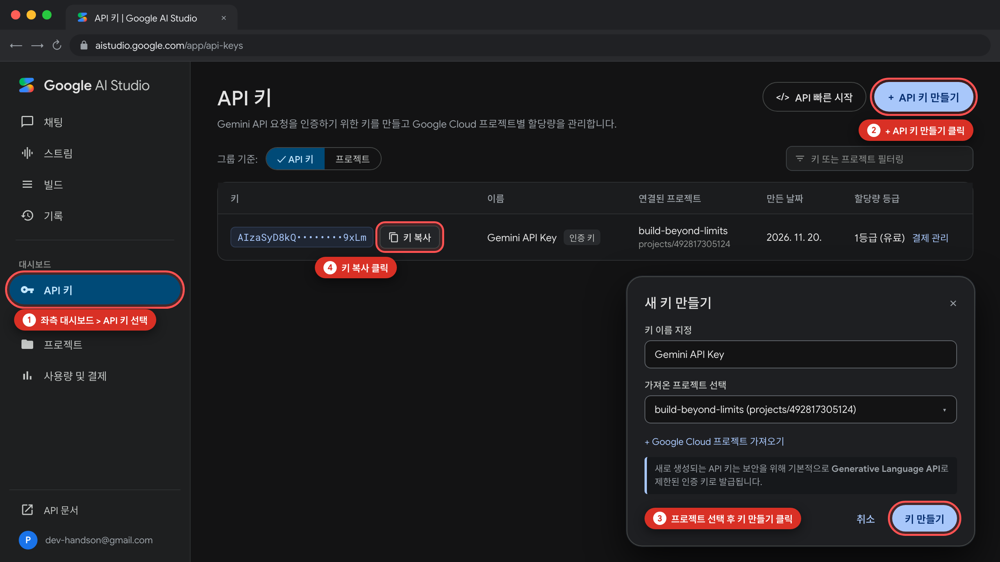
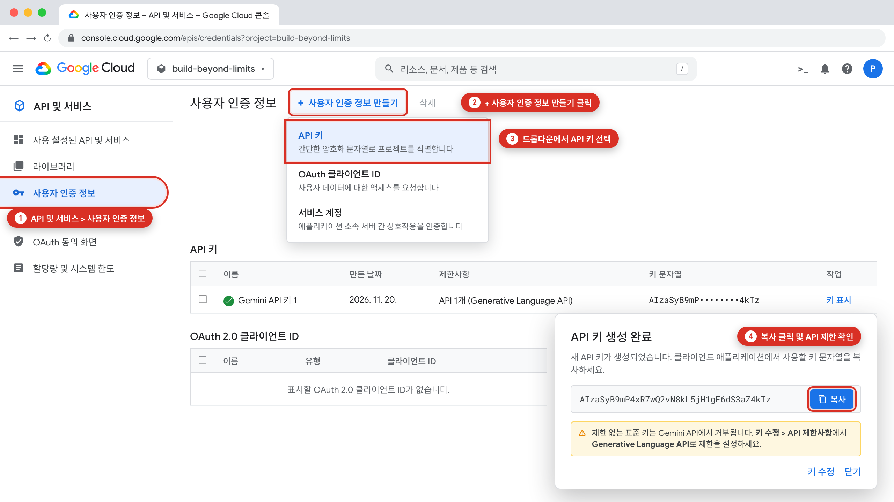

# 핸즈온 선행 준비 가이드 (Antigravity 설치 및 Gemini API 키 발급)

핸즈온 세션 시작 전에 아래 순서대로 필수 도구 설치, 인증 연결, 로컬 MCP 서버 동작 확인을 마쳐 주세요. 전체 소요 시간은 약 5~10분입니다.

---

## 1. 필수 런타임 확인

터미널(macOS/Linux 기본 터미널 또는 Windows PowerShell)을 열고 **Node.js 20 LTS 이상**과 **Git**이 설치되어 있는지 확인합니다.

```bash
node -v
git --version
```

- `node -v` 출력이 `v20.0.0` 미만이거나 명령어를 찾을 수 없다면 [Node.js 공식 다운로드 페이지](https://nodejs.org/en/download)에서 LTS 버전을 설치합니다.
- `git --version`이 출력되지 않는다면 [Git 다운로드 페이지](https://git-scm.com/downloads)에서 설치합니다.

---

## 2. 실습 리포지토리 클론

작업할 디렉터리에서 실습 리포지토리를 복제한 뒤 폴더로 이동합니다.

```bash
git clone https://github.com/KennethanCeyer/build-beyond-limits.git
cd build-beyond-limits
```

---

## 3. Google Antigravity CLI (`agy`) 설치

운영체제에 맞는 설치 명령어를 실행합니다.

### macOS 및 Linux

```bash
curl -fsSL https://antigravity.google/cli/install.sh | bash
```

### Windows PowerShell

```powershell
irm https://antigravity.google/cli/install.ps1 | iex
```

### Windows 명령 프롬프트 (`cmd`)

```cmd
curl -fsSL https://antigravity.google/cli/install.cmd -o install.cmd && install.cmd && del install.cmd
```

설치가 끝나면 **새 터미널 창**을 열어 정상 설치 여부를 확인합니다.

```bash
agy --version
agy --help
```

> 터미널 대신 GUI 에디터 환경을 선호한다면 [Antigravity 다운로드 페이지](https://antigravity.google/download)에서 데스크톱 IDE를 설치해 `build-beyond-limits` 폴더를 열어도 동일하게 진행할 수 있습니다.

---

## 4. 모델 인증 설정 (`OAuth` 또는 `Gemini API Key`)

아래 두 가지 방식 중 **하나만** 선택해 설정합니다.

### 방법 A. Google 계정 OAuth 로그인 (개인 노트북 권장)

1. 터미널에서 `agy`를 실행합니다.
2. 기본 브라우저가 열리면 Google 계정으로 로그인하고 권한을 승인합니다.
3. 다른 계정으로 전환할 때는 `agy` 프롬프트에서 `/logout`을 입력합니다.

### 방법 B. Gemini API 키 인증 (행사장 크레딧 · 원격 서버 환경)

`GEMINI_API_KEY` 환경 변수만 등록하면 OAuth 화면이 계속 표시되므로, 반드시 **`settings.json`의 `"modelProvider": "gemini"` 설정을 함께 지정**해야 합니다.

#### 4-1. Google AI Studio에서 발급받기 (가장 빠른 방법)

1. [Google AI Studio API 키 페이지](https://aistudio.google.com/apikey)에 접속합니다.
2. 좌측 `대시보드 > API 키` 메뉴에서 우측 상단 **`+ API 키 만들기`** 버튼을 클릭합니다.
3. 키 이름과 연결할 Google Cloud 프로젝트를 선택한 뒤 **`키 만들기`**를 누르고 생성된 `AIza...` 키를 복사합니다.



#### 4-2. Google Cloud 콘솔에서 발급받기 (GCP 크레딧 프로젝트 사용 시)

1. [Google Cloud 콘솔 사용자 인증 정보](https://console.cloud.google.com/apis/credentials) 페이지로 이동합니다.
2. 상단 **`+ 사용자 인증 정보 만들기 > API 키`**를 클릭해 키를 생성합니다.
3. [Generative Language API](https://console.cloud.google.com/apis/library/generativelanguage.googleapis.com)를 **사용 설정**한 뒤, `키 수정 > API 제한사항`에서 **`Generative Language API`**로 제한을 걸어 저장합니다.



#### 4-3. `settings.json` 및 환경 변수 등록

1. `~/.gemini/antigravity-cli/settings.json` 파일을 생성(또는 수정)하여 `"modelProvider": "gemini"`를 기록합니다.

   **macOS / Linux:**
   ```bash
   mkdir -p ~/.gemini/antigravity-cli
   cat << 'EOF' > ~/.gemini/antigravity-cli/settings.json
   {
     "modelProvider": "gemini"
   }
   EOF
   ```

   **Windows PowerShell:**
   ```powershell
   New-Item -ItemType Directory -Force -Path "$HOME\.gemini\antigravity-cli" | Out-Null
   '{"modelProvider":"gemini"}' | Set-Content -Encoding UTF8 "$HOME\.gemini\antigravity-cli\settings.json"
   ```

2. 터미널 세션(또는 `~/.zshrc`, `~/.bashrc`)에 발급받은 API 키를 등록합니다.

   **macOS / Linux:**
   ```bash
   export GEMINI_API_KEY="여기에_복사한_AIza_키_입력"
   ```

   **Windows PowerShell:**
   ```powershell
   $env:GEMINI_API_KEY="여기에_복사한_AIza_키_입력"
   ```

---

## 5. 로컬 MCP 서버 및 라이브 게임 서버 연결 점검

리포지토리 루트(`build-beyond-limits/`)에는 워크스페이스 MCP 설정 파일([`.agents/mcp_config.json`](../.agents/mcp_config.json))이 포함되어 있습니다. 아래 명령으로 MCP 등록과 라이브 서버 응답까지 한 번에 확인합니다.

```bash
cd build-beyond-limits

# 1) 라이브 게임 서버 상태 확인 (status: "ok" 응답 확인)
curl -s http://34.158.215.133:8080/api/health

# 2) 전역 MCP 목록에도 등록해 확인하고 싶은 경우 (선택)
agy mcp add --env BBL_SERVER_URL=http://34.158.215.133:8080 bbl-roguelike node ./mcp-server/index.mjs
agy mcp list

# 3) Gemini 4 모델 지정 단건 응답 테스트
agy --model gemini-4-neon-low -p "한 줄로 인사해 줘"
```



---

## 6. 시작 전 최종 체크리스트

- [ ] `node -v` 실행 시 `v20` 이상 버전 출력 확인하기
- [ ] `build-beyond-limits` 리포지토리 클론 완료하기
- [ ] `agy --version` 실행 확인 및 OAuth 또는 `GEMINI_API_KEY` + `settings.json` 인증 완료하기
- [ ] `curl http://34.158.215.133:8080/api/health` 호출 시 `"status":"ok"` 응답 확인하기
- [ ] `agy -p "안녕"` 실행 시 정상 응답 확인하기

---

## 자주 겪는 문제 해결

| 증상 | 원인 | 해결 방법 |
| :--- | :--- | :--- |
| `agy: command not found` | 설치 후 셸 `PATH` 미반영 | 새 터미널 창을 열거나 `source ~/.zshrc` (`~/.bashrc`) 실행 |
| `GEMINI_API_KEY`를 넣었는데 OAuth 창이 뜸 | `settings.json` 설정 누락 | `~/.gemini/antigravity-cli/settings.json`에 `{"modelProvider": "gemini"}` 추가 |
| GCP 콘솔에서 만든 API 키 호출 거부(`403`) | Generative Language API 미활성 또는 미제한 키 | 콘솔에서 `Generative Language API` 활성화 후 해당 API로 키 제한 설정 |
| `34.158.215.133:8080` 연결 시간 초과 | 사내 보안망·방화벽의 `8080` 포트 차단 | 행사장 Wi-Fi 또는 개인 핫스팟으로 전환 후 재시도 |
