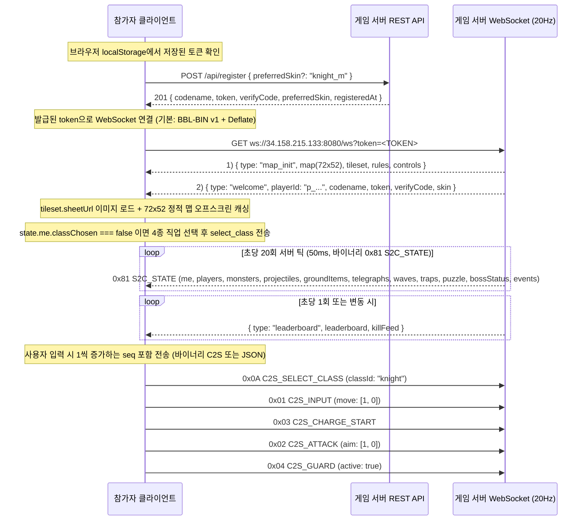

# Build Beyond Limits 네트워크 및 보안 프로토콜 명세 (v2.0)

라이브 게임 서버(`http://34.158.215.133:8080`, `ws://34.158.215.133:8080/ws`)의 접속 절차, 바이너리 패킷 레이아웃, JSON 스키마, 서버 검증 규칙을 정의합니다.

---

## 클라이언트 접속 및 통신 순서

클라이언트는 아래 순서대로 초기화하고 게임 루프를 실행합니다.



### 구현 순서 체크리스트
1. **계정 등록 (`POST /api/register`)**: 최초 1회 호출해 고유 코드네임, 비밀 인증 `token`, 6자리 검증 코드(`verifyCode`)를 발급받아 `localStorage`에 저장하기
2. **WebSocket 연결**: `ws://<HOST>:8080/ws?token=<token>`에 `ws.binaryType = 'arraybuffer'`로 연결하기 (기본값은 바이너리 `BBL-BIN v1` + `perMessageDeflate` 압축이며, 디버깅할 때만 `&encoding=json` 사용)
3. **`map_init` 처리**:
   - `map.width`(72), `map.height`(52), `map.tiles[y][x]`, `map.zones[]`, `map.bossArena`, `map.runePads[]`, `map.gateTiles[]`, `map.dartShooters[]` 저장하기
   - `httpBase + map_init.tileset.sheetUrl`(`/assets/tileset/dungeon_autotile_16x16.png?v=2.4`)로 이미지 불러오기(`img.crossOrigin = 'anonymous'`)
   - `tileset.sprites[key]`의 `{ x, y, w, h }`로 타일·캐릭터·몬스터·무기·방패·하트·물약 그리기
4. **`welcome` 처리**: `playerId`(`p_xxxxxxxxxxxx` 공개 식별자, `token`과 분리됨), `codename`, `verifyCode`, `skin`을 화면에 연결하고, `token`은 재접속용 비밀 키로만 로컬에 보관하기
5. **직업 선택 (`select_class`)**: `state.me.alive && !state.me.classChosen`일 때 4종 직업(`knight`, `ranger`, `mage`, `berserker`) 선택 창을 띄우고 `0x0A C2S_SELECT_CLASS`(또는 `{ type: "action", seq, action: "select_class", classId }`) 전송하기
6. **`state` 처리 (20Hz)**:
   - 수신한 `ArrayBuffer`의 `0x81 S2C_STATE` 바이너리 프레임을 디코딩해 `state.me`의 좌표, 체력(`hp`/`maxHp` 반칸 단위), 직업·주 무기 숙련, 남은 부활 횟수(`revivesLeft`), 분기형 스킬 트리(`skillTree.q` / `skillTree.r`), 가방, 장비, `ackSeq` 갱신하기
   - `state.events[]`는 해당 틱에 1회만 오므로 즉시 시각·오디오 효과 큐에 넣어 재생하기
7. **입력 전송 (`input` / `action`)**:
   - 이동 벡터는 **방향이 바뀔 때만** `0x01 C2S_INPUT`(7바이트) 또는 `type: "input"`으로 전송하기(초당 60개 메시지 제한)
   - 모든 메시지에 1씩 증가하는 `seq`를 담아 보내고, 서버가 처리한 최신 번호를 `state.me.ackSeq`로 확인하기

---

## 아키텍처 및 서버 검증 원칙

| 항목 | 서버 처리 방식 |
| :--- | :--- |
| 이동·충돌 | 클라이언트는 좌표를 직접 보낼 수 없습니다. 서버가 `move: [dx, dy]`를 `[-1, 1]` 범위로 정규화한 뒤 20Hz 루프에서 이동 속도와 벽 충돌을 직접 계산합니다. |
| 인증 분리 및 단일 세션 | 접속 인증용 `token`과 공개 식별자 `playerId`(`p_...`)가 분리되어 있어 타인의 인증 토큰이 브로드캐스트나 MCP 조회에 노출되지 않습니다. 같은 토큰으로 새 소켓을 열면 기존 소켓은 종료 코드 `4002`로 닫힙니다. |
| 쿨다운 및 행동 잠금 | 공격(`360ms`), 대시(`2100ms`), 스킬(`Q`/`R`), 장비 교체(`150ms`), 줍기(`160ms`), 소비 아이템(`240ms`), 패링 재장전(`750ms`) 대기시간을 모두 서버 시계로 검증하며, 대시 진행 중(`200ms`)에는 공격·방어·스킬·재대시가 막힙니다. |
| 회피·패링 및 강공격 판정 | 대시 회피 무적(`280ms`, 대시 `200ms` + 네트워크 유예 `80ms`)은 실제 대시 구간에서만 인정되며 보스 충격파(`dash_dodge`)도 해당 구간 밖에서는 회피로 인정되지 않습니다. 패링(`0.32초`, 수호기사 `0.42초`)은 바라보는 방향 기준 전방 `120도` 내 근접·원거리 공격(속도 벡터 기준 선분 충돌, 방패 요격 반경 `1.05`타일, 동일 투사체 반사)과 방향 무관 광역 장판 패턴에 발동합니다. 방패 장착 중 일반 원거리 투사체를 막으면(`0.85`타일 요격) `Math.floor` 경감을 적용해 피해 `0`으로 완전히 막아낼 수 있습니다. 강공격은 클라이언트가 보낸 `charge` 값을 무시하고 `charge_start` 수신 이후 서버 경과 시간(`>= 550ms * 0.65 ≈ 358ms`, 공격 대기시간 중 예약 불가)으로만 판정합니다. |
| 아이템·직업 검증 | 모든 아이템은 서버 발급 ID(`item_xxxxxxxx`)로 관리되며 방어구 교체로 체력이 회복되지 않습니다. 직업 선택(`select_class`)은 탐험당 1회만 허용되고, 부활을 모두 소진해 초기화되거나 `restart_run`으로 다시 시작할 때 다시 열립니다. |
| 패킷 제한 | 소켓당 최대 페이로드 `1024 bytes`, 초당 최대 `60`개 메시지로 제한됩니다. 혼잡 소켓(`bufferedAmount > 32KB`)은 오래된 틱을 건너뛰어 지연 누적을 막습니다. |

---

## REST API 명세

Base URL: `http://34.158.215.133:8080/api`

### `GET /api/health`
```json
{
  "status": "ok",
  "service": "build-beyond-limits-server",
  "tickRate": 20,
  "onlinePlayers": 14,
  "bossAlive": true,
  "bossTier": 1,
  "pvpEnabled": false
}
```

### `POST /api/register`
- Request Body (optional): `{ "preferredSkin": "knight_m" }`
- 허용 `preferredSkin`: `knight_m`, `knight_f`, `wizzard_m`, `wizzard_f`, `elf_m`, `elf_f`, `dwarf_m`, `lizard_m`
- Response (`201 Created`):
```json
{
  "codename": "Crimson-Blade-42",
  "token": "6d2e89d1-3d2a-4c9a-9e87-9f281a241b02",
  "verifyCode": "A7F9K2",
  "preferredSkin": "knight_m",
  "registeredAt": "2026-11-19T03:00:00.000Z"
}
```

### `GET /api/map`
`map_init.map`과 동일한 구조(`width`, `height`, `tiles`, `zones`, `bossArena`, `runePads`, `gateTiles`, `dartShooters`)를 반환합니다. `Accept-Encoding: gzip` 요청 시 사전 압축된 `gzip` 응답을 전달합니다.

### `GET /api/tileset` / `GET /api/leaderboard`
통합 512×640 타일셋 매니페스트(`/api/tileset` 역시 사전 압축 `gzip` 지원)와 실시간 리더보드를 조회합니다.

### `POST /api/submit`
```json
{
  "missionId": "mission-1",
  "token": "6d2e89d1-3d2a-4c9a-9e87-9f281a241b02",
  "clientStyle": "pixel-autotile",
  "checksPassed": ["client-test", "client-build", "server-health"],
  "note": "초기 접속 및 커스텀 HUD 구현"
}
```

---

## WebSocket 메시지 스키마

- 플레이어 접속 (기본값: 바이너리 `BBL-BIN v1` + RFC 7692 `perMessageDeflate` 압축): `ws://34.158.215.133:8080/ws?token=<token>&skin=<optionalSkin>`
- 플레이어 접속 (디버깅용 JSON 선택): `ws://34.158.215.133:8080/ws?token=<token>&encoding=json`
- 지연 시간 측정: 바이너리 `0x0F C2S_PING` (5바이트) -> `0x8F S2C_PONG` (9바이트), 또는 JSON `{ "type": "ping" }` -> `{ "type": "pong", "serverTime": ... }`

---

## 바이너리 패킷 및 압축 전송 (`BBL-BIN v1` + `perMessageDeflate`)

- `/ws` 엔드포인트 기본값은 리틀 엔디안 바이너리 프레임(`BBL-BIN v1`) + RFC 7692 `perMessageDeflate` 슬라이딩 윈도우 압축입니다.
- 클라이언트에서 `ws.binaryType = 'arraybuffer'`를 지정하면 초기 제어 메시지(`map_init`, `welcome`, 1Hz `leaderboard`)는 텍스트 JSON으로, 20Hz 상태(`0x81`)와 `pong`(`0x8F`)은 바이너리 `ArrayBuffer`로 수신됩니다(브라우저가 `perMessageDeflate` 압축 해제를 자동 수행).
- 디버깅 시 평문 JSON이 필요하면 `?encoding=json` 쿼리를 붙입니다. C2S 송신은 어느 모드에서나 바이너리와 JSON(`type: "input" | "action" | "ping"`)을 모두 수락합니다.

### 실측 패킷 크기 비교 (플레이어 10명 · 몬스터 25마리 기준)

| 메시지 | 평문 JSON | 바이너리 (`BBL-BIN v1`) | 바이너리 + Deflate 압축 | 총 절감률 |
| :--- | :---: | :---: | :---: | :---: |
| 20Hz 월드 상태 (`state` + `me`) | `22,213 bytes` | `4,258 bytes` (`-80.8%`) | `2,658 bytes` (슬라이딩 윈도우 시 더 축소) | **88.0% 이상 절감 (8.4배 축소)** |
| 이동 입력 (`input`) | `38 bytes` | `7 bytes` | `7 bytes` (`<256B` 임계값 미만, 압축 생략) | **81.6% 절감 (5.4배 축소)** |
| `ping` / `pong` | `15 / 38 bytes` | `5 / 9 bytes` | `5 / 9 bytes` | **75% 절감** |

### 양자화 및 문자열 풀 규칙
- **월드 좌표 `(x, y)`**: `uint16` = `Math.round(v * 100)` (`0.01` 타일 정밀도, 최대 `655.35` 타일, 2바이트)
- **단위 방향 벡터 `(dx, dy)`**: `int8` = `Math.round(v * 100)` (`-100..100`, 1바이트)
- **속도 `(vx, vy)`**: `int16` = `Math.round(v * 100)` (2바이트)
- **비율 (`charge`, `progress`, `fadeAlpha`, `critChance`, `blockReduction`)**: `uint8` (`0..100`, 1바이트)
- **StringPool**: `S2C_STATE` 프레임 안의 반복 문자열(스프라이트 키, 색상, 몬스터 이름 등)을 헤더 직후 풀에 1회만 저장하고 엔티티 레코드에서는 `uint16` 인덱스로 참조합니다.

### Client -> Server 패킷 다이어그램 (`C2S_*`)

```text
0                   1                   2                   3
0 1 2 3 4 5 6 7 8 9 0 1 2 3 4 5 6 7 8 9 0 1 2 3 4 5 6 7 8 9 0 1
+-+-+-+-+-+-+-+-+-+-+-+-+-+-+-+-+-+-+-+-+-+-+-+-+-+-+-+-+-+-+-+-+
|   op (u8)     |              seq (u32, LE) [bytes 1..4]       |
+-+-+-+-+-+-+-+-+-+-+-+-+-+-+-+-+-+-+-+-+-+-+-+-+-+-+-+-+-+-+-+-+
| seq (cont.)   |        Opcode-specific payload bytes ...      |
+-+-+-+-+-+-+-+-+-+-+-+-+-+-+-+-+-+-+-+-+-+-+-+-+-+-+-+-+-+-+-+-+
```

| Opcode | 이름 | 바이트 레이아웃 (Little-Endian) | 전체 크기 |
| :---: | :--- | :--- | :---: |
| `0x01` | `C2S_INPUT` | `[0] u8 op` \| `[1..4] u32 seq` \| `[5] i8 moveX(-100..100)` \| `[6] i8 moveY(-100..100)` | **7 B** |
| `0x02` | `C2S_ATTACK` | `[0] u8 op` \| `[1..4] u32 seq` \| `[5] u8 charge(0..100)` \| `[6] i8 aimX` \| `[7] i8 aimY` \| `[8] u8 hasAim(0\|1)` | **9 B** |
| `0x03` | `C2S_CHARGE_START` | `[0] u8 op` \| `[1..4] u32 seq` | **5 B** |
| `0x04` | `C2S_GUARD` | `[0] u8 op` \| `[1..4] u32 seq` \| `[5] u8 active(0\|1)` | **6 B** |
| `0x05` | `C2S_DASH` | `[0] u8 op` \| `[1..4] u32 seq` \| `[5] i8 dirX` \| `[6] i8 dirY` \| `[7] u8 hasDir(0\|1)` | **8 B** |
| `0x06` | `C2S_SKILL` | `[0] u8 op` \| `[1..4] u32 seq` \| `[5] u8 slot(0=q,1=r)` \| `[6] i8 aimX` \| `[7] i8 aimY` \| `[8] u8 hasAim` | **9 B** |
| `0x07` | `C2S_PICKUP` | `[0] u8 op` \| `[1..4] u32 seq` | **5 B** |
| `0x08` | `C2S_USE_SLOT` | `[0] u8 op` \| `[1..4] u32 seq` \| `[5] u8 slot(0..2)` | **6 B** |
| `0x09` | `C2S_ALLOCATE_STAT` | `[0] u8 op` \| `[1..4] u32 seq` \| `[5] u8 stat(0=str,1=vit,2=agi)` | **6 B** |
| `0x0A` | `C2S_SELECT_CLASS` | `[0] u8 op` \| `[1..4] u32 seq` \| `[5] u8 classIdx(0=knight,1=ranger,2=mage,3=berserker)` | **6 B** |
| `0x0B` | `C2S_LEARN_SKILL` | `[0] u8 op` \| `[1..4] u32 seq` \| `[5] u8 slot(0=q,1=r)` \| `[6] u8 skillIdx(1..6)` | **7 B** |
| `0x0C` | `C2S_ITEM_ACTION` | `[0] u8 op` \| `[1..4] u32 seq` \| `[5] u8 subOp(0=equip,1=use_item,2=drop_item,3=pickup)` \| `[6] u8 len` \| `[7..] utf8 itemId` | **7+N B** |
| `0x0D` | `C2S_RESTART_RUN` | `[0] u8 op` \| `[1..4] u32 seq` | **5 B** |
| `0x0F` | `C2S_PING` | `[0] u8 op` \| `[1..4] u32 clientTs` | **5 B** |

### Server -> Client 패킷 다이어그램 (`0x81 S2C_STATE`, `0x8F S2C_PONG`)

```text
0x8F S2C_PONG (9 bytes):
+---------------+---------------------------------------------------------------+
| [0] op = 0x8F | [1..8] serverTime (float64, Little-Endian)                    |
+---------------+---------------------------------------------------------------+

0x81 S2C_STATE (Shared World Prefix encoded ONCE per tick + per-player `me` suffix):
+--------+--------+-----------------------+---------------+--------+------------+
| [0] op | [1] ver| [2..9] serverTime(f64)| [10..13] tick | [14] F | [15..16] N |
|  0x81  |   0x01 |      Unix ms          |     (u32)     | flags  | poolCount  |
+--------+--------+-----------------------+---------------+--------+------------+
| StringPool: (N - 1) entries of [u16 byteLen | utf8 bytes]  (N >= 1, idx 0 = "") |
+-------------------------------------------------------------------------------+
| Players:      u16 count | count × 36B fixed record                            |
| Monsters:     u16 count | count × 33B fixed record                            |
| Projectiles:  u16 count | count × 13B fixed record                            |
| Waves:        u8  count | count × 15B fixed record                            |
| Traps:        u16 count | count ×  4B fixed record [u8 x|u8 y|u8 phase|u8 fr] |
| Telegraphs:   u8  count | count × 22B fixed record                            |
| GroundItems:  u16 count | count × [u16 id|u16 x|u16 y|u8 fade|ItemRecord]     |
| Puzzle:       (if F.bit1) flags, clueStr, litRunes[], pads[], lastWrongAt     |
| BossStatus:   flags, tier, nextTier, bossUuidStr, nameStr, nextBossInMs, ...  |
| Timer:        (if F.bit2) u16 labelStr, u32 remainingMs, u16 durationSec      |
| Events:       u16 count | (if count > 0: u32 jsonByteLen + utf8 bytes)        |
+-------------------------------------------------------------------------------+
| Private `me`: (if F.bit3) self-contained binary player stats, skillTree,      |
|               equipment[3], inventory[], buffs[], counters, zone              |
+-------------------------------------------------------------------------------+
```

- **헤더 플래그 `[14] F`**: `bit0=pvpEnabled`, `bit1=hasPuzzle`, `bit2=hasTimer`, `bit3=hasMe`
- **50인 브로드캐스트 최적화**: 공유 월드 영역(헤더~Events)을 틱당 1회만 바이너리 인코딩하고, 각 플레이어 소켓에는 개인 `me` 바이트만 뒤에 이어 붙여(`bit3` 활성화) 전송합니다.

#### 고정 크기 엔티티 레코드 필드 순서

| 레코드 | 크기 | 필드 순서 (Little-Endian) |
| :--- | :---: | :--- |
| **Players** | `36 B` | `u16 idStr`, `u16 codenameStr`, `u8 skinIdx`, `u16 x100`, `u16 y100`, `i8 dirX100`, `i8 dirY100`, `u16 flags`, `u8 charging100`, `u16 invulnMs`, `u8 hp`, `u8 maxHp`, `u8 level`, `u16 respawnInMs`, `u8 weaponClassIdx`, `u8 weaponRarityIdx`, `u16 weaponSpriteStr`, `u8 shieldRarityIdx`, `u16 shieldSpriteStr`, `u16 bossKills`, `u32 bossDamage`, `u16 pvpKills`<br>플래그(`u16`): `bit0=facingLeft`, `bit1=moving`, `bit2=dashing`, `bit3=attacking`, `bit4=guarding`, `bit5=parrying`, `bit6=hit`, `bit7=invulnerable`, `bit8=alive` |
| **Monsters** | `33 B` | `u16 idStr`, `u16 uuidStr`, `u16 typeStr`, `u8 archIdx`, `u8 aiStateIdx`, `u8 windupKindIdx`, `u8 windupProg100`, `i8 windupDirX100`, `i8 windupDirY100`, `u8 flags`, `u16 nameStr`, `u16 spriteBaseStr`, `u16 projColorStr`, `u16 auraColorStr`, `u8 tier`, `u8 bossTier`, `u8 phase`, `u8 size100`, `u16 x100`, `u16 y100`, `u16 hp`, `u16 maxHp`<br>플래그(`u8`): `bit0=stunned`, `bit1=slowed`, `bit2=vulnerable`, `bit3=singleAnim`, `bit4=isBoss`, `bit5=hit`, `bit6=facingLeft`, `bit7=moving`<br>`auraColorStr` 형식: 빈 문자열 `""`이면 `null`, 색상이 있으면 `"rgb:R,G,B"` (예: `"rgb:205,52,42"` -> `[205, 52, 42]`) |
| **Projectiles** | `13 B` | `u16 idStr`, `u16 x100`, `u16 y100`, `i16 vx100`, `i16 vy100`, `u8 kindAndHeavy` (`bits0..2=kind`, `bit7=heavy`), `u16 colorStr` |
| **Waves** | `15 B` | `u16 idStr`, `u16 labelStr`, `u16 x100`, `u16 y100`, `u16 radius100`, `u16 maxRadius100`, `u8 bandWidth100`, `u16 colorStr` |
| **Traps** | `4 B` | `u8 x`, `u8 y`, `u8 phaseIdx`, `u8 frame` |
| **Telegraphs** | `22 B` | `u16 idStr`, `u16 patternStr`, `u16 labelStr`, `u8 shapeIdx`, `u16 x100`, `u16 y100`, `u16 p1_100`, `u16 p2_100`, `u8 bX1`, `u8 bY1`, `u8 bX2`, `u8 bY2`, `u8 damage`, `u8 progress100`, `u8 triggered`<br>`shapeIdx`별 `p1_100`/`p2_100` 해석 (`×100` 양자화, 디코딩 시 `/100`): `0=circle` -> `radius=p1_100/100` (`p2=0`), `1=cross` -> `halfWidth=p1_100/100` 및 `bounds={x1:bX1, y1:bY1, x2:bX2, y2:bY2}`, `2=ring` -> `innerRadius=p1_100/100`, `outerRadius=p2_100/100` |

### 바이너리 열거형 인덱스표 및 가변 레코드 레이아웃

클라이언트에서 직접 `DataView` / `Uint8Array` 디코더와 인코더를 작성할 때 아래 인덱스표와 가변 레코드 순서를 그대로 사용하면 됩니다.

#### 열거형 인덱스 (`u8`)

| 열거형 | 인덱스 매핑 |
| :--- | :--- |
| `SKINS` | `0=knight_m`, `1=knight_f`, `2=wizzard_m`, `3=wizzard_f`, `4=elf_m`, `5=elf_f`, `6=dwarf_m`, `7=lizard_m` |
| `WEAPON_CLASSES` | `0=melee`, `1=bow`, `2=staff` |
| `RARITIES` | `0=null`, `1=common(일반)`, `2=rare(희귀)`, `3=unique(유니크)`, `4=legendary(전설)` |
| `CLASSES` | `0=knight`, `1=ranger`, `2=mage`, `3=berserker` |
| `SKILLS` | `0=null`, `1=crimson_tempest`, `2=frost_nova`, `3=phantom_lunge`, `4=abyssal_lance`, `5=solar_judgment`, `6=soul_reaver` |
| `ARCHETYPES` | `0=skirmisher`, `1=bruiser`, `2=ranged`, `3=elite`, `4=boss` |
| `AI_STATES` | `0=patrol`, `1=combat`, `2=windup`, `3=recovery`, `4=leash` |
| `WINDUP_KINDS` | `0=null`, `1=melee`, `2=ranged`, `3=cinder_barrage` |
| `PROJ_KINDS` | `0=undefined(orb)`, `1=arrow`, `2=arcane`, `3=dart` |
| `TRAP_PHASES` | `0=idle`, `1=armed`, `2=extended`, `3=cooldown` |
| `TEL_SHAPES` | `0=circle`, `1=cross`, `2=ring` |
| `ITEM_KINDS` | `0=weapon`, `1=armor`, `2=shield`, `3=consumable`, `4=instant_heart` |
| `BUFF_TYPES` | `0=berserk`, `1=swiftness` |
| `ROLL_GRADES` | `0=null`, `1=하급`, `2=중급`, `3=상급`, `4=최상급` |
| `STATS` / `ITEM_SUB_OPS` | `STATS`: `0=str`, `1=vit`, `2=agi` / `ITEM_SUB_OPS`: `0=equip`, `1=use_item`, `2=drop_item`, `3=pickup` |

#### `ItemRecord` 가변 레이아웃
공유 풀 모드(`groundItems`)에서는 모든 `str` 필드를 StringPool `u16` 인덱스로, 개인 `me` 내부(`equipment`, `inventory`)에서는 `str8`(`u8 len + utf8`)로 기록합니다. `rarityLabel`은 별도로 전송하지 않으며 `rarityIdx`에서 파생(`1=일반`, `2=희귀`, `3=유니크`, `4=전설`)합니다.
1. 공통 헤더: `str id`, `str templateId`, `str name`, `str spriteKey`, `str color`, `str summary`, `u8 kindIdx`, `u8 rarityIdx`, `u16 fieldMask`
2. `fieldMask` 비트가 켜진 순서대로 선택 필드 추가:
   - `bit0`: `u8 weaponClassIdx` / `bit1`: `u16 atkBonus` / `bit2`: `u8 critBonus100` / `bit3`: `u16 splashRadius100`
   - `bit4`: `u8 heartBonus` / `bit5`: `u8 blockReduction100` / `bit6`: `u16 parryReflectMult100` / `bit7`: `u8 healHearts`
   - `bit8`: `u8 grantSkillPoint` / `bit9`: `u8 grantRevive` / `bit10`: `u8 buffTypeIdx, u16 buffDurationMs` / `bit11`: `u8 rollQuality, u8 rollGradeIdx`
   - `bit12`: `u8 rmask` (`bit0`: `u16[2] atkRange`, `bit1`: `u8[2] critRange100`, `bit2`: `u16[2] splashRange100`, `bit3`: `u8[2] heartRange`, `bit4`: `u8[2] blockRange100`, `bit5`: `u16[2] parryRange100`, `bit6`: `u8[2] defRange`)
   - `bit13`: `u16 projSpeed100, str projColor` / `bit14`: `u8 defBonus` / `bit15`: `str effectKey, str effectName, str effectDesc`

#### `Puzzle`, `BossStatus`, `Private me` 가변 레이아웃
- **`Puzzle` (`F.bit1=1`)**: `u8 flags(bit0=solved, bit1=gateOpen)`, `u16 clueStr`, `u8 total`, `u8 litLen`, `u16[litLen] litRuneStrs`, `u8 padLen`, `padLen × (u16 id, u16 label, u16 color, u8 x, u8 y)`, `f64 lastWrongAt`
- **`BossStatus`**: `u8 flags(bit0=alive, bit1=hasKilledBy)`, `u8 tier`, `u8 nextTier`, `u16 bossUuidStr`, `u16 nameStr`, `u32 nextBossInMs` + (`bit1=1`일 때 `u16 codenameStr`, `u16 verifyCodeStr`, `u16 heroicItemStr`)
- **바이너리 경량 생략 참고**: 20Hz 대역폭 절감을 위해 바이너리 프레임에서는 `telegraphs[]`의 타임스탬프(`createdAt`/`activatesAt`/`expiresAt`, `progress`로 대체)와 `bossStatus`의 부가 메타(`killedAt`, `nextBossAt`, `heroicDrop`, `killedBy` 내부의 상세 DPS 항목)가 생략됩니다.
- **`Private me` (`F.bit3=1`, 문자열은 모두 `str8`)**:
  - 기본 정보: `id`, `codename`, `verifyCode`, `u8 classIdx`, `className`, `u8 prefWpnClassIdx`, `prefWpnLabel`, `masteryDesc`, `u8 skinIdx`, `u32 ackSeq`
  - 좌표·전투 수치: `u16 x100`, `u16 y100`, `i8 dirX100`, `i8 dirY100`, `u8 hp`, `u8 maxHp`, `u16 atk`, `u16 def`, `u8 blockRed100`, `u16 moveSpeed100`, `u8 crit100`
  - 성장·상태: `u8 level`, `u32 xp`, `u32 xpToNext`, `u8 statPoints`, `u8 skillPoints`, `u8 str`, `u8 vit`, `u8 agi`, `u8 revivesLeft`, `u16 meFlags(bit0=classChosen, bit1=weaponMasteryActive, bit2=alive, bit3=hit, bit4=guarding, bit5=parrying, bit6=dashing, bit7=invulnerable, bit8=inSafeZone, bit9=hasLastRunSummary)`
  - 타이머·재사용 대기시간: `u8 charging100`, `u16 invulnMs`, `u16 respawnInMs`, `u16 dashCdMs`, `u16 dashMaxCdMs`, `u16 atkCdMs` + (`bit9=1`일 때 `u8 reachedLevel`, `u16 mobKills`, `u16 bossKills`, `f64 endedAt`)
  - 스킬·장비·가방·전적: `2 × SkillSlot(u8 skillIdx, str8 name, u8 lv, u8 maxLv, u16 cdMs, u16 maxCdMs)`, `u8 eqMask(bit0=weapon, bit1=shield, bit2=armor) + ItemRecords`, `u8 invLen + ItemRecords`, `u8 buffLen + buffLen × (u8 typeIdx, u16 remMs)`, `u16 mobKills`, `u16 bossKills`, `u16 pvpKills`, `u32 bossDamage`, `u16 bossDps`, `str8 zone`

### Server -> Client: `map_init` (접속 직후 1회)
```json
{
  "type": "map_init",
  "protocolVersion": "2.0",
  "map": {
    "width": 72,
    "height": 52,
    "tiles": [[0, 2, 1]],
    "zones": [
      { "id": "sanctuary", "name": "성소", "x1": 3, "y1": 39, "x2": 14, "y2": 47 },
      { "id": "seal_sanctum", "name": "봉인의 제단", "x1": 40, "y1": 4, "x2": 51, "y2": 15 },
      { "id": "boss_arena", "name": "왕좌", "x1": 53, "y1": 3, "x2": 68, "y2": 17 }
    ],
    "bossArena": { "x1": 53, "y1": 3, "x2": 68, "y2": 17, "centerX": 60.5, "centerY": 10.0 },
    "runePads": [
      { "id": "blue", "label": "청의 룬", "color": "#58b4ff", "x": 42, "y": 10 }
    ],
    "gateTiles": [
      { "x": 52, "y": 8 }, { "x": 52, "y": 9 }, { "x": 52, "y": 10 }, { "x": 52, "y": 11 }
    ],
    "dartShooters": [
      { "x": 45.5, "y": 28.5, "vx": 8.5, "vy": 0, "intervalMs": 2200 }
    ]
  },
  "tileset": {
    "name": "0x72_DungeonAutotile_16x16",
    "sheetUrl": "/assets/tileset/dungeon_autotile_16x16.png?v=2.4",
    "sheetWidth": 512,
    "sheetHeight": 640,
    "tileSize": 16,
    "tileTypes": {},
    "sprites": {},
    "renderingHints": {}
  },
  "rules": {
    "tickRate": 20,
    "respawnMs": 3000,
    "bossRespawnMs": 180000,
    "pvpEnabled": false,
    "heartSystem": { "baseMaxHalfHearts": 6, "unitsPerFullHeart": 2, "levelUpHealHalfHearts": 1, "vitPerHalfHeart": 3, "maxVitHalfHearts": 4 },
    "roguelikePermadeath": { "startingRevives": 1, "maxRevives": 3, "rareReviveItem": "phoenix_feather" },
    "classCatalog": {},
    "skillCatalog": {},
    "attackRange": 2.35,
    "attackArcDeg": 140,
    "attackCooldownMs": 360,
    "heavyChargeMs": 550,
    "dashDurationMs": 200,
    "dashCooldownMs": 2100,
    "dashIframesMs": 280,
    "hitIframesMs": 650,
    "parryWindowMs": 320,
    "parryArcDeg": 120,
    "parryRearmMs": 750,
    "equipCooldownMs": 150,
    "guardSpeedMult": 0.52,
    "itemUnattendedDespawnMs": 5000,
    "trapArmMs": 380,
    "trapExtendMs": 950,
    "pickupRange": 1.9,
    "maxInventorySlots": 10,
    "statPointsPerLevel": 1,
    "skillPointEveryNLevels": 3,
    "skillMaxLevel": 10,
    "maxMessagesPerSec": 60
  },
  "controls": {
    "move": ["ArrowUp", "ArrowDown", "ArrowLeft", "ArrowRight", "KeyW", "KeyA", "KeyS", "KeyD"],
    "attack": ["Space", "KeyJ"],
    "guard": ["KeyC", "KeyL", "RightClick"],
    "dash": ["ShiftLeft", "ShiftRight", "KeyK"],
    "skills": ["KeyQ", "KeyR"],
    "pickup": ["KeyE", "KeyF"],
    "useConsumable": ["Digit1", "Digit2", "Digit3"]
  }
}
```

### Server -> Client: `welcome` (접속 직후 1회)
```json
{
  "type": "welcome",
  "playerId": "p_9f4a21c8e0b3",
  "codename": "Crimson-Blade-42",
  "token": "6d2e89d1-3d2a-4c9a-9e87-9f281a241b02",
  "verifyCode": "A7F9K2",
  "skin": "knight_m"
}
```

### Server -> Client: `state` (초당 20회, 기본 바이너리 `0x81 S2C_STATE` + Deflate)

> 기본 연결(`/ws?token=...`)에서는 위 `0x81 S2C_STATE` 바이너리 프레임에 RFC 7692 `perMessageDeflate` 압축을 적용해 전송합니다. 아래 JSON 구조는 바이너리 프레임을 디코딩했을 때 얻어지는 논리 객체(또는 `?encoding=json` 디버깅 연결의 응답 구조)입니다.

```json
{
  "type": "state",
  "serverTime": 1795062000123,
  "tick": 1420,
  "pvpEnabled": false,
  "puzzle": {
    "solved": false,
    "clue": "추리 단서 문구",
    "litRunes": ["blue"],
    "total": 4,
    "pads": [{ "id": "blue", "label": "청의 룬", "color": "#58b4ff", "x": 42, "y": 10 }],
    "gateOpen": false,
    "lastWrongAt": 0
  },
  "me": {
    "id": "p_9f4a21c8e0b3",
    "codename": "Crimson-Blade-42",
    "verifyCode": "A7F9K2",
    "classId": "knight",
    "className": "수호기사",
    "classChosen": true,
    "preferredWeaponClass": "melee",
    "preferredWeaponLabel": "근접 무기",
    "weaponMasteryActive": true,
    "weaponMasteryDesc": "근접 무기 장착 시 공격력 +15%, 치명타 확률 +5%, 막기 피해 감소 +5%",
    "revivesLeft": 1,
    "lastRunSummary": null,
    "skin": "knight_m",
    "ackSeq": 47,
    "x": 28.5,
    "y": 26.1,
    "dirX": 1,
    "dirY": 0,
    "hp": 8,
    "maxHp": 8,
    "atk": 29,
    "def": 6,
    "blockReduction": 0.72,
    "moveSpeed": 5.4,
    "critChance": 0.15,
    "level": 3,
    "xp": 45,
    "xpToNext": 139,
    "statPoints": 1,
    "skillPoints": 1,
    "stats": { "str": 2, "vit": 0, "agi": 0 },
    "alive": true,
    "hit": false,
    "guarding": false,
    "parrying": false,
    "dashing": false,
    "charging": 0,
    "invulnerable": false,
    "invulnerableMs": 0,
    "respawnInMs": 0,
    "dashCooldownMs": 0,
    "dashMaxCooldownMs": 2100,
    "attackCooldownMs": 0,
    "skillTree": {
      "q": { "id": "crimson_tempest", "name": "핏빛 선풍", "level": 1, "maxLevel": 10, "cooldownMs": 0, "maxCooldownMs": 5200 },
      "r": { "id": null, "name": null, "level": 0, "maxLevel": 10, "cooldownMs": 0, "maxCooldownMs": 0 }
    },
    "equipment": {
      "weapon": {
        "id": "item_a1b2c3d4",
        "templateId": "knight_greatsword",
        "name": "기사 대검",
        "kind": "weapon",
        "weaponClass": "melee",
        "rarity": "rare",
        "rarityLabel": "희귀",
        "atkBonus": 18,
        "critBonus": 0.06,
        "effectKey": "heavy_cleave",
        "effectName": "묵직한 베기",
        "effectDesc": "강공격 피해 +18%",
        "rollQuality": 67,
        "rollGrade": "상급",
        "rollMeta": { "atkRange": [15, 22], "critRange": [0.06, 0.12] },
        "spriteKey": "weapon_knight_sword",
        "color": "#5ea6e0",
        "summary": "공격력 +18, 치명타 확률 +6% · [묵직한 베기]"
      },
      "shield": {
        "id": "item_22334455",
        "templateId": "iron_buckler",
        "name": "철제 버클러",
        "kind": "shield",
        "rarity": "rare",
        "rarityLabel": "희귀",
        "blockReduction": 0.64,
        "parryReflectMult": 0.45,
        "effectKey": "parry_nova",
        "effectName": "반격 파동",
        "effectDesc": "패링 성공 시 반경 2.8타일 적 기절 및 충격파",
        "rollQuality": 58,
        "rollGrade": "중급",
        "rollMeta": { "blockRange": [0.58, 0.69], "parryRange": [0.32, 0.48] },
        "spriteKey": "shield_iron",
        "color": "#5ea6e0",
        "summary": "막기 피해 감소 64% · [반격 파동]"
      },
      "armor": null
    },
    "inventory": [
      {
        "id": "item_11223344",
        "templateId": "health_potion",
        "name": "치유 물약",
        "kind": "consumable",
        "rarity": "common",
        "rarityLabel": "일반",
        "healHearts": 3,
        "spriteKey": "flask_red",
        "color": "#b8b0a4",
        "summary": "하트 +1.5"
      }
    ],
    "buffs": [{ "type": "berserk", "remainingMs": 8400 }],
    "mobKills": 6,
    "bossKills": 0,
    "pvpKills": 0,
    "bossDamage": 420,
    "bossDps": 68,
    "zone": "회랑",
    "inSafeZone": false
  },
  "players": [
    {
      "id": "p_9f4a21c8e0b3",
      "codename": "Crimson-Blade-42",
      "skin": "knight_m",
      "x": 28.5,
      "y": 26.1,
      "dirX": 1,
      "dirY": 0,
      "facing": "right",
      "moving": true,
      "dashing": false,
      "attacking": false,
      "charging": 0,
      "guarding": false,
      "parrying": false,
      "hit": false,
      "invulnerable": false,
      "invulnerableMs": 0,
      "hp": 8,
      "maxHp": 8,
      "level": 3,
      "alive": true,
      "respawnInMs": 0,
      "weaponRarity": "rare",
      "weaponSprite": "weapon_knight_sword",
      "weaponClass": "melee",
      "shieldSprite": "shield_iron",
      "shieldRarity": "rare",
      "bossKills": 0,
      "bossDamage": 420,
      "pvpKills": 0
    }
  ],
  "monsters": [
    {
      "id": "boss_malakor",
      "uuid": "5b1f09a4-...",
      "type": "boss_tier_1",
      "archetype": "boss",
      "aiState": "combat",
      "windupKind": null,
      "projColor": null,
      "windupProgress": 0,
      "windupDirX": -1,
      "windupDirY": 0,
      "stunned": false,
      "slowed": false,
      "vulnerable": false,
      "name": "심연의 화신 말라코르",
      "spriteBase": "big_demon",
      "singleAnim": false,
      "tier": 4,
      "bossTier": 1,
      "auraColor": [205, 52, 42],
      "isBoss": true,
      "phase": 1,
      "size": 2.15,
      "x": 60.5,
      "y": 10.0,
      "hp": 2400,
      "maxHp": 2400,
      "hit": false,
      "facing": "left",
      "moving": false
    }
  ],
  "projectiles": [
    { "id": "prj_1a2b3c", "x": 19.5, "y": 24.0, "vx": 13.0, "vy": 0, "kind": "arrow", "heavy": false, "color": "#f0dfad" }
  ],
  "groundItems": [
    { "id": "drop_1a2b", "x": 14.2, "y": 26.5, "fadeAlpha": 1, "item": { "id": "item_...", "name": "생명의 하트", "kind": "instant_heart", "healHearts": 2, "spriteKey": "ui_heart_full" } }
  ],
  "telegraphs": [
    { "id": "tel_1a2b", "pattern": "infernal_slam", "label": "지옥 운석", "shape": "circle", "x": 60.0, "y": 10.0, "radius": 2.7, "damage": 4, "progress": 0.45, "createdAt": 0, "activatesAt": 0, "expiresAt": 0, "triggered": false }
  ],
  "waves": [
    { "id": "wav_1a2b", "label": "심연의 충격파 [DASH]", "x": 60.5, "y": 10.0, "radius": 4.2, "maxRadius": 13.5, "bandWidth": 0.95, "color": "#ff4d4d" }
  ],
  "traps": [
    { "x": 44, "y": 29, "phase": "armed", "frame": 1 }
  ],
  "bossStatus": {
    "alive": true,
    "bossUuid": "5b1f09a4-...",
    "tier": 1,
    "nextTier": 0,
    "name": "심연의 화신 말라코르",
    "killedBy": null,
    "killedAt": null,
    "nextBossAt": 0,
    "nextBossInMs": 0
  },
  "timer": { "active": false, "label": "", "remainingMs": 0, "durationSec": 0 },
  "events": []
}
```

### Server -> Client: `leaderboard` (초당 1회 또는 변동 시)
```json
{
  "type": "leaderboard",
  "leaderboard": {
    "pvpEnabled": false,
    "onlineCount": 12,
    "totalRegistered": 20,
    "awards": {
      "highestLevel": { "codename": "Crimson-Blade-42", "verifyCode": "A7F9K2", "level": 9, "mobKills": 48 },
      "mostBossKills": { "codename": "Crimson-Blade-42", "verifyCode": "A7F9K2", "bossKills": 2, "bossDps": 185 },
      "mostPvp": null,
      "fastestJoin": { "codename": "Crimson-Blade-42", "verifyCode": "A7F9K2", "joinedAt": "2026-11-19T03:00:00.000Z" },
      "bossFirstKiller": null,
      "highestBossDps": null
    },
    "topLevel": [],
    "topBossKills": [],
    "topPvp": [],
    "topBossDps": [],
    "fastestJoin": [],
    "bossFirstKiller": null,
    "missions": {}
  },
  "killFeed": [
    { "id": "b1ecd0", "text": "Crimson-Blade-42 entered the dungeon (#1)", "category": "join", "at": "2026-11-19T03:00:00.000Z" }
  ]
}
```

---

### Client -> Server 메시지 전체 목록

| 동작 | 바이너리 Opcode | 동등한 JSON 페이로드 | 설명 |
| :--- | :---: | :--- | :--- |
| 이동 방향 변경 | `0x01` (7B) | `{ "type": "input", "seq": N, "move": [dx, dy] }` | `dx, dy ∈ [-1, 1]`. 방향이 바뀔 때만 전송합니다. |
| 직업 선택 | `0x0A` (6B) | `{ "type": "action", "seq": N, "action": "select_class", "classId": "knight" \| "ranger" \| "mage" \| "berserker" }` | 최초 접속 또는 탐험 초기화 후 `me.classChosen === false`일 때 전송합니다. 탐험당 1회만 허용됩니다. |
| 탐험 다시하기 | `0x0D` (5B) | `{ "type": "action", "seq": N, "action": "restart_run" }` | 현재 탐험의 레벨·장비·스킬을 초기화하고 성소에서 직업 선택(`classChosen = false`) 상태로 새 탐험을 시작합니다(리더보드 최고 기록 유지). 실수 방지를 위해 확인 창을 띄운 뒤 전송하는 것을 권장합니다. |
| 강공격 차지 시작 | `0x03` (5B) | `{ "type": "action", "seq": N, "action": "charge_start" }` | 공격 키를 길게 누르기 시작할 때 전송합니다. 공격 대기시간·대시 중에는 거부되며, 서버가 경과 시간을 계측합니다. |
| 공격 발동 | `0x02` (9B) | `{ "type": "action", "seq": N, "action": "attack", "aim": [dx, dy] }` | 근접 참격 / 화살 / 폭발 마법구 발사. `charge_start` 후 약 `358ms`(화염 술사 `265ms`) 이상 지나면 강공격이 발동합니다(클라이언트가 임의로 보낸 `charge` 값은 무시). |
| 방패 막기 · 패링 | `0x04` (6B) | `{ "type": "action", "seq": N, "action": "guard", "active": true \| false }` | 누를 때 `active: true`, 뗄 때 `active: false`. 전방 `120도` 내 근접·원거리 공격(속도 벡터 판정, 동일 미사일 반사) 또는 광역 장판 적중 직전 `0.32초`(수호기사 `0.42초`) 이내에 막기를 올리면 패링이 발동합니다(재장전 `750ms`). |
| 대시 슬라이드 | `0x05` (8B) | `{ "type": "action", "seq": N, "action": "dash", "dir": [dx, dy] }` | 고속 슬라이드(`200ms`) + `280ms` 회피 무적(보스 `waves[]` 통과 필수). 대시 중 타 행동 잠금. |
| 스킬 습득·강화 | `0x0B` (7B) | `{ "type": "action", "seq": N, "action": "learn_skill", "slot": "q" \| "r", "skillId": "crimson_tempest" }` | 슬롯별 3종 후보 중 1종 선택 및 최대 레벨 10까지 강화. |
| 스킬 발동 | `0x06` (9B) | `{ "type": "action", "seq": N, "action": "skill", "slot": "q" \| "r", "aim": [dx, dy] }` | 습득한 `Q` 또는 `R` 액티브 스킬 시전. |
| 능력치 투자 | `0x09` (6B) | `{ "type": "action", "seq": N, "action": "allocate_stat", "stat": "str" \| "vit" \| "agi" }` | 레벨업으로 얻은 `statPoints` 1점 소비. |
| 아이템 줍기 | `0x07` (5B) / `0x0C` | `{ "type": "action", "seq": N, "action": "pickup", "itemId": "optional" }` | 근처 바닥 아이템 획득(`itemId` 지정 시 `0x0C` `subOp=3`, `instant_heart`는 접근 시 자동 흡수). |
| 소비 아이템 사용 | `0x08` (6B) / `0x0C` | `{ "type": "action", "seq": N, "action": "use_item", "slot": 0 }` 또는 `{ ..., "itemId": "item_xxxx" }` | 물약, 비약, 고대 비전서, 불사조의 깃털 사용. |
| 장비 장착 | `0x0C` (7+NB) | `{ "type": "action", "seq": N, "action": "equip", "itemId": "item_xxxx" }` | 가방의 무기·방패·방어구 장착. |
| 아이템 버리기 | `0x0C` (7+NB) | `{ "type": "action", "seq": N, "action": "drop_item", "itemId": "item_xxxx" }` | 가방의 아이템을 현재 발밑에 버림. |
| RTT 측정 | `0x0F` (5B) | `{ "type": "ping" }` | 서버가 `0x8F S2C_PONG`(9바이트) 또는 `{ "type": "pong", "serverTime": ... }` 응답. |
